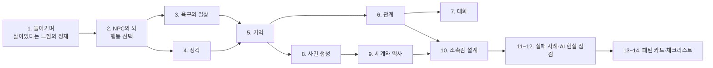

!!! tip "처음이라면 여기부터"
    - **[실전 — 주민 8명 마을 만들기](00a-practice.html)**: 12단계를 순서대로 따라 하면 살아 있는 마을이 됩니다. 단계마다 넣을 숫자, 계산 예시, 확인 방법, 이상할 때 바꿀 숫자가 있습니다.
    - **[수치 레퍼런스](00b-numbers.html)**: 동숲·스타듀·림월드의 실제 수치와 "처음 넣어 볼 값"을 한 장에 모았습니다.
    - 1장부터는 각 기법을 깊이 읽는 참고 자료입니다. 실전 페이지에서 막힐 때 펼쳐 보세요.

## 이 가이드가 다루는 것

이 가이드는 "살아있는 것처럼 느껴지는 NPC와 세계"를 만드는 방법을 다룹니다. 모든 내용을 네 가지 목표에 비추어 정리했습니다.

| 목표 | 뜻 | 대표 장치 |
|---|---|---|
| {소속감} | 내가 이 마을·집단의 일원이라고 느끼는 것 | 주민의 부탁, 마을 평가, 공동 목표(마을회관), 내가 남긴 흔적이 퍼지는 것 |
| {개연성} | 사건이 무작위가 아니라 "그럴 만했다"고 납득되는 것 | 원인이 보이는 기분 시스템, 긴장 곡선, 원인→결과 기록 |
| {관계} | NPC끼리, NPC와 플레이어 사이에 관계가 쌓이고 변하는 것 | 친밀도, 관계망, 관계 변화 이벤트 |
| {실존감} | NPC가 실제로 사는 사람처럼 느껴지는 것 | 일상, 기억, 성격, 내가 없을 때도 돌아가는 삶 |

각 장 맨 위에 그 장의 기법이 어떤 목표에 기여하는지 표시했고, 본문의 사례마다 다시 태그를 달았습니다.

## 신뢰도 표시

모든 핵심 주장에는 근거의 종류를 표시하고 출처 링크를 달았습니다.

| 태그 | 근거의 종류 |
|---|---|
| [공식] | 개발자 발표, 공식 문서·공지, GDC 발표, 논문 |
| [분석] | 디컴파일 소스, 게임 데이터 파일, 데이터마이닝, 모드 문서처럼 **게임이 실제로 그렇게 동작한다는 것을 확인할 수 있는** 자료 |
| [추정] | 플레이 관찰, 커뮤니티 추측, 2차 보도, 이 가이드 자신의 판단 |
| [확인 못 함] | 찾아봤지만 믿을 만한 출처가 없음. 지어내지 않고 이렇게 남겨 두었습니다. |

!!! tip "필터 쓰는 법"
    페이지 위쪽 **태그 필터**에서 태그를 누르면 그 태그가 붙은 문장만 남습니다. 여러 개를 누르면 "그중 하나라도 붙은 것"이 남습니다. [태그 모아보기](tags.html)에서는 사이트 전체를 한 번에 거를 수 있습니다. 예: [추정]만 골라서 아직 근거가 약한 주장만 보기.

## 세 갈래 구조

2장부터 10장까지는 모든 주제를 세 갈래로 나누어 다룹니다.

- **AI 없이 (전통 기법)**: 상태 기계, 행동 트리, Utility AI, GOAP, HTN, 스마트 오브젝트, 일정표, 대사 풀, 관계 수치, 스토리텔러, 절차적 역사 생성
- **AI 사용 (LLM·생성형)**: Generative Agents식 기억·회고·계획, 대화 생성, 기억 요약
- **섞어 쓰기**: 행동과 규칙은 전통 시스템이 맡고, LLM은 대사·회고·요약처럼 틀려도 게임이 망가지지 않는 부분만 맡는 구조

기법을 고를 때 하나만 추천하지 않고, 상황별로 쓸 만한 후보를 표로 비교했습니다. 고르는 것은 읽는 사람의 몫입니다.

## 읽는 순서

처음이라면 [1장](01-intro.html)을 먼저 읽으세요. 게임을 기획하는 중이라면 [14장 체크리스트](14-checklist.html)부터 보고 필요한 장으로 돌아가도 됩니다. 필요한 기법을 빨리 찾으려면 [13장 패턴 카드](13-patterns.html)가 편합니다.

## 이 가이드의 근거

가장 깊게 판 자료는 다음과 같습니다.

- **동물의 숲 GameCube 북미판 디컴파일 소스** ([ACreTeam/ac-decomp](https://github.com/ACreTeam/ac-decomp)): 원본 실행 파일과 바이트 단위로 똑같이 다시 빌드되도록 복원한 C 코드라서 [분석] 중에서도 가장 확실한 근거입니다. 이 사이트의 동숲 수치는 대부분 이 소스의 파일과 행 번호까지 확인한 것입니다.
- **동숲 최적화 분석 시리즈** ([0편](https://nobbs-it-study.tistory.com/entry/%EA%B2%8C%EC%9E%84%EB%B6%84%EC%84%9D-%EB%86%80%EB%8F%99%EC%88%B2%EC%9D%B4-32MB-%EC%95%88%EC%97%90-%EB%93%A4%EC%96%B4%EA%B0%94%EB%8B%A4%EA%B3%A0) · [1편](https://nobbs-it-study.tistory.com/entry/%EA%B2%8C%EC%9E%84%EB%B6%84%EC%84%9D-%EB%86%80%EB%8F%99%EC%88%B2%EC%9D%98-%EB%A7%88%EC%9D%84%EC%9D%80-36-Byte%EB%8B%A4-%EC%B5%9C%EC%A0%81%ED%99%94-%EB%B6%84%EC%84%9D-1%ED%8E%B8) · [2편](https://nobbs-it-study.tistory.com/entry/%EA%B2%8C%EC%9E%84-%EB%B6%84%EC%84%9D-%EB%8F%99%EC%88%B2-%EC%A3%BC%EB%AF%BC%EC%9D%84-%EC%96%B4%EB%96%BB%EA%B2%8C-%EC%82%B4%EC%95%84%EC%9E%88%EA%B2%8C-%EB%A7%8C%EB%93%A4%EC%97%88%EB%82%98-%EC%B5%9C%EC%A0%81%ED%99%94-%EB%B6%84%EC%84%9D-2%ED%8E%B8)): 위 디컴파일 소스를 근거로 쓴 글. 2편의 주장 13개를 소스와 다시 대조해 모두 일치함을 확인했습니다.
- **Generative Agents 논문과 공식 코드** ([논문](https://arxiv.org/abs/2304.03442) · [코드](https://github.com/joonspk-research/generative_agents)): 논문에 적힌 값과 공개 코드의 값이 다른 부분까지 확인했습니다([5장](05-memory.html)).
- **스타듀 밸리 위키의 모딩 문서**: 게임 데이터 파일의 형식을 설명한 문서라 [분석]으로 표시했습니다.
- **GDC 발표, 개발자 글, 논문**: Tynan Sylvester, Jeff Orkin, Dave Mark, Elan Ruskin, Richard Evans, Michael Mateas 등.

!!! warning "버전과 시리즈를 섞지 않았습니다"
    동물의 숲은 GameCube판(2001~2002), 놀러오세요(2005), 튀어나와요(2012), 모여봐요(2020)의 규칙이 서로 다릅니다. GameCube판 소스로 확인한 규칙을 다른 작품에 그대로 옮겨 쓰지 않았고, 작품 이름을 항상 같이 적었습니다.

## 출처

- ACreTeam, ac-decomp — <https://github.com/ACreTeam/ac-decomp>
- 이 가이드의 전체 참고문헌 — [15장](15-references.html)
