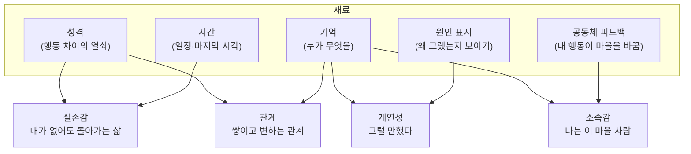

## 한눈에 보기

- 플레이어는 게임의 코드를 보지 못합니다. 보는 것은 화면에 드러난 결과뿐이고, 이야기는 그 결과를 보고 **플레이어 머릿속에서** 만들어집니다.
- 그래서 "얼마나 정교하게 시뮬레이션하느냐"보다 **"무엇을 보여주느냐"**가 더 중요합니다.
- 살아있다는 느낌을 만드는 길은 크게 둘입니다. 사람이 데이터를 많이 쓰는 길(스타듀 밸리)과, 규칙과 확률이 상태를 바꾸게 두는 길(동물의 숲)입니다. 대부분의 게임은 둘을 섞습니다.

!!! note "비유: 인형극"
    인형극의 인형은 표정이 바뀌지 않습니다. 그런데 관객은 인형이 슬퍼한다고 느낍니다. 고개를 숙이는 각도, 앞 장면에서 무슨 일이 있었는지, 음악이 바뀌는 타이밍을 보고 관객이 감정을 채워 넣기 때문입니다. 시뮬레이션 게임의 NPC도 같습니다. 감정을 진짜로 계산할 필요는 없고, 관객이 감정을 읽을 단서를 정확한 순간에 보여주면 됩니다.

## 두 개의 모델: 게임 속 모델과 머릿속 모델

림월드를 만든 Tynan Sylvester는 2013년 글 「The Simulation Dream」에서 이 문제를 정리했습니다. [공식] ([Game Developer](https://www.gamedeveloper.com/design/the-simulation-dream))

- **게임 모델(Game Model)**: 코드로 만든 시뮬레이션.
- **플레이어 모델(Player Model)**: 플레이어가 플레이하면서 머릿속에 세운 그 세계의 그림.
- 플레이어는 게임 모델을 직접 볼 수 없고 플레이어 모델만 경험합니다. 그래서 **게임 모델에 있어도 플레이어 모델로 옮겨지지 않는 것은 쓸모가 없다**는 것이 그의 "플레이어 모델 원칙"입니다. 그는 울티마 온라인과 바이오쇼크의 생태계 시뮬레이션이 플레이어에게 보이지 않아 잡음이 된 예를 듭니다. [공식]
- 반대로, 게임 모델에 없는데도 플레이어 모델에 생기는 것이 있습니다. 그는 이것을 **아포페니아(apophenia: 무작위이거나 의미 없는 데이터에서 의미 있는 패턴을 보는 경향)**라고 부르고, 시뮬레이션 게임을 성공시키는 열쇠라고 말합니다. [공식]
- 그의 예: 심즈 3에서 한 플레이어가 자기와 룸메이트를 심으로 만들었고, 새로 온 이웃이 룸메이트에게만 끌리자 "질투"와 "분노"를 느꼈습니다. 하지만 심즈 3의 사회적 상호작용 모델은 질투 같은 감정을 다루지 않을 만큼 단순했습니다. 감정은 플레이어가 채운 것입니다. 그래서 그는 시뮬레이션을 **플레이어와 함께 이야기를 쓰는 공동 저자**라고 부릅니다. [공식]

그가 같은 글에서 제안하는 실천 원칙도 이 가이드 전체에 쓰입니다. [공식]

1. **익숙한 원형을 써라**: 질투, 사악한 계모, 선한 왕 같은 누구나 아는 틀을 쓰면 플레이어가 빈칸을 쉽게 채운다.
2. **복잡성에 빠뜨리지 마라**: 관계가 너무 많으면 원인과 결과가 안 보여서 이야기가 묻힌다.
3. **단순한 쪽으로 기울어라**: 게임은 저자가 아니라 공동 저자다. 힌트만 주면 된다.
4. **"머리카락 복잡성(hair complexity)"을 써라**: 다른 시스템에 영향을 주지 않는 장식용 세부(카드 게임의 배경 글 같은 것)는 싸게 분위기를 만든다.

## 같은 목표, 정반대의 비용

살아있다는 느낌을 내는 데 드는 비용을 어디에 쓰느냐에 따라 길이 갈립니다.

| | 스타듀 밸리 | 동물의 숲 (GameCube판) |
|---|---|---|
| 하루 동선 | NPC마다, 조건 키(계절·요일·날씨·하트)별로 작가가 직접 작성 [분석] | 성격 6종 × 일과표 1장 [분석] |
| 동선 선택 | 정해진 우선순위로 키를 맞춰 보고 첫 번째 일치 사용 [분석] | 현재 시각으로 표를 훑어 상태 결정 + 확률로 산책 목적지 [분석] |
| 대사 | NPC별 대사 파일, 요일·하트·장소 키 [분석] | 성격별 시작 번호 + 날씨·달·무작위 오프셋 [분석] |
| 관계 서사 | 하트 단계별 이벤트(작가가 쓴 이야기) [분석] | 기억 7칸, 편지, 주민끼리 유행 전파 [분석] |
| 마을 변화 | 같은 주민이 계속 산다 [공식] | 주민이 이사 오고 떠난다 [분석] |

근거: 스타듀는 위키의 [Modding:Schedule data](https://stardewvalleywiki.com/Modding:Schedule_data)·[Modding:Dialogue](https://stardewvalleywiki.com/Modding:Dialogue), 동숲은 [ac-decomp](https://github.com/ACreTeam/ac-decomp) 소스와 [동숲 분석 2편](https://nobbs-it-study.tistory.com/entry/%EA%B2%8C%EC%9E%84-%EB%B6%84%EC%84%9D-%EB%8F%99%EC%88%B2-%EC%A3%BC%EB%AF%BC%EC%9D%84-%EC%96%B4%EB%96%BB%EA%B2%8C-%EC%82%B4%EC%95%84%EC%9E%88%EA%B2%8C-%EB%A7%8C%EB%93%A4%EC%97%88%EB%82%98-%EC%B5%9C%EC%A0%81%ED%99%94-%EB%B6%84%EC%84%9D-2%ED%8E%B8).

스타듀는 **사람의 시간**을 썼고, 동숲은 **규칙이 굴러가는 시간**을 썼습니다. 동숲 분석 2편의 표현을 빌리면 스타듀는 "쓴 만큼 살고", 동숲은 "규칙이 굴러가는 만큼 산다"입니다. 어느 쪽이 더 낫다는 게 아니라, 팀 규모와 원하는 경험에 따라 비율을 고르는 문제입니다.

- 작가를 많이 쓸 수 있고, 인물 한 명 한 명의 이야기가 중요하다 → 손으로 쓴 데이터 비중을 높인다.
- 인원이 적고, 반복 플레이·장기 플레이에서 매번 다른 일이 일어나야 한다 → 규칙과 확률 비중을 높인다.

## 네 가지 목표를 만드는 재료

조사한 게임들에서 공통으로 보이는 재료를 목표별로 묶었습니다. 이후 장들은 이 재료를 하나씩 다룹니다.

- {실존감}: 시간표(동숲·스타듀), 화면 밖에서도 움직이는 NPC(동숲 좌표 산책), 성격이 생활 리듬으로 드러나는 것. → [3장](03-routine.html), [4장](04-personality.html), [9장](09-world.html)
- {관계}: NPC가 플레이어를 기억하는 칸(동숲 7칸), NPC끼리의 관계값(동숲·림월드·CK3). → [5장](05-memory.html), [6장](06-relationship.html)
- {개연성}: 기분이 왜 바뀌었는지 보여주는 생각 목록(림월드), 긴장 곡선(림월드 스토리텔러, Façade). → [8장](08-events.html)
- {소속감}: 내 행동이 공동체에 남는 장치. 동숲에서는 마을을 가꾸면 새 주민이 올 확률이 오르고, 내가 지어준 말버릇이 다른 주민에게 퍼집니다. [분석] ([ac-decomp](https://github.com/ACreTeam/ac-decomp) `m_field_assessment.c`, `ac_npc_act_greeting.c_inc`) → [10장](10-belonging.html)

## 시뮬레이션은 재료, 보여주는 것은 선별

James Ryan은 박사논문 *Curating Simulated Storyworlds*(UC 산타크루즈, 2018)에서 시뮬레이션이 만든 사건 기록은 재료일 뿐이고, 그중 흥미로운 것을 골라 보여주는 **선별(curation)** 단계가 따로 필요하다고 주장합니다. 그가 만든 Talk of the Town은 한 마을을 1839년부터 1979년까지 시뮬레이션한 뒤, 거기서 이야기를 골라냅니다. [공식] ([eScholarship](https://escholarship.org/uc/item/1340j5h2), [Emily Short의 장별 리뷰](https://emshort.blog/2019/05/21/curating-simulated-storyworlds-james-ryan/))

동숲은 이 선별을 규칙 안에 넣었습니다. 유행(말버릇·옷)은 **플레이어가 만나 본 주민 중 친한 순서로** 퍼지고, 떠나는 주민은 **플레이어와 인연이 가장 약한 주민**입니다. 같은 계산이라도 결과가 플레이어 눈에 띄는 쪽으로 흐릅니다. [분석] ([ac-decomp](https://github.com/ACreTeam/ac-decomp) `src/actor/npc/ac_npc_act_greeting.c_inc`, `src/game/m_npc.c`)

## 게임 × 기법 한눈에 보기

각 게임이 다섯 가지 문제를 어떤 방식으로 푸는지 정리했습니다. 칸 안의 세부와 근거는 해당 장에 있습니다.

| 게임 | 행동 선택 | 기억 | 관계 | 사건 | 역사 | 근거 |
|---|---|---|---|---|---|---|
| 심즈 1 | 오브젝트가 광고하는 욕구 점수 중 최대 | 거의 없음 | 관계 수치 | 플레이어 주도 | 없음 | [공식] Forbus & Wright 2001 |
| 동물의 숲 GC | 성격별 일과표 + 확률 목적지 + 3층 상태 기계 | 플레이어 7명 기억(친밀도·마지막 대화·편지) | 주민끼리 관계값 0~255, 유행 전파 | 계절·기념일 이벤트, 이사 | 없음(마을 기록 일부) | [분석] ac-decomp |
| 스타듀 밸리 | 조건 키로 고른 손 작성 일정 | 이벤트 본 여부·대화 여부 플래그 | 하트(1하트=250점), 하트 이벤트 | 축제·하트 이벤트 | 고정 설정 | [분석] 위키 모딩 문서 |
| 림월드 | 일 우선순위 + 욕구 + 정신 붕괴 | 기한부 생각(moodlet) | 호감도(opinion), 연인·라이벌 | AI 스토리텔러, 위협 점수 | 짧은 세계 생성 | [분석] RimWorld 위키 |
| 드워프 포트리스 | 일 + 욕구 + 성격 | 단기 8칸·장기 8칸·핵심 기억 | 관계, 원한 | 시뮬레이션 결과 | 수백 년 역사 시뮬레이션 | [분석] DF 위키 |
| 크루세이더 킹즈 3 | 특성에 맞는 AI 가중치 | 사건 기록, 비밀 | 호감도·친구·라이벌·연인 | 이벤트 + 음모 | 왕조 기록 | [공식] 개발 일지 |
| 오블리비언 | AI 패키지(일정+조건) | 거의 없음 | 성향(disposition) 0~100 | 퀘스트 스크립트 | 고정 설정 | [분석] Paavo 분석 |
| 섀도우 오브 모르도르 | 전투 AI + 서열 시뮬레이션 | 적이 플레이어와의 만남을 기억 | 오크 사이 서열·원한 | 서열 다툼 | 없음 | [추정] 특허·보도 |
| Caves of Qud | 일반 AI | — | 파벌 평판 | — | 사건을 먼저 뽑고 이유를 나중에 붙임 | [공식] FDG 2017 |
| Wildermyth | 전투 AI | 영웅의 이력 | 연인·라이벌 관계 | 손 작성 줄거리 + 절차 이벤트 | 캠페인 기록 | [공식] GDC 2022 |
| Generative Agents | LLM 계획(위에서 아래로 쪼개기) | 기억 스트림 + 검색 점수 + 회고 | 대화와 기억으로 형성 | 창발(정보 전파) | 없음 | [공식] 논문 |
| 인조이 Smart Zoi | 기존 시스템 + 기기 내 소형 언어 모델(세부 공개 안 됨) | 일기, 하루 끝 회고 | 기존 시스템 | 기존 시스템 | — | [공식] 발표 / 세부 [확인 못 함] |

## 이 장의 결론

- 시뮬레이션의 품질은 "얼마나 많이 계산했나"가 아니라 "플레이어 머릿속에 무엇이 남았나"로 잽니다.
- 이후 장에서 기법을 고를 때마다 같은 질문을 던지세요. **이 계산의 결과를 플레이어가 볼 수 있는가? 본다면, 그 원인도 같이 보이는가?**

## 출처

- Tynan Sylvester, "The Simulation Dream" (Game Developer, 2013) — <https://www.gamedeveloper.com/design/the-simulation-dream>
- James Ryan, *Curating Simulated Storyworlds* (UCSC 박사논문, 2018) — <https://escholarship.org/uc/item/1340j5h2>
- Kenneth D. Forbus & Will Wright, "Some notes on programming objects in The Sims" (2001) — <https://qrg.northwestern.edu/papers/Files/Programming_Objects_in_The_Sims.pdf>
- ACreTeam, ac-decomp (동물의 숲 GC 북미판 디컴파일) — <https://github.com/ACreTeam/ac-decomp>
- 동숲 최적화 분석 2편 — <https://nobbs-it-study.tistory.com/entry/%EA%B2%8C%EC%9E%84-%EB%B6%84%EC%84%9D-%EB%8F%99%EC%88%B2-%EC%A3%BC%EB%AF%BC%EC%9D%84-%EC%96%B4%EB%96%BB%EA%B2%8C-%EC%82%B4%EC%95%84%EC%9E%88%EA%B2%8C-%EB%A7%8C%EB%93%A4%EC%97%88%EB%82%98-%EC%B5%9C%EC%A0%81%ED%99%94-%EB%B6%84%EC%84%9D-2%ED%8E%B8>
- Stardew Valley Wiki, Modding:Schedule data — <https://stardewvalleywiki.com/Modding:Schedule_data>
- 각 게임의 세부 출처는 해당 장과 [15장](15-references.html)
