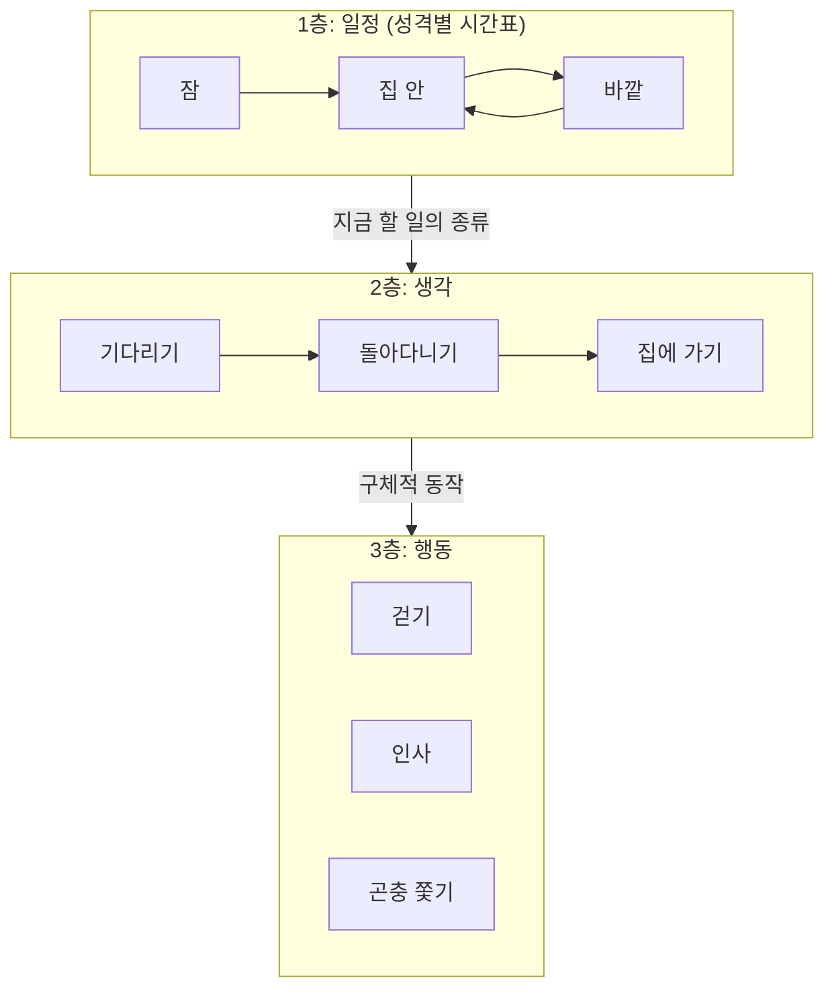
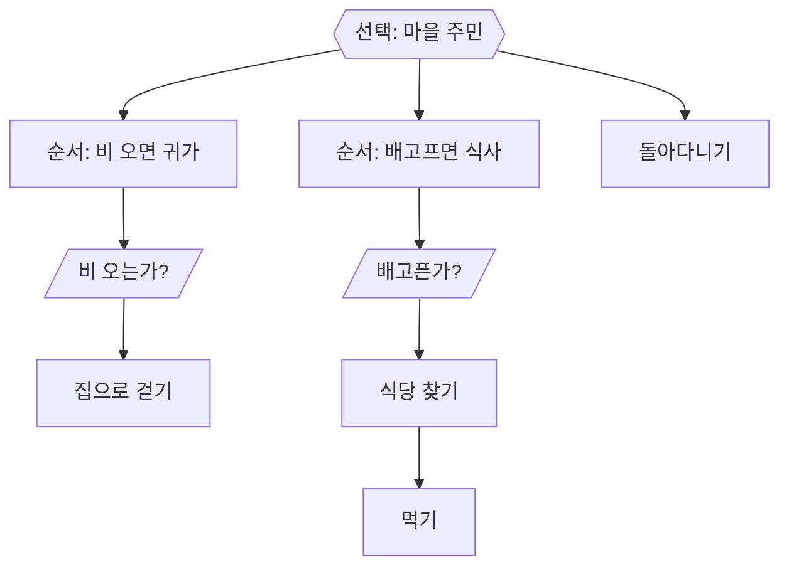
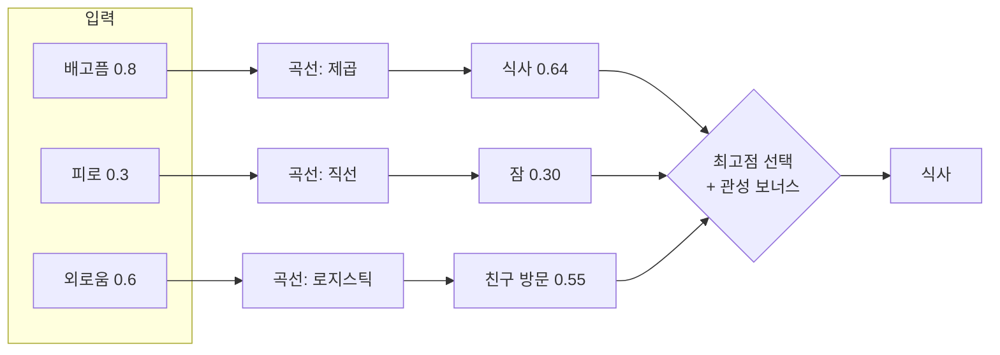
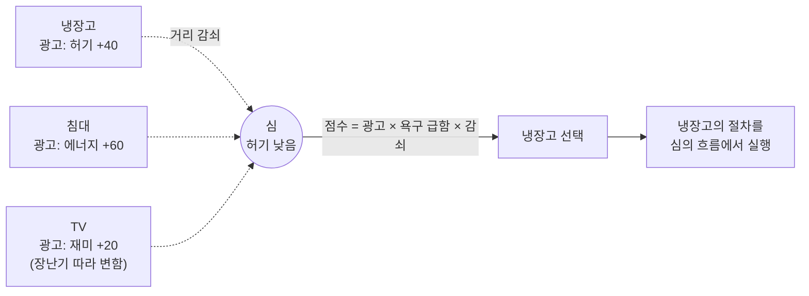
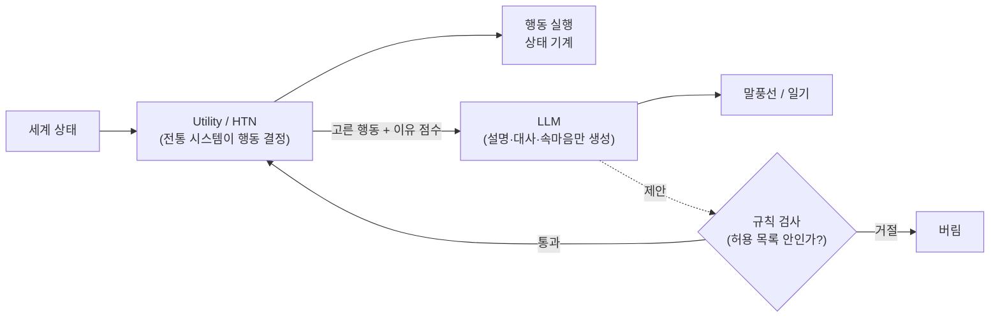

## 한눈에 보기

행동 선택(decision making: NPC가 지금 할 행동을 고르는 과정)은 모든 NPC 시스템의 중심입니다. 방식마다 **누가 결정 규칙을 들고 있느냐**가 다릅니다.

| 방식 | 결정 규칙이 있는 곳 | 한 줄 특징 |
|---|---|---|
| 상태 기계 (FSM) | 상태와 상태 사이의 화살표 | 단순하고 예측 쉬움, 상태가 늘면 화살표가 폭발 |
| 행동 트리 (BT) | 우선순위가 정해진 나무 | 기획자가 읽기 쉬움, 고정된 우선순위 |
| Utility AI | 행동마다 붙은 점수 공식 | 상황에 따라 부드럽게 바뀜, 숫자 조율이 일 |
| GOAP | 행동의 "전제 조건과 효과" | 목표만 주면 순서를 스스로 찾음 |
| HTN | "큰 일 → 작은 일" 분해 규칙 | 기획 의도대로 계획, GOAP보다 통제 쉬움 |
| 스마트 오브젝트 | 오브젝트 쪽 | 물건을 추가하면 행동이 늘어남 |
| LLM 계획 | 언어 모델의 추론 | 표현력 최고, 비용·일관성·재현성이 약점 |

!!! note "비유: 직원에게 일 시키는 방법"
    - **상태 기계**: "지금은 청소 중. 손님이 오면 응대로 바꿔." 상황마다 바꿀 곳을 다 적어 줍니다.
    - **행동 트리**: 우선순위가 적힌 업무 수첩. 위에서부터 읽다가 할 수 있는 첫 일을 합니다.
    - **Utility AI**: 할 일마다 "지금 얼마나 급한가"를 점수로 매기고 가장 높은 일을 합니다.
    - **GOAP**: "매장을 깨끗하게"라는 목표만 주면, 직원이 걸레를 가져오고 → 물을 받고 → 닦는 순서를 스스로 짭니다.
    - **HTN**: "개점 준비"를 "청소 → 진열 → 계산대 점검"으로 쪼개는 매뉴얼을 줍니다.
    - **스마트 오브젝트**: 매장 물건에 "나를 쓰면 이게 좋아져요"라는 쪽지가 붙어 있습니다.
    - **LLM 계획**: 상황을 말로 설명해 주면 직원이 알아서 판단합니다. 가끔 엉뚱한 판단을 합니다.

## 상태 기계 (FSM)

**상태 기계(FSM, Finite State Machine: 정해진 상태 중 하나에 있다가 조건이 맞으면 다른 상태로 넘어가는 구조)**는 가장 기본입니다.

### 실제 게임 사례

- **동물의 숲 GameCube판은 상태 기계를 세 층으로 쌓았습니다.** {실존감} [분석]
    1. **일정(schedule)**: 지금 바깥에 있을지, 집 안에 있을지, 잘지. 성격별 시간표가 정합니다(`src/game/m_npc_schedule.c`).
    2. **생각(think)**: 기다리기, 돌아다니기, 집에 가기, 집에 들어가기 등(`src/actor/npc/ac_npc2_think_*.c_inc`).
    3. **행동(act)**: 걷기, 인사, 곤충 쫓기, 우산 펴기, 옷 갈아입기 등(`src/actor/npc/ac_npc_act_*.c_inc`).
    
    위층은 "무엇을 할 시간인가"만, 아래층은 "어떻게 움직이나"만 다룹니다. 층을 나누면 상태 하나하나는 단순해집니다. ([ac-decomp](https://github.com/ACreTeam/ac-decomp), [동숲 분석 2편](https://nobbs-it-study.tistory.com/entry/%EA%B2%8C%EC%9E%84-%EB%B6%84%EC%84%9D-%EB%8F%99%EC%88%B2-%EC%A3%BC%EB%AF%BC%EC%9D%84-%EC%96%B4%EB%96%BB%EA%B2%8C-%EC%82%B4%EC%95%84%EC%9E%88%EA%B2%8C-%EB%A7%8C%EB%93%A4%EC%97%88%EB%82%98-%EC%B5%9C%EC%A0%81%ED%99%94-%EB%B6%84%EC%84%9D-2%ED%8E%B8))
- **F.E.A.R.의 상태 기계는 상태가 3개뿐입니다**: 이동(Goto), 애니메이션(Animate), 스마트 오브젝트 사용(UseSmartObject). 무엇을 할지는 계획기(GOAP)가 정하고 상태 기계는 실행만 합니다. {개연성} [공식] ([Orkin, GDC 2006](https://pages.cs.wisc.edu/~dyer/cs540/handouts/gdc2006_orkin_jeff_fear.pdf))



### 구현 스케치

```csharp
// 동숲식 1층: 성격별 시간표에서 지금 상태를 찾는다 (엔진 무관한 순수 C#)
public enum DayState { Sleep, InHouse, Field }

public struct ScheduleEntry
{
    public DayState State;
    public int EndSecond;   // 이 시각(하루 기준 초)까지 이 상태
}

public static class Schedule
{
    // 끝나는 시각이 지금보다 늦은 첫 줄을 고른다 (ac-decomp mNPS_schedule_manager_sub와 같은 방식)
    public static DayState Current(ScheduleEntry[] table, int nowSecond)
    {
        foreach (var e in table)
            if (e.EndSecond > nowSecond) return e.State;
        return table[table.Length - 1].State;
    }
}

// lazy(먹보) 성격의 시간표: 8시까지 잠 → 9시 집 → 12시 바깥 → 14시 집 → 19:30 바깥 → 22시 집 → 잠
// 값은 src/game/m_npc_schedule.c 의 boy_schedule_dt
static readonly ScheduleEntry[] Lazy = {
    new() { State = DayState.Sleep,   EndSecond =  8 * 3600 },
    new() { State = DayState.InHouse, EndSecond =  9 * 3600 },
    new() { State = DayState.Field,   EndSecond = 12 * 3600 },
    new() { State = DayState.InHouse, EndSecond = 14 * 3600 },
    new() { State = DayState.Field,   EndSecond = 19 * 3600 + 30 * 60 },
    new() { State = DayState.InHouse, EndSecond = 22 * 3600 },
    new() { State = DayState.Sleep,   EndSecond = 24 * 3600 },
};
```

**쓸 때**: 상태가 적고 분명할 때, 그리고 다른 방식의 **가장 아래층(실행층)**으로. **피할 때**: 상태가 10개를 넘어 화살표가 얽히기 시작할 때. 그때는 층을 나누거나 다른 방식으로 위층을 바꿉니다.

## 행동 트리 (Behavior Tree)

**행동 트리(BT: 조건과 행동을 나무 모양으로 엮고, 위에서부터 차례로 시도하는 구조)**는 2000년대 중반 이후 업계 표준처럼 쓰였습니다. 기본 부품은 두 개입니다. [공식] ([Champandard & Dunstan, Game AI Pro 1권 6장](https://www.gameaipro.com/GameAIPro/GameAIPro_Chapter06_The_Behavior_Tree_Starter_Kit.pdf))

- **선택(Selector)**: 자식을 차례로 시도해서 **하나라도 성공하면** 성공. "이게 안 되면 저거".
- **순서(Sequence)**: 자식을 차례로 실행해서 **하나라도 실패하면** 실패. "이거 하고 저거 하고".

### 실제 게임 사례

- 파이널 판타지 XV는 행동 트리와 상태 기계를 섞어 캐릭터 판단 시스템을 만들었습니다. [공식] ([Game AI Pro 3권 11장](https://www.gameaipro.com/GameAIPro3/GameAIPro3_Chapter11_A_Character_Decision-Making_System_for_FINAL_FANTASY_XV_by_Combining_Behavior_Trees_and_State_Machines.pdf))
- 같은 게임의 도시 주민 상호작용(벤치에 앉은 노인과 관광객의 짧은 대화 같은 것)은 "스마트 오브젝트"를 "스마트 장소"로 넓힌 규칙 기반 시스템으로 만들었습니다. {실존감} [공식] ([Game AI Pro 3권 35장](https://www.gameaipro.com/GameAIPro3/GameAIPro3_Chapter35_Ambient_Interactions_Improving_Believability_by_Leveraging_Rule-Based_AI.pdf))
- 행동 트리 설계에서 자주 빠지는 함정을 정리한 장도 있습니다. [공식] ([Game AI Pro 3권 9장](https://www.gameaipro.com/GameAIPro3/GameAIPro3_Chapter09_Overcoming_Pitfalls_in_Behavior_Tree_Design.pdf))



### 구현 스케치

```csharp
// 최소 행동 트리 (순수 C#). 실제 프로젝트에서는 매 프레임 Tick을 부른다.
public enum Status { Success, Failure, Running }

public abstract class Node { public abstract Status Tick(Npc npc); }

public sealed class Selector : Node
{
    readonly Node[] children;
    public Selector(params Node[] c) => children = c;
    public override Status Tick(Npc npc)
    {
        foreach (var c in children)
        {
            var s = c.Tick(npc);
            if (s != Status.Failure) return s;   // 성공했거나 진행 중이면 여기서 멈춤
        }
        return Status.Failure;
    }
}

public sealed class Sequence : Node
{
    readonly Node[] children;
    public Sequence(params Node[] c) => children = c;
    public override Status Tick(Npc npc)
    {
        foreach (var c in children)
        {
            var s = c.Tick(npc);
            if (s != Status.Success) return s;   // 실패했거나 진행 중이면 여기서 멈춤
        }
        return Status.Success;
    }
}

public sealed class Condition : Node
{
    readonly System.Func<Npc, bool> test;
    public Condition(System.Func<Npc, bool> t) => test = t;
    public override Status Tick(Npc npc) => test(npc) ? Status.Success : Status.Failure;
}
// 사용: new Selector(new Sequence(new Condition(n => n.World.IsRaining), new GoHome()), new Wander());
```

**쓸 때**: 우선순위가 비교적 고정돼 있고, 기획자가 그림으로 보며 고치고 싶을 때. **피할 때**: "배가 조금 고프지만 친구가 불러서 같이 간다" 같은 **여러 욕구의 정도를 비교**해야 할 때. 행동 트리는 순서로 우선순위를 정하므로 정도 비교에 약합니다. 이럴 때는 Utility를 트리 안에 넣는 방법이 있습니다. [공식] ([Game AI Pro 1권 10장](https://www.gameaipro.com/GameAIPro/GameAIPro_Chapter10_Building_Utility_Decisions_into_Your_Existing_Behavior_Tree.pdf))

## Utility AI

**Utility AI(효용 기반 AI: 가능한 행동을 모두 점수로 매기고 높은 것을 고르는 방식)**는 생활 시뮬레이션과 가장 잘 맞습니다. 핵심은 "조건이 참/거짓"이 아니라 **"얼마나"**를 다룬다는 점입니다.

- Dave Mark와 Kevin Dill은 GDC 2010 AI Summit에서 if/then 대신 **반응 곡선(response curve: 입력값을 0~1 점수로 바꾸는 그래프)**으로 판단을 모델링하자고 발표했습니다. [공식] ([GDC Vault](https://gdcvault.com/play/1012410/Improving-AI-Decision-Modeling-Through))
- David "Rez" Graham은 모든 행동을 한꺼번에 점수 매기고 상위 행동 중 하나를 고르는 구조와, 결정이 계속 바뀌는 것을 막는 **관성(inertia)**을 소개합니다. [공식] ([Game AI Pro 1권 9장](https://www.gameaipro.com/GameAIPro/GameAIPro_Chapter09_An_Introduction_to_Utility_Theory.pdf))
- 점수 요소(consideration)를 고르는 법 [공식] ([Game AI Pro 3권 13장](https://www.gameaipro.com/GameAIPro3/GameAIPro3_Chapter13_Choosing_Effective_Utility-Based_Considerations.pdf)), 가중치와 확률을 같이 쓰는 이중 효용 [공식] ([Game AI Pro 2권 3장](https://www.gameaipro.com/GameAIPro2/GameAIPro2_Chapter03_Dual-Utility_Reasoning.pdf)), 드래곤 에이지: 인퀴지션의 점수 구조 [공식] ([Game AI Pro 3권 31장](https://www.gameaipro.com/GameAIPro3/GameAIPro3_Chapter31_Behavior_Decision_System_Dragon_Age_Inquisition%E2%80%99s_Utility_Scoring_Architecture.pdf))도 참고할 만합니다.

### 실제 게임 사례

- **심즈 1**: 심은 모든 오브젝트의 모든 행동 중 **지금 행복을 가장 크게 올리는 행동**을 고릅니다. 이 점수가 오브젝트의 "광고"에서 나옵니다(아래 스마트 오브젝트 절). {실존감} [공식] ([Forbus & Wright 2001](https://qrg.northwestern.edu/papers/Files/Programming_Objects_in_The_Sims.pdf))
- **동숲 GC의 산책 목적지**: 성격과 시간대별로 목적지 후보 배열을 두고 무작위로 하나를 뽑습니다. 가중치를 숫자로 적지 않고 **같은 값을 배열에 여러 번 넣는** 방식입니다. 무뚝뚝(cranky)은 `{신사×3, 혼자 있는 곳×7}`이라 70% 확률로 아무도 없는 곳으로 갑니다. 엄밀히는 점수 비교가 아니라 가중치 무작위 선택이지만, Utility의 가장 단순한 형태로 볼 수 있습니다. {실존감} [분석] (`src/game/m_npc_walk.c` 60행)



### 구현 스케치

```csharp
// 반응 곡선 + 점수 합성 + 관성. AnimationCurve를 쓰면 기획자가 인스펙터에서 곡선을 그릴 수 있다.
using UnityEngine;   // [Unity 의존] AnimationCurve, ScriptableObject

[CreateAssetMenu(menuName = "AI/UtilityAction")]
public class UtilityAction : ScriptableObject
{
    [System.Serializable]
    public class Consideration
    {
        public string need;            // 예: "hunger"
        public AnimationCurve curve;   // 입력 0~1 → 점수 0~1
    }

    public string actionName;
    public Consideration[] considerations;

    // 여러 요소를 곱한다: 하나라도 0이면 이 행동은 안 한다
    public float Score(NeedSet needs)
    {
        float score = 1f;
        foreach (var c in considerations)
            score *= c.curve.Evaluate(needs.Get(c.need));
        return score;
    }
}

public static class UtilityBrain
{
    const float InertiaBonus = 0.1f;   // 하던 일을 조금 더 하게 해서 결정이 깜빡이지 않게

    public static UtilityAction Pick(UtilityAction[] actions, NeedSet needs, UtilityAction current)
    {
        UtilityAction best = null;
        float bestScore = -1f;
        foreach (var a in actions)
        {
            float s = a.Score(needs) + (a == current ? InertiaBonus : 0f);
            if (s > bestScore) { bestScore = s; best = a; }
        }
        return best;
    }
}
```

**쓸 때**: 욕구가 여러 개이고 상황에 따라 부드럽게 우선순위가 바뀌어야 할 때(생활 시뮬레이션). **피할 때**: 반드시 이 순서로 해야 하는 연출(컷신, 튜토리얼). 점수 조율이 끝없이 이어질 수 있으니, 디버그 화면에 **각 행동의 점수를 항상 띄워 두는 것**이 사실상 필수입니다.

## GOAP

**GOAP(Goal-Oriented Action Planning: 목표를 주면 행동들의 전제 조건과 효과를 보고 순서를 스스로 찾는 계획 방식)**은 F.E.A.R.(2005)로 알려졌습니다. [공식] ([Orkin, GDC 2006](https://pages.cs.wisc.edu/~dyer/cs540/handouts/gdc2006_orkin_jeff_fear.pdf))

- 1970년 스탠퍼드의 STRIPS 계획기를 게임에 맞게 고친 것으로, 행동마다 **전제 조건(precondition)**과 **효과(effect)**를 적어 둡니다. [공식]
- 길찾기에 쓰던 A*를 행동 순서 찾기에도 씁니다. "세계 상태"를 노드로, 행동을 간선으로 보고 목표 상태까지의 가장 싼 경로를 찾습니다. [공식]
- 무엇을 할지는 계획기가, 어떻게 움직일지는 3개짜리 상태 기계가 맡습니다. [공식]

생활 시뮬레이션에서는 "밥 먹기"라는 목표에 대해 "냉장고에 재료 있음 → 요리 → 먹기"와 "돈 있음 → 식당 가기 → 먹기" 중 상황에 맞는 길을 고르게 할 때 씁니다. {개연성} 오블리비언이 홍보한 "목표만 주고 방법은 NPC가 고른다"는 아이디어가 이런 방향이었습니다([11장](11-failures.html)).

### 구현 스케치

```csharp
// GOAP의 뼈대: 세계 상태는 문자열 키 → bool, 계획은 너비 우선 탐색(작은 행동 수에서 충분)
using System.Collections.Generic;

public class GoapAction
{
    public string Name;
    public float Cost = 1f;
    public Dictionary<string, bool> Pre = new();
    public Dictionary<string, bool> Effect = new();

    public bool CanRun(Dictionary<string, bool> s)
    {
        foreach (var kv in Pre)
            if (!s.TryGetValue(kv.Key, out var v) || v != kv.Value) return false;
        return true;
    }
}

public static class GoapPlanner
{
    public static List<GoapAction> Plan(Dictionary<string, bool> start, Dictionary<string, bool> goal, List<GoapAction> actions)
    {
        var open = new Queue<(Dictionary<string, bool> state, List<GoapAction> path)>();
        open.Enqueue((start, new List<GoapAction>()));
        while (open.Count > 0)
        {
            var (state, path) = open.Dequeue();
            if (Satisfies(state, goal)) return path;
            if (path.Count >= 6) continue;                 // 깊이 제한: 계획이 끝없이 길어지지 않게
            foreach (var a in actions)
            {
                if (!a.CanRun(state)) continue;
                var next = new Dictionary<string, bool>(state);
                foreach (var kv in a.Effect) next[kv.Key] = kv.Value;
                open.Enqueue((next, new List<GoapAction>(path) { a }));
            }
        }
        return null;   // 방법이 없음 → 다른 목표로
    }

    static bool Satisfies(Dictionary<string, bool> s, Dictionary<string, bool> goal)
    {
        foreach (var kv in goal)
            if (!s.TryGetValue(kv.Key, out var v) || v != kv.Value) return false;
        return true;
    }
}
// 실제로는 비용을 고려한 A*로 바꾸고, 행동 수가 많으면 계획을 몇 초에 한 번만 다시 세운다.
```

**쓸 때**: 같은 목표를 이루는 길이 여러 개이고, 환경에 따라 길이 막히거나 열릴 때. **피할 때**: 행동이 적어서 행동 트리로 충분할 때, 또는 기획자가 "꼭 이 순서로"를 원할 때. 계획 결과를 예측하기 어려워서 퀘스트와 부딪칠 수 있습니다(오블리비언의 교훈).

## HTN

**HTN(Hierarchical Task Network: 큰 일을 작은 일로 쪼개는 규칙을 미리 적어 두고 그 규칙대로 계획하는 방식)**은 GOAP처럼 계획을 세우지만, 탐색 범위를 기획자가 정한 분해 규칙 안으로 좁힙니다. [공식] ([Humphreys, Game AI Pro 1권 12장](https://www.gameaipro.com/GameAIPro/GameAIPro_Chapter12_Exploring_HTN_Planners_through_Example.pdf))

- **복합 작업(compound task)**: "아침 일과" 같은 큰 일. 조건별로 여러 **분해 방법(method)**을 가짐.
- **기본 작업(primitive task)**: 더 쪼갤 수 없는 실제 행동.
- 계획기는 위에서부터 조건이 맞는 첫 방법으로 쪼개 내려갑니다. 그래서 결과가 GOAP보다 예측하기 쉽습니다. [공식]

생활 시뮬레이션에서 HTN은 **하루 계획**과 잘 맞습니다. "평일 하루 → 출근 준비 → 일 → 퇴근 후 여가"를 분해 규칙으로 적어 두면, 날씨나 기분에 따라 다른 분해 방법이 골라집니다. Generative Agents의 "하루 큰 일정 → 1시간 단위 → 5~15분 단위"로 쪼개는 계획([3장](03-routine.html))은 같은 생각을 LLM으로 한 것입니다. [공식]

```csharp
// HTN의 뼈대 (의사코드에 가까운 C#)
// 복합 작업: 조건이 맞는 첫 방법으로 분해, 기본 작업: 계획에 그대로 추가
abstract class Task { }
class Primitive : Task { public string Action; }
class Compound : Task { public (System.Func<World, bool> when, Task[] subtasks)[] Methods; }

static bool Decompose(Task t, World w, List<Primitive> plan)
{
    if (t is Primitive p) { plan.Add(p); return true; }
    var c = (Compound)t;
    foreach (var (when, subtasks) in c.Methods)
    {
        if (!when(w)) continue;
        int mark = plan.Count;
        bool ok = true;
        foreach (var s in subtasks) if (!Decompose(s, w, plan)) { ok = false; break; }
        if (ok) return true;
        plan.RemoveRange(mark, plan.Count - mark);   // 실패하면 되돌리고 다음 방법
    }
    return false;
}
```

## 스마트 오브젝트

**스마트 오브젝트(smart object: 행동 방법과 그 효과를 NPC가 아니라 오브젝트가 들고 있는 설계)**는 심즈의 핵심입니다.

### 실제 게임 사례: 심즈 1의 광고

Ken Forbus와 Will Wright가 2001년에 쓴 심즈 오브젝트 제작 문서에 구조가 그대로 나옵니다. {실존감} [공식] ([Forbus & Wright 2001](https://qrg.northwestern.edu/papers/Files/Programming_Objects_in_The_Sims.pdf))

- 오브젝트마다 행동 목록이 있고, 행동마다 세 가지를 가집니다. **실행 절차**, **가능한지 검사하는 절차(Check Tree)**, 그리고 **광고(advertisement)**: "나는 어떤 욕구를 얼마나 채워 준다".
- 심(플레이어가 직접 조종하지 않을 때)은 **모든 오브젝트의 모든 행동 중에서 현재 행복을 가장 크게 올리는 것**을 고릅니다.
- 광고 값은 욕구별로 최소~최대 범위를 가집니다. 예: 변기는 방광(Bladder)에 0~70을 광고합니다.
- 성격에 따라 광고 값이 바뀝니다. 예: 어항의 "물고기 밥 주기"는 장난기(Playful) 점수에 따라 재미(Fun)를 1~11 사이로 광고합니다.
- **거리 감쇠(attenuation)**: 멀리 있는 오브젝트의 광고는 약해집니다. 감쇠 없음으로 두면 거리와 상관없이 같은 세기로 광고합니다.
- 선택한 행동의 절차는 오브젝트에 있지만 **심의 실행 흐름 안에서** 돌아가서, 심의 값과 오브젝트의 값을 모두 쓸 수 있습니다. 심 자신도 "조금 더 복잡한 오브젝트"일 뿐입니다.

Will Wright는 초기 버전의 자율 행동이 너무 잘해서 "플레이어가 뭘 해도 자동으로 두는 것보다 못했다"고 말했습니다. 플레이어가 개입할 이유를 남기려고 일부러 덜 똑똑하게 했다는 뜻입니다. [공식] ([PC Gamer](https://www.pcgamer.com/games/the-sims/will-wright-says-the-original-sims-ai-was-actually-too-good-almost-anything-the-player-did-was-worse-than-the-sims-running-on-autopilot))

심즈 3에서는 Richard Evans가 "각 심의 개성이 자율 행동에 드러나게" 하는 방법을 GDC에서 발표했습니다. [공식] ([GDC Vault](https://gdcvault.com/play/1012294/Modeling-Individual-Personalities-in-The)) 발표 원문은 확인하지 못했고, 특성이 특성 전용 욕구를 추가하는 방식이었다는 해설은 2차 자료입니다. [추정]



### 구현 스케치

```csharp
// 스마트 오브젝트: 오브젝트가 광고를 들고 있고, NPC는 광고를 비교만 한다
using UnityEngine;   // [Unity 의존] MonoBehaviour, Vector3

public class SmartObject : MonoBehaviour
{
    [System.Serializable]
    public class Advert { public string need; public float min, max; public string personalityScale; }

    public string interaction = "냉장고 열기";
    public Advert[] adverts;
    public float attenuation = 0.05f;   // 0이면 거리 무관

    public virtual bool CanUse(Npc npc) => true;   // 심즈의 Check Tree

    public float ScoreFor(Npc npc)
    {
        if (!CanUse(npc)) return 0f;
        float score = 0f;
        foreach (var ad in adverts)
        {
            // 성격 점수(0~10)로 광고 값을 min~max 사이에서 고른다
            float t = string.IsNullOrEmpty(ad.personalityScale) ? 1f : npc.Personality.Get(ad.personalityScale) / 10f;
            float offer = Mathf.Lerp(ad.min, ad.max, t);
            score += offer * npc.Needs.Urgency(ad.need);   // 급한 욕구일수록 크게
        }
        float dist = Vector3.Distance(transform.position, npc.transform.position);
        return score / (1f + attenuation * dist);
    }

    public virtual System.Collections.IEnumerator Use(Npc npc) { yield break; }   // 실제 동작은 오브젝트가 정의
}
```

**쓸 때**: 물건이 많고 계속 늘어나는 게임(생활 시뮬, 건설 시뮬). 새 가구를 추가하면 그 가구를 쓰는 행동이 자동으로 생깁니다. **주의**: 모든 NPC가 모든 오브젝트를 매번 훑으면 비싸집니다. 근처 것만, 몇 초에 한 번만 평가하세요. 심즈 3는 욕구별로 그 욕구를 채우는 오브젝트 목록을 따로 들고 있었다는 해설이 있습니다. [추정]

## LLM 계획

**LLM 계획**은 언어 모델에게 NPC의 상황을 글로 설명하고 다음 행동이나 하루 계획을 글로 받는 방식입니다.

- **Generative Agents**(Park 외, 2023): 에이전트의 하루 계획을 LLM이 "큰 일정 → 1시간 단위 → 5~15분 단위"로 쪼개서 만들고, 관찰할 때마다 "반응할지"를 판단해 계획을 고칩니다. [공식] ([arXiv 2304.03442](https://arxiv.org/abs/2304.03442)) 자세한 구조는 [3장](03-routine.html), [5장](05-memory.html).
- **인조이 Smart Zoi**: 크래프톤은 특성과 상황에 따라 행동을 조정하고, 하루가 끝나면 경험을 바탕으로 일정을 조정한다고 발표했습니다. [공식] ([크래프톤 공지](https://playinzoi.com/en/news/8419)) 다만 언어 모델이 행동을 **직접 고르는지**, 기존 행동 시스템의 가중치만 바꾸는지는 공개되지 않았습니다. [확인 못 함]
- **Concordia**(Google DeepMind): 테이블 롤플레잉 게임처럼 "게임 마스터" 역할의 에이전트가 행동의 결과를 판정합니다. 즉 **LLM이 제안한 행동을 누가 검증하고 세계에 반영하느냐**를 구조로 정해 둡니다. [공식] ([GitHub](https://github.com/google-deepmind/concordia))

## 섞어 쓰기

현실적인 구조는 **"고르는 일"과 "말하는 일"을 나누는 것**입니다.



1. **결정은 전통 시스템, 표현은 LLM**: Utility가 "식사"를 골랐고 점수가 "배고픔 0.8, 돈 부족"이라면, LLM에게 "이 상황에서 이 인물의 속마음 한 줄"만 쓰게 합니다. 행동은 틀릴 수 없고, 표현만 다양해집니다.
2. **LLM이 제안, 규칙이 검증**: LLM이 "친구 집에 놀러 가기"를 제안하면, 그 행동이 허용 목록에 있고 전제 조건이 맞을 때만 계획에 넣습니다(GOAP의 전제 조건 검사를 그대로 씀).
3. **LLM은 느린 층에만**: 하루 계획처럼 하루 한 번 바뀌는 층에는 LLM을, 매 프레임 바뀌는 층에는 전통 시스템을 씁니다. 응답 지연과 비용을 피할 수 있습니다([12장](12-ai-reality.html)).

```csharp
// 섞어 쓰기: Utility가 고르고, LLM은 이유를 말로만 바꾼다
public async System.Threading.Tasks.Task<string> DescribeChoice(Npc npc, UtilityAction chosen, NeedSet needs)
{
    // 1) 결정은 이미 끝남 — LLM은 결정을 바꾸지 못한다
    string facts = $"{npc.Name}(성격: {npc.Personality.Summary}) / 고른 행동: {chosen.actionName} / " +
                   $"배고픔 {needs.Get("hunger"):0.0}, 피로 {needs.Get("energy"):0.0}";
    // 2) 짧은 출력만 요청 + 실패하면 미리 써 둔 문장으로
    string line = await llm.Complete($"다음 사실만 써서 인물의 속마음을 20자 이내 한 문장으로: {facts}", maxTokens: 40);
    return Validate(line) ? line : FallbackLines.For(chosen.actionName);
}
```

## 행동 선택 방식 비교표

아래 평가는 이 장에서 인용한 자료들의 설명과 일반적인 구현 경험을 종합한 이 가이드의 상대 비교입니다(5점이 가장 좋음). 프로젝트마다 달라질 수 있어 [추정]으로 둡니다.

| 기준 | FSM | 행동 트리 | Utility | GOAP | HTN | 스마트 오브젝트 | LLM 계획 |
|---|---|---|---|---|---|---|---|
| 표현력 (다양한 행동) | 2 | 3 | 4 | 4 | 4 | 4 | 5 |
| 디버깅 쉬움 | 5 | 4 | 3 | 2 | 3 | 3 | 1 |
| 성능 (싸다) | 5 | 4 | 3 | 2 | 3 | 3 (평가 범위 제한 시) | 1 |
| 기획자가 다루기 쉬움 | 4 | 5 | 3 (곡선 편집기 있으면 4) | 2 | 3 | 4 | 4 (글로 지시) / 통제는 1 |
| 예측 가능성 | 5 | 5 | 3 | 2 | 4 | 3 | 1 |
| 재현성 (같은 입력 → 같은 결과) | 5 | 5 | 5 (무작위 시드 고정 시) | 5 | 5 | 5 | 1~2 |
| 생활 시뮬레이션과의 궁합 | 실행층 | 연출·특수 상황 | 일상 행동 선택 | 목표 달성 경로 | 하루 계획 | 물건 상호작용 | 표현·회고 |

근거 [추정]: 각 기법의 성질은 위 절들에 링크한 공식 자료(Orkin, Champandard & Dunstan, Graham, Humphreys, Forbus & Wright, Park 외)에서 왔고, 점수화는 이 가이드의 판단입니다.

### 상황별 후보

| 상황 | 후보 1 | 후보 2 | 후보 3 |
|---|---|---|---|
| 2D 마을, 주민 10~30명, 1인 개발 | 동숲식 일정 FSM + 가중치 무작위 | 행동 트리 + 일정표 | Utility (욕구 3~5개) |
| 욕구 기반 생활 시뮬 (심즈류) | Utility + 스마트 오브젝트 | Utility를 넣은 행동 트리 | HTN 하루 계획 + Utility 세부 |
| 같은 목표에 여러 해결 경로 | GOAP | HTN | Utility + 스마트 오브젝트 |
| NPC 대화가 핵심, 행동은 단순 | 행동 트리 + LLM 표현 | Utility + LLM 속마음 | LLM 계획 + 규칙 검증 |

## 출처

- Jeff Orkin, "Three States and a Plan: The A.I. of F.E.A.R." (GDC 2006) — <https://pages.cs.wisc.edu/~dyer/cs540/handouts/gdc2006_orkin_jeff_fear.pdf>
- Alex J. Champandard & Philip Dunstan, "The Behavior Tree Starter Kit" (Game AI Pro 1권 6장) — <https://www.gameaipro.com/GameAIPro/GameAIPro_Chapter06_The_Behavior_Tree_Starter_Kit.pdf>
- David "Rez" Graham, "An Introduction to Utility Theory" (Game AI Pro 1권 9장) — <https://www.gameaipro.com/GameAIPro/GameAIPro_Chapter09_An_Introduction_to_Utility_Theory.pdf>
- Troy Humphreys, "Exploring HTN Planners through Example" (Game AI Pro 1권 12장) — <https://www.gameaipro.com/GameAIPro/GameAIPro_Chapter12_Exploring_HTN_Planners_through_Example.pdf>
- Dave Mark & Kevin Dill, "Improving AI Decision Modeling Through Utility Theory" (GDC 2010) — <https://gdcvault.com/play/1012410/Improving-AI-Decision-Modeling-Through>
- Kenneth D. Forbus & Will Wright, "Some notes on programming objects in The Sims" (2001) — <https://qrg.northwestern.edu/papers/Files/Programming_Objects_in_The_Sims.pdf>
- Richard Evans, "Modeling Individual Personalities in The Sims 3" (GDC) — <https://gdcvault.com/play/1012294/Modeling-Individual-Personalities-in-The>
- Hendrik Skubch, "Ambient Interactions" (Game AI Pro 3권 35장) — <https://www.gameaipro.com/GameAIPro3/GameAIPro3_Chapter35_Ambient_Interactions_Improving_Believability_by_Leveraging_Rule-Based_AI.pdf>
- ACreTeam, ac-decomp — <https://github.com/ACreTeam/ac-decomp>
- Park 외, "Generative Agents" (UIST 2023) — <https://arxiv.org/abs/2304.03442>
- Google DeepMind, Concordia — <https://github.com/google-deepmind/concordia>
- 크래프톤, inZOI Smart Zoi 공지 — <https://playinzoi.com/en/news/8419>
