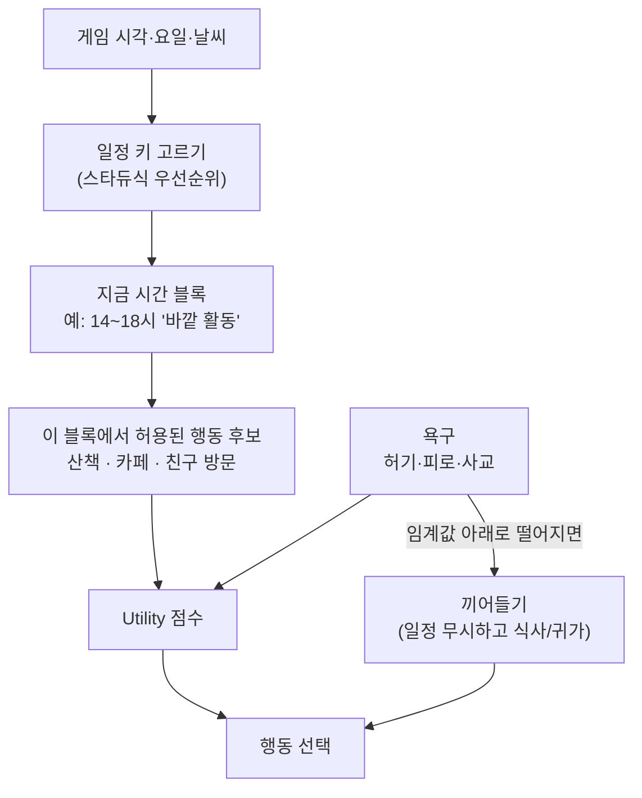

## 한눈에 보기

- **시간표(schedule)**: "이 시간에는 여기서 이걸 한다"를 미리 정해 둔 것. 플레이어가 "아침 9시면 저 사람은 가게에 있지"라고 **예측**할 수 있게 해 줍니다. 예측이 맞을 때 NPC가 그 세계에 **산다**고 느낍니다.
- **욕구(needs, motive)**: 배고픔, 피로처럼 시간이 지나면 줄어드는 수치. 같은 시간이라도 상황에 따라 다른 행동이 나오게 합니다.
- 시간표만 있으면 기계 같고, 욕구만 있으면 생활 리듬이 없습니다. 대부분의 게임은 **시간표로 큰 틀을, 욕구로 틀 안의 변화를** 만듭니다.

!!! note "비유: 학교 시간표와 쉬는 시간"
    학교 시간표는 몇 교시에 어느 교실에 있는지 정해 줍니다. 그런데 쉬는 시간 10분에 매점에 갈지, 화장실에 갈지, 친구와 떠들지는 그때 배고픔과 기분이 정합니다. 시간표가 "어디에 있을지"를, 욕구가 "그 안에서 무엇을 할지"를 맡는 구조입니다.

## 실제 게임 사례

### 스타듀 밸리 — 손으로 쓴 조건별 일정 {실존감}

스타듀의 NPC 일정은 NPC마다 데이터 파일 하나(`Characters/schedules/<이름>`)에 들어 있습니다. [분석] ([Modding:Schedule data](https://stardewvalleywiki.com/Modding:Schedule_data))

- 한 줄은 `시각 장소 X Y 방향 [애니메이션] [대사]`를 `/`로 이은 것입니다. 예: `900 SeedShop 39 5 0/1030 SeedShop 2 20 3/1300 Town 73 54 2/…` → 9시에 가게 (39,5)로, 10:30에 (2,20)으로, 13시에 마을 (73,54)로 걸어갑니다. [분석]
- 어떤 일정을 쓸지는 **키**로 정합니다. 결혼 여부, 축제, `계절_날짜`(spring_15), `날짜_하트`(11_6: 11일인데 하트 6 이상이면), `날짜`, `rain`, `rain2`(비 오는 날 50% 확률), `계절_요일_하트`, `계절_요일` 등을 **정해진 순서로 맞춰 보고 처음 맞는 것**을 씁니다. [분석]
- `GOTO 다른키`로 다른 일정을 재사용하고, `NOT friendship Sebastian 6`처럼 다른 NPC와의 관계가 조건이 되기도 합니다. [분석]
- 도착하면 애니메이션(예: `abigail_flute`)을 재생하고, 그 자리에서 말을 걸면 전용 대사가 나옵니다. [분석]

**배울 점**: 일정이 계절·요일·날씨·**호감도**에 따라 갈리기 때문에, 플레이어가 친해질수록 NPC의 동선 자체가 바뀝니다. 관계가 일상에 스며드는 구조입니다. {관계}

### 동물의 숲 GameCube판 — 성격별 일과표 6장 {실존감}

동숲 GC에는 주민별 일정이 없습니다. **성격 6종마다 일과표가 한 장씩**, 그게 전부입니다. [분석] (`src/game/m_npc_schedule.c`, [동숲 분석 2편](https://nobbs-it-study.tistory.com/entry/%EA%B2%8C%EC%9E%84-%EB%B6%84%EC%84%9D-%EB%8F%99%EC%88%B2-%EC%A3%BC%EB%AF%BC%EC%9D%84-%EC%96%B4%EB%96%BB%EA%B2%8C-%EC%82%B4%EC%95%84%EC%9E%88%EA%B2%8C-%EB%A7%8C%EB%93%A4%EC%97%88%EB%82%98-%EC%B5%9C%EC%A0%81%ED%99%94-%EB%B6%84%EC%84%9D-2%ED%8E%B8))

| 성격 (내부 이름) | 자는 시간 | 밖에 나와 있는 시간 |
|---|---|---|
| 친절함 normal (GIRL) | 21:00 ~ 05:00 | 06:00~12:00, 13:00~18:30 |
| 아이돌 peppy (KO_GIRL) | 23:30 ~ 07:00 | 08:00~13:00, 14:00~22:00 |
| 먹보 lazy (BOY) | 22:00 ~ 08:00 | 09:00~12:00, 14:00~19:30 |
| 운동광 jock (SPORT_MAN) | 01:00 ~ 05:30 | 06:30~12:00, 12:30~23:00 |
| 무뚝뚝 cranky (GRIM_MAN) | 05:00 ~ 10:00 | 11:00~15:00, 16:00~22:00, 23:00~04:00 |
| 성숙함 snooty (NANIWA_LADY) | 02:30 ~ 09:00 | 10:00~13:00, 14:00~21:00, 22:00~01:30 |

표의 시각은 소스의 일과표 값을 그대로 옮긴 것입니다. [분석]

- 새벽에 접속하면 마을에 무뚝뚝과 성숙함만 돌아다니는 것이 이 표 때문입니다. 성격이 **생활 시간대**로 드러납니다. {실존감}
- 첫 아르바이트(튜토리얼) 기간과 핼러윈에는 표를 무시하고 모두 바깥으로 나옵니다(`mNPS_schedule_manager`). 플레이어가 만나야 하는 날에는 시간표보다 연출이 우선입니다. [분석]
- 일정 관리 함수는 시간·조명 갱신 코드(`m_kankyo.c`) 끝에서 불리고, 복원자가 "이상한 위치"라는 주석을 남겼습니다. [분석]
- 바깥에 있는 시간 동안에는 성격·시간대별 목적지 배열(신사, 남의 집, 아무도 없는 곳, 자기 집)에서 무작위로 골라 산책합니다([2장](02-brain.html), [9장](09-world.html)). [분석]

**배울 점**: 데이터가 6장뿐인데도 "이 주민은 이 시간에 나와 있다"는 리듬이 생깁니다. 개인차는 다른 장치(기억, 말버릇, 옷)가 맡습니다.

### 심즈 1 — 욕구가 모든 행동을 끌고 간다 {실존감}

심의 욕구는 에너지, 편안함, 허기, 위생, 방광, 방(환경), 사교, 재미, 기분입니다. 심은 이 욕구를 채워 주겠다고 광고하는 행동 중 행복을 가장 크게 올리는 것을 고릅니다. [공식] ([Forbus & Wright 2001](https://qrg.northwestern.edu/papers/Files/Programming_Objects_in_The_Sims.pdf)) 시간표는 없고, 출근 같은 고정 일정만 따로 있습니다. 그래서 심즈의 하루는 욕구가 만든 **즉흥**에 가깝습니다.

### 림월드 — 욕구와 기분이 일을 방해한다 {개연성}

정착민은 일 우선순위표를 따르지만, 음식·수면·여가 같은 욕구가 바닥나면 일을 멈춥니다. 욕구 상태는 "배고픔 −6" 같은 생각으로 기분에 반영되고, 기분이 무너지면 정신 붕괴가 옵니다([4장](04-personality.html), [8장](08-events.html)). [분석] ([RimWorld 위키: Mood](https://rimworldwiki.com/wiki/Mood))

### 드워프 포트리스 — 욕구는 기분이 아니라 집중력에 [분석]

드워프의 욕구(기도, 사교, 술 등)는 성격에 따라 종류와 무게가 다르고, 채워지지 않으면 **집중력(focus)**이 떨어집니다. 기분과는 별개로 돕니다. ([DF 위키: Need](https://dwarffortresswiki.org/index.php/DF2014:Need)) 욕구를 "행동을 고르는 점수"가 아니라 **"일을 얼마나 잘하는가"**에 연결한 예입니다.

### 오블리비언 — 일정 + 조건 = AI 패키지 [분석]

오블리비언 NPC는 "AI 패키지"를 여러 개 가지고, 패키지마다 시간과 조건(예: 비가 안 올 때 정오부터 4시간 시장 배회)이 붙습니다. 한 번에 하나만 활성화되고 끝나면 다음 것으로 넘어갑니다. NPC에게는 심즈나 드워프 포트리스 같은 **욕구가 없고** 일정으로 먹고 잡니다. ([Paavo, "What was Radiant AI, anyway?"](https://blog.paavo.me/radiant-ai))

### Generative Agents — LLM이 하루 계획을 쪼갠다 {실존감}

- 아침에 에이전트의 요약 설명(이름, 특성, 최근 경험 요약)과 전날 요약을 주고 **하루 큰 일정**을 쓰게 합니다. [공식] ([Park 외 2023, 4.3절](https://arxiv.org/abs/2304.03442))
- 그 일정을 **1시간 단위**로, 다시 **5~15분 단위**로 쪼갭니다. 예: "13~17시 작곡" → "16:00 간식, 16:05 산책 …". [공식]
- 계획은 기억 스트림에 저장되어 검색 대상이 되고, 관찰할 때마다 "반응할지"를 판단해 필요하면 계획을 다시 세웁니다. [공식]
- 논문은 쪼개지 않은 계획이 "약국 카운터에 4시간 앉아 그림 그리기" 같은 비현실적인 결과를 낸다고 설명합니다. 쪼개는 이유가 **개연성**입니다. {개연성} [공식]

## 구조 다이어그램: 시간표와 욕구 합치기



## 세 갈래로 보기

### AI 없이

| 후보 | 하는 일 | 좋은 점 | 약한 점 | 대표 |
|---|---|---|---|---|
| 성격별 공용 일과표 | 성격마다 시간표 1장 | 데이터 최소, 성격이 리듬으로 보임 | 같은 성격끼리 동선이 같음 | 동숲 GC |
| 개인별 조건 키 일정 | NPC마다 계절·요일·날씨·하트별 일정 | 인물마다 개성, 관계가 동선을 바꿈 | 작성량이 매우 많음 | 스타듀 |
| 욕구 + Utility | 일정 없이 욕구로 즉흥 | 상황 대응이 자연스러움 | 생활 리듬이 약함, 예측 어려움 | 심즈 |
| 일정 블록 + 욕구 (혼합) | 블록이 후보를 정하고 욕구가 고름 | 리듬과 변화 둘 다 | 설계할 것이 많음 | 아래 구현 스케치 |
| 조건부 패키지 목록 | 시간+조건별 행동 묶음 | 기획자 통제 쉬움 | 욕구 없음 | 오블리비언 |

### AI 사용

- **LLM 하루 계획**: Generative Agents식으로 하루 계획을 글로 생성하고 쪼갭니다. 매일 다른 하루가 나오지만, 비용이 크고 결과가 장소·물건과 맞지 않을 수 있습니다. 논문 저자들은 25명을 이틀 시뮬레이션하는 데 토큰 비용으로 수천 달러가 들었다고 밝혔습니다. [공식] ([Park 외 2023, 한계와 향후 과제 부분](https://arxiv.org/abs/2304.03442))
- **인조이 Smart Zoi의 일정 조정**: 하루가 끝나면 경험을 바탕으로 개인 일정을 조정한다고 발표했습니다. [공식] ([NVIDIA](https://www.nvidia.com/en-gb/geforce/news/nvidia-ace-naraka-bladepoint-inzoi-launch-this-month)) 실제로 행동이 얼마나 달라지는지에 대해서는 플레이어 사이에 "속마음 말풍선 외에 차이를 못 느꼈다"는 반응도 있습니다. [추정] ([Steam 토론](https://steamcommunity.com/app/2456740/discussions/0/836123794066162014/))

### 섞어 쓰기

- **블록은 데이터, 블록 안의 선택만 LLM**: "14~18시 바깥 활동"은 일정표가 정하고, 그 안에서 "오늘은 누구를 만나러 갈까"를 LLM이 허용 후보 목록 중에서 고르게 합니다. 목록 밖의 답이 나오면 Utility 결과로 대체합니다.
- **하루 한 번만 LLM**: 밤에 그날 기억을 요약해 "내일 하고 싶은 것 1~2개"만 뽑고, 그것을 다음 날 Utility 점수에 보너스로 넣습니다. 매 순간의 결정은 전통 시스템이 합니다.

## 구현 스케치

### 스타듀식 일정 키 고르기

```csharp
// 정해진 순서대로 키를 만들어 보고, 데이터에 있는 첫 키를 쓴다 (엔진 무관 C#)
using System.Collections.Generic;

public static class ScheduleKeyResolver
{
    public static string Resolve(Dictionary<string, string> schedules, GameDate d, int hearts, bool raining, System.Random rng)
    {
        var tries = new List<string>
        {
            $"{d.Season}_{d.Day}",                 // spring_15
        };
        foreach (int h in new[] { 10, 8, 6, 4, 2 })   // 하트 조건은 높은 것부터
            if (hearts >= h) tries.Add($"{d.Day}_{h}");
        tries.Add($"{d.Day}");
        if (raining && rng.NextDouble() < 0.5) tries.Add("rain2");
        if (raining) tries.Add("rain");
        foreach (int h in new[] { 10, 8, 6, 4, 2 })
            if (hearts >= h) tries.Add($"{d.Season}_{d.Weekday}_{h}");
        tries.Add($"{d.Season}_{d.Weekday}");
        tries.Add(d.Weekday);
        tries.Add(d.Season);
        tries.Add("default");

        foreach (var key in tries)
            if (schedules.TryGetValue(key, out var raw))
                return raw.StartsWith("GOTO ") ? schedules[raw.Substring(5)] : raw;
        return null;
    }
}
```

!!! note "순서는 단순화했습니다"
    실제 스타듀의 키 순서와 세부 규칙(결혼 일정, 축제, `NOT friendship` 조건 등)은 [Modding:Schedule data](https://stardewvalleywiki.com/Modding:Schedule_data)를 보세요. 위 코드는 "우선순위 목록에서 첫 일치"라는 구조만 옮긴 것입니다.

### 일정 블록 + 욕구 끼어들기

```csharp
using UnityEngine;   // [Unity 의존] MonoBehaviour, Time

public class DailyLife : MonoBehaviour
{
    public ScheduleBlock[] blocks;        // ScriptableObject: 시간 범위 + 허용 행동 목록
    public UtilityAction[] emergency;     // 식사, 귀가 등
    public NeedSet needs;
    const float Critical = 0.15f;         // 이 아래면 일정보다 욕구 우선

    UtilityAction current;
    float nextThink;

    void Update()
    {
        needs.Decay(Time.deltaTime);
        if (Time.time < nextThink) return;          // 판단은 0.5~2초에 한 번이면 충분
        nextThink = Time.time + Random.Range(0.5f, 2f);

        var block = ScheduleBlock.Find(blocks, GameClock.Now);
        UtilityAction[] candidates = needs.Lowest() < Critical ? emergency : block.allowed;
        current = UtilityBrain.Pick(candidates, needs, current);
        GetComponent<ActionRunner>().Run(current);  // 실행은 아래층 상태 기계
    }
}
```

## 장단점과 언제 쓰나

| | 쓰면 좋은 때 | 피할 때 |
|---|---|---|
| 시간표 중심 | 플레이어가 NPC를 "찾아가는" 게임 (어디 있는지 예측 가능해야 함) | 매번 다른 일이 일어나야 하는 생존 시뮬 |
| 욕구 중심 | NPC를 "돌보는" 게임 (심즈, 림월드) | 만나야 할 NPC가 엉뚱한 곳에 있으면 곤란한 퀘스트 중심 게임 |
| 혼합 | 마을 생활 시뮬 대부분 | 인원이 매우 적어 손으로 다 쓰는 편이 싼 경우 |
| LLM 계획 | 연구·실험, 소수 핵심 NPC | 실시간 다수 NPC, 비용 제한이 있는 상용 게임 |

!!! warning "예측 가능성은 기능이다"
    시간표가 있는 게임에서 플레이어는 NPC를 **찾아갑니다**. NPC가 매일 랜덤한 곳에 있으면 찾기 어려워지고 관계 쌓기가 귀찮아집니다. 스타듀와 동숲이 시간표를 버리지 않는 이유입니다. 변화는 "예측 가능한 틀 안의 작은 변화"로 주는 편이 안전합니다.

## 출처

- Stardew Valley Wiki, Modding:Schedule data — <https://stardewvalleywiki.com/Modding:Schedule_data>
- ACreTeam, ac-decomp (`src/game/m_npc_schedule.c`, `src/game/m_npc_walk.c`, `src/game/m_kankyo.c`) — <https://github.com/ACreTeam/ac-decomp>
- 동숲 최적화 분석 2편 — <https://nobbs-it-study.tistory.com/entry/%EA%B2%8C%EC%9E%84-%EB%B6%84%EC%84%9D-%EB%8F%99%EC%88%B2-%EC%A3%BC%EB%AF%BC%EC%9D%84-%EC%96%B4%EB%96%BB%EA%B2%8C-%EC%82%B4%EC%95%84%EC%9E%88%EA%B2%8C-%EB%A7%8C%EB%93%A4%EC%97%88%EB%82%98-%EC%B5%9C%EC%A0%81%ED%99%94-%EB%B6%84%EC%84%9D-2%ED%8E%B8>
- Forbus & Wright, "Some notes on programming objects in The Sims" (2001) — <https://qrg.northwestern.edu/papers/Files/Programming_Objects_in_The_Sims.pdf>
- RimWorld Wiki, Mood — <https://rimworldwiki.com/wiki/Mood>
- Dwarf Fortress Wiki, Need — <https://dwarffortresswiki.org/index.php/DF2014:Need>
- Paavo, "What was Radiant AI, anyway?" — <https://blog.paavo.me/radiant-ai>
- Park 외, "Generative Agents" — <https://arxiv.org/abs/2304.03442>
- NVIDIA, inZOI ACE 발표 — <https://www.nvidia.com/en-gb/geforce/news/nvidia-ace-naraka-bladepoint-inzoi-launch-this-month>
- Steam 토론, "What is Smart Zoi really doing" — <https://steamcommunity.com/app/2456740/discussions/0/836123794066162014/>
