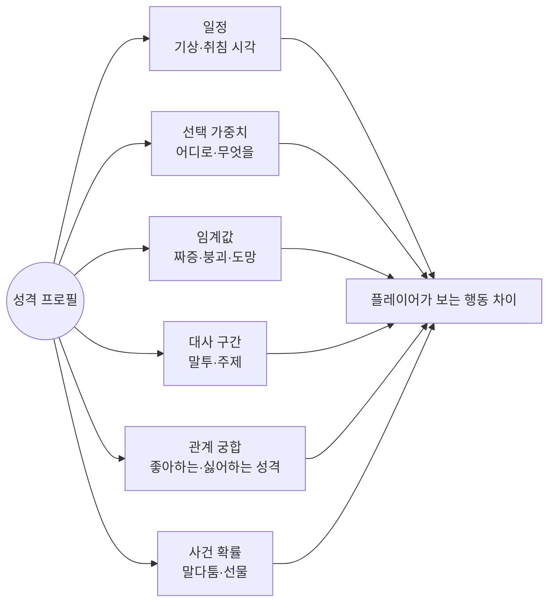

## 한눈에 보기

- 성격이 "느껴지려면" 플레이어가 **행동 차이**를 봐야 합니다. 프로필 화면에 "소심함"이라고 써 있어도, 행동이 다른 NPC와 같으면 아무 의미가 없습니다.
- 잘 만든 게임은 성격 값 하나를 **여러 시스템의 열쇠**로 씁니다. 동물의 숲 GC에서는 성격 1바이트가 일정, 산책 목적지, 대사 번호 구간, 인사 동작, 참을성 기준을 한꺼번에 정합니다. [분석] ([ac-decomp](https://github.com/ACreTeam/ac-decomp), 아래 사례)
- 성격을 표현하는 방식은 크게 셋입니다. **유형(type)**, **특성(trait) 조합**, **연속 수치(facet)**.

!!! note "비유: 배우의 캐릭터 시트"
    배우에게 "이 인물은 까칠하다"고만 말하면 연기가 흐릿해집니다. 대신 "말을 세 번 이상 걸면 짜증을 낸다, 새벽까지 깨어 있다, 사람 없는 곳을 좋아한다"처럼 **행동 규칙**으로 주면 누가 연기해도 까칠해 보입니다. 게임의 성격 값도 행동 규칙들로 풀려야 합니다.

## 세 가지 표현 방식

| 방식 | 생김새 | 장점 | 약점 | 대표 |
|---|---|---|---|---|
| 유형 (archetype) | 6~8개 중 하나 | 데이터가 적고, 플레이어가 금방 알아봄 | 같은 유형끼리 비슷함 | 동물의 숲 |
| 특성 조합 (trait) | 특성 2~5개를 고름 | 조합으로 다양성, 각 특성의 효과가 분명 | 특성끼리 충돌·밸런스 관리 | 림월드, CK3, 심즈 3 |
| 연속 수치 (facet) | 수십 개 축에 0~100 | 미세한 차이, 기억에 따라 변화 가능 | 플레이어에게 전달이 어려움 | 드워프 포트리스 |
| 자연어 페르소나 | 문단 하나의 설명 | 표현력 최고, 쓰기 쉬움 | 행동 규칙으로 바뀌지 않으면 말투만 다름 | Generative Agents, LLM NPC |

## 실제 게임 사례

### 동물의 숲 — 성격 1바이트가 모든 것의 열쇠 {실존감}

GameCube판 기준. [분석] ([ac-decomp](https://github.com/ACreTeam/ac-decomp), [동숲 분석 2편](https://nobbs-it-study.tistory.com/entry/%EA%B2%8C%EC%9E%84-%EB%B6%84%EC%84%9D-%EB%8F%99%EC%88%B2-%EC%A3%BC%EB%AF%BC%EC%9D%84-%EC%96%B4%EB%96%BB%EA%B2%8C-%EC%82%B4%EC%95%84%EC%9E%88%EA%B2%8C-%EB%A7%8C%EB%93%A4%EC%97%88%EB%82%98-%EC%B5%9C%EC%A0%81%ED%99%94-%EB%B6%84%EC%84%9D-2%ED%8E%B8))

- 주민 한 명의 고유 기본값은 **기본 옷, 말버릇 문자열 번호, 우산**뿐이고, 행동과 대사를 정하는 건 **성격 값(`looks`)** 하나입니다. [분석]
- 성격이 정하는 것:
    - **일정**: 성격별 일과표([3장](03-routine.html)) (`m_npc_schedule.c`)
    - **산책 목적지 가중치**: 무뚝뚝은 혼자 있는 곳 70%, 성숙함은 신사 70% (`m_npc_walk.c`)
    - **대사 구간**: 성격별 시작 번호에 오프셋을 더해 대사를 고름([7장](07-dialogue.html)) (`ac_quest_talk_normal_init.c`)
    - **인사 동작**: 성격별로 다른 인사 단계 (`aNPC_get_greeting_step`)
    - **참을성**: 연속으로 말을 걸 때 짜증 내기 시작하는 횟수와 대화를 거부하는 횟수 (`m_npc.c` `l_npc_temper`)
- 참을성 표(짜증 시작 / 대화 거부): 친절함 12/15, 아이돌 10/13, 먹보 12/15, 운동광 10/13, 무뚝뚝 9/12, 성숙함 9/12. 회복 타이머도 무뚝뚝·성숙함이 가장 깁니다(5000), 아이돌이 가장 짧습니다(3000). [분석]
    - 소스 주석에는 이 표가 기분(FEEL) 순서로 적혀 있지만, 실제로는 `l_npc_temper[looks]`로 성격 번호를 넣어 읽습니다.
- 성숙함의 내부 이름은 `NANIWA_LADY`(나니와는 오사카의 옛 이름)입니다. 개발자가 특정한 사람의 이미지를 떠올리며 성격을 만들었다는 흔적입니다. [분석] 모여봐요 개발진도 CEDEC 2020에서 성격을 만들 때 실제 사람들을 참고했다고 밝혔다는 보도가 있습니다. [추정] ([GoNintendo 요약](https://gonintendo.com/stories/368235-nintendo-details-their-process-for-creating-unique-villagers-in-a))
- **시리즈별 차이**: GC판은 6종입니다(소스 확인). [분석] 모여봐요는 8종(느끼함 smug, 단순활발 big sister 추가)이고 내부적으로 0~7 번호를 씁니다. [분석] ([Nookipedia](https://nookipedia.com/wiki/Villager)) 모여봐요에 같은 성격 안의 하위 유형이 있다는 커뮤니티 자료가 있습니다. [추정]

**배울 점**: "성격 → 여러 시스템의 열쇠" 구조 덕분에 같은 성격이면 확실히 비슷하고, 다른 성격이면 확실히 다릅니다. 같은 성격끼리의 차이는 기억·옷·말버릇 같은 **살면서 바뀌는 값**이 만듭니다([5장](05-memory.html), [6장](06-relationship.html)).

### 림월드 — 특성이 임계값과 관계를 바꾼다 {개연성} {관계}

[분석] ([RimWorld 위키: Mood](https://rimworldwiki.com/wiki/Mood), [Mental break](https://rimworldwiki.com/wiki/Mental_break), [Opinion](https://rimworldwiki.com/wiki/Opinion))

- 정신 붕괴 기본 임계값은 35%(경미)·20%(심각)·5%(극단)인데, 특성이 이 값을 옮깁니다. 예: 강철 의지(Iron-willed)는 기준값을 18% 낮추고, 신경과민(Nervous)은 8% 높입니다. 같은 일을 겪어도 무너지는 시점이 다릅니다.
- 특성이 다른 사람에 대한 호감도를 바꿉니다. 예: 금주가(teetotaler)와 화학 물질 애호가 사이의 감점, 일 중독자 계열 특성이 게으른 사람에게 주는 감점(−20, −30) 등. 성격이 **관계의 씨앗**이 됩니다.
- 거친 성격(abrasive)은 모욕·무시 상호작용이 나올 확률이 2.3배입니다. 성격이 **사건 확률**을 바꿉니다.

### 드워프 포트리스 — 수십 개의 수치, 그리고 기억이 성격을 바꾼다 {실존감}

[분석] ([DF 위키: Personality facet](https://dwarffortresswiki.org/index.php/DF2014:Personality_facet), [Memory](https://dwarffortresswiki.org/index.php/DF2014:Memory_(thought)), [Need](https://dwarffortresswiki.org/index.php/DF2014:Need))

- **성격 측면(facet)**: 0~100 값으로 "어떻게 행동하는가"(분노, 불안, 호기심 등)를 정합니다. 40~60은 보통이라 따로 묘사되지 않습니다.
- **가치관(value)**: "무엇을 믿는가"를 따로 둡니다. 행동 방식과 신념을 분리한 것입니다.
- 성격 측면이 **욕구의 종류와 무게**를 정합니다. 사교적인 드워프는 사교 욕구가 큽니다.
- **핵심 기억**이 생기면 성격이 영구히 바뀝니다([5장](05-memory.html)). 트라우마나 성장을 성격 변화로 표현하는 구조입니다.

### 크루세이더 킹즈 3 — 성격에 어긋나는 행동에는 대가가 있다 {개연성}

- 특성과 반대되는 선택을 하면 **스트레스**가 쌓이고, 스트레스가 단계를 넘으면 정신 붕괴 이벤트가 나옵니다. 어떤 붕괴가 나올지는 성격 특성에 크게 좌우됩니다. [공식] ([개발 일지 31](https://forum.paradoxplaza.com/forum/developer-diary/ck3-dev-diary-31-a-stressful-situation.1399764/))
- 개발 일지 58은 스트레스를 특성과 더 단단히 묶었습니다. 예: 소심한(Shy) 인물은 개인 음모를 시작해도 스트레스를 받지 않지만 음모 진행이 느립니다. [공식] ([개발 일지 58](https://forum.paradoxplaza.com/forum/threads/ck3-dev-diary-58-stre-ss-tching-the-traits.1472092))
- 개발 일지 104는 "AI의 성격 특성만 보고도 대략 무엇을 하려는지 알 수 있어야 한다"는 원칙을 밝혔습니다. [공식] ([개발 일지 104](https://forum.paradoxplaza.com/forum/threads/ck3-dev-diary-104-ai-ai-ai.1539411/))

!!! warning "CK3 개발 일지 원문"
    Paradox 포럼이 자동 접속을 막아서 이 세 개발 일지는 원문을 직접 열지 못했고, 검색 결과에 나온 본문 인용으로 확인했습니다. 세부 수치를 쓰기 전에 원문을 다시 확인하세요.

**배울 점**: 성격을 "AI가 고르는 행동의 가중치"로만 쓰면 플레이어 캐릭터에는 영향이 없습니다. CK3는 **플레이어에게도** 성격을 지키라고 압박합니다. 플레이어가 롤플레이를 하게 만드는 장치입니다.

### 심즈 — 성격이 광고 값을 바꾼다 {실존감}

심즈 1에서 오브젝트의 광고 값은 성격 점수에 따라 최소~최대 사이에서 바뀝니다. 예: 어항의 "물고기 밥 주기"는 장난기(Playful) 점수에 따라 재미를 1~11로 광고합니다. 성격 목록은 반대 성향 쌍(착함/심술, 활동적/게으름 등)으로 되어 있어서 "장난기의 반대"를 고르면 부호가 뒤집힙니다. [공식] ([Forbus & Wright 2001](https://qrg.northwestern.edu/papers/Files/Programming_Objects_in_The_Sims.pdf))

### 오블리비언 — 성향 수치 네 개 [분석]

NPC마다 공격성(aggression), 자신감(confidence), 활동성(energy), 책임감(responsibility)이 0~100으로 있습니다. 책임감이 30 이하면 범죄를 신고하지 않고, **목표를 이루려고 스스로 범죄를 저지르기도** 합니다. 낮은 책임감의 상인은 장물을 삽니다. ([Paavo](https://blog.paavo.me/radiant-ai)) 성격 수치가 행동 방법 선택에 직접 들어간 예이고, 이것이 [11장](11-failures.html)의 "약 거래상 살해" 같은 사고로 이어질 수 있었습니다.

### LLM 페르소나 {실존감}

- Generative Agents는 각 에이전트를 이름, 나이, 특성, 직업, 관계를 적은 **문단 하나**로 시작합니다. 이 문단이 기억 스트림의 첫 기억들이 됩니다. [공식] ([Park 외 2023](https://arxiv.org/abs/2304.03442))
- 후속 연구 "Generative Agent Simulations of 1,000 People"(Park 외, 2024)은 실제 사람 1,052명의 2시간 인터뷰로 에이전트를 만들었더니, 본인이 2주 뒤 같은 설문에 답하는 정확도의 약 85% 수준으로 설문 답을 재현했다고 보고합니다. 짧은 인구통계 설명으로 만든 에이전트보다 집단별 편향도 적었습니다. [공식] ([arXiv 2411.10109](https://arxiv.org/abs/2411.10109))
- 게임에 주는 시사점: **페르소나를 형용사 몇 개 대신 구체적인 일화와 습관으로 쓰면 더 일관적**이라는 것. 다만 이 연구는 설문 응답 재현이지 게임 속 행동 연구가 아닙니다. [추정]

## 구조 다이어그램: 성격을 여러 시스템에 연결하기



## 세 갈래로 보기

### AI 없이

- **유형 + 열쇠 표**: 동숲처럼 유형마다 표 여러 장(일정, 가중치, 임계값, 대사 구간)을 둡니다. 1인 개발에서 가장 가성비가 좋습니다.
- **특성 = 수정자 묶음**: 림월드·CK3처럼 특성 하나가 "임계값 −18%", "게으른 사람에게 호감 −20" 같은 수정자 여러 개를 가집니다. 조합으로 다양성이 생깁니다.
- **수치 + 문턱 묘사**: 드워프 포트리스처럼 0~100 수치를 두되, 플레이어에게는 극단값(40~60 밖)만 문장으로 보여 줍니다.

### AI 사용

- **자연어 페르소나 + LLM 대사**: 말투와 화제는 금방 다양해지지만, 행동 시스템과 연결하지 않으면 "말만 다른 똑같은 사람"이 됩니다.
- **페르소나 일관성 문제**: 대화가 길어지면 설정에서 벗어나는 일이 있습니다([7장](07-dialogue.html), [12장](12-ai-reality.html)).

### 섞어 쓰기

- **수치가 원본, 글은 파생**: 성격 수치·특성을 원본 데이터로 두고, LLM에게 넘기는 페르소나 문단은 그 수치에서 **자동 생성**합니다. 성격이 바뀌면(DF의 핵심 기억처럼) 문단도 다시 만듭니다. 행동과 말투가 같은 원본에서 나와 어긋나지 않습니다.

## 구현 스케치

```csharp
// 성격 하나가 여러 시스템의 값을 준다 (동숲식 '열쇠 표' + 림월드식 '수정자')
using UnityEngine;   // [Unity 의존] ScriptableObject

[CreateAssetMenu(menuName = "NPC/Personality")]
public class Personality : ScriptableObject
{
    [Header("일정")]
    public ScheduleEntry[] dailySchedule;            // 3장의 시간표

    [Header("선택 가중치 (배열 중복 = 가중치, 동숲식)")]
    public WalkGoal[] morningGoals = { WalkGoal.Shrine, WalkGoal.Alone, WalkGoal.Alone };
    public WalkGoal[] eveningGoals = { WalkGoal.Shrine, WalkGoal.Home };

    [Header("임계값")]
    public int annoyedAfterTalks = 10;                // 몇 번째 대화부터 짜증
    public int refuseAfterTalks = 13;                 // 몇 번째 대화부터 거부
    [Range(0, 1)] public float breakThreshold = 0.35f; // 기분이 이 아래면 붕괴 위험

    [Header("대사")]
    public string dialogueTablePrefix = "lazy_";      // 대사 테이블 구간

    [Header("관계 궁합 (상대 성격 → 첫인상 보정)")]
    public Personality[] likes;
    public Personality[] dislikes;

    public WalkGoal PickWalkGoal(bool evening, System.Random rng)
    {
        var pool = evening ? eveningGoals : morningGoals;
        return pool[rng.Next(pool.Length)];           // 배열에 많이 들어간 값일수록 잘 뽑힌다
    }
}

// CK3식: 성격에 어긋나는 선택을 하면 스트레스
public static class Stress
{
    public static int Cost(Npc who, ChoiceTag choice)
    {
        int cost = 0;
        foreach (var trait in who.Traits)
            if (trait.Opposes(choice)) cost += trait.stressPenalty;   // 예: 정직한 인물이 거짓말 → +20
        return cost;
    }
}
```

## 성격이 "행동 차이"로 드러나는지 점검하기

새 성격이나 특성을 추가할 때 아래 중 **최소 세 개**가 바뀌는지 확인하세요.

1. 하루 리듬(언제 자고, 언제 밖에 있나)
2. 장소 선호(어디에 자주 있나)
3. 같은 상황에서의 선택(선물을 받았을 때, 비가 올 때, 모르는 사람을 만났을 때)
4. 참을성·임계값(얼마나 빨리 짜증 내고, 무너지나)
5. 말투와 화제
6. 다른 성격과의 궁합(누구와 잘 지내고 누구와 부딪치나)
7. 사건 확률(말다툼, 친절, 선물)

플레이어에게 성격을 **알려 주는 방법**도 같이 정하세요. 동숲은 프로필 화면이 없어도 대사와 생활 시간대로 알려 주고, 림월드는 특성 이름과 생각 목록으로 알려 줍니다. 수치만 있고 단서가 없으면 1장에서 말한 "플레이어 모델로 옮겨지지 않는 것"이 됩니다.

## 출처

- ACreTeam, ac-decomp (`m_npc_schedule.c`, `m_npc_walk.c`, `m_npc.c`, `ac_npc_act_greeting.c_inc`, `include/m_npc_personal_id.h`) — <https://github.com/ACreTeam/ac-decomp>
- 동숲 최적화 분석 2편 — <https://nobbs-it-study.tistory.com/entry/%EA%B2%8C%EC%9E%84-%EB%B6%84%EC%84%9D-%EB%8F%99%EC%88%B2-%EC%A3%BC%EB%AF%BC%EC%9D%84-%EC%96%B4%EB%96%BB%EA%B2%8C-%EC%82%B4%EC%95%84%EC%9E%88%EA%B2%8C-%EB%A7%8C%EB%93%A4%EC%97%88%EB%82%98-%EC%B5%9C%EC%A0%81%ED%99%94-%EB%B6%84%EC%84%9D-2%ED%8E%B8>
- Nookipedia, Villager — <https://nookipedia.com/wiki/Villager>
- GoNintendo, CEDEC 2020 요약 — <https://gonintendo.com/stories/368235-nintendo-details-their-process-for-creating-unique-villagers-in-a>
- RimWorld Wiki: Mood, Mental break, Opinion — <https://rimworldwiki.com/wiki/Mood>, <https://rimworldwiki.com/wiki/Mental_break>, <https://rimworldwiki.com/wiki/Opinion>
- Dwarf Fortress Wiki: Personality facet, Memory, Need — <https://dwarffortresswiki.org/index.php/DF2014:Personality_facet>
- Paradox, CK3 개발 일지 31·58·104 — <https://forum.paradoxplaza.com/forum/developer-diary/ck3-dev-diary-31-a-stressful-situation.1399764/>
- Forbus & Wright 2001 — <https://qrg.northwestern.edu/papers/Files/Programming_Objects_in_The_Sims.pdf>
- Paavo, "What was Radiant AI, anyway?" — <https://blog.paavo.me/radiant-ai>
- Park 외 2023 — <https://arxiv.org/abs/2304.03442>
- Park 외, "Generative Agent Simulations of 1,000 People" (2024) — <https://arxiv.org/abs/2411.10109>
