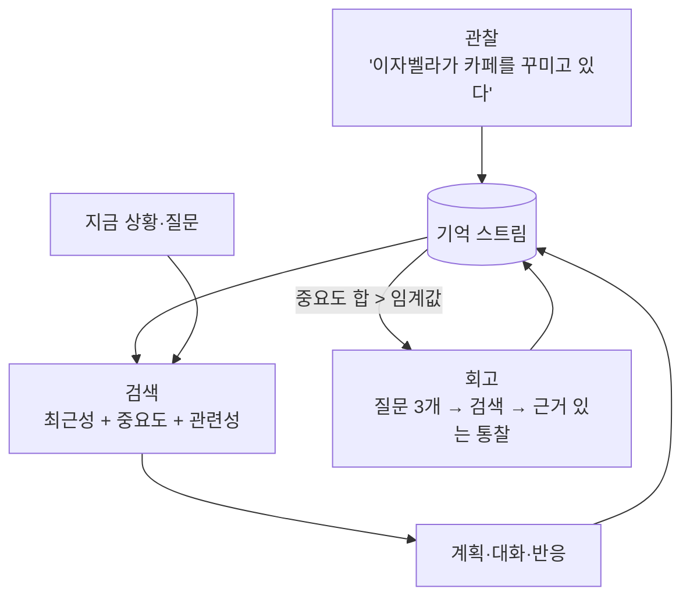

## 한눈에 보기

- 기억은 세 가지 일을 합니다. **알아보기**("오랜만이야"), **근거 대기**("네가 지난번에 도와줬잖아"), **바뀌기**(겪은 일 때문에 성격·관계가 달라짐).
- 기억의 깊이는 단계가 있습니다.

| 단계 | 저장하는 것 | 대표 | AI 필요 |
|---|---|---|---|
| 1. 플래그 | "이 이벤트 봤음" 참/거짓 | 스타듀 이벤트 기록 | 없음 |
| 2. 카운터·시각 | 횟수, 마지막으로 만난 시각 | 동숲 마지막 대화 시각 | 없음 |
| 3. 정해진 칸의 기억 | 사람별·사건별 기록 몇 칸 + 잊는 규칙 | 동숲 7칸, DF 단기 8칸·장기 8칸 | 없음 |
| 4. 기한부 생각 | 사건이 남긴 효과와 남은 시간 | 림월드 생각(moodlet) | 없음 |
| 5. 기억 스트림 | 모든 관찰을 문장으로 + 검색 | Generative Agents | 검색·요약에 필요 |

!!! note "비유: 수첩과 일기장"
    1~2단계는 달력에 체크하는 것, 3단계는 칸이 정해진 수첩(꽉 차면 덜 중요한 것을 지움), 4단계는 포스트잇(시간이 지나면 떨어짐), 5단계는 매일 쓰는 일기장(다 남기지만 필요한 페이지를 찾는 게 일)입니다.

## 실제 게임 사례

### 동물의 숲 GC — 플레이어를 기억하는 7칸 {관계} {실존감}

[분석] ([ac-decomp](https://github.com/ACreTeam/ac-decomp) `include/m_npc.h`, `src/game/m_npc.c`, `src/actor/ac_quest_talk_greeting.c`; [동숲 분석 2편](https://nobbs-it-study.tistory.com/entry/%EA%B2%8C%EC%9E%84-%EB%B6%84%EC%84%9D-%EB%8F%99%EC%88%B2-%EC%A3%BC%EB%AF%BC%EC%9D%84-%EC%96%B4%EB%96%BB%EA%B2%8C-%EC%82%B4%EC%95%84%EC%9E%88%EA%B2%8C-%EB%A7%8C%EB%93%A4%EC%97%88%EB%82%98-%EC%B5%9C%EC%A0%81%ED%99%94-%EB%B6%84%EC%84%9D-2%ED%8E%B8))

- 주민 한 명은 플레이어를 **최대 7명** 기억합니다(`ANIMAL_MEMORY_NUM 7`). 기억 한 칸(`Anmmem_c`, 0x138바이트)에는 다음이 들어 있습니다.
    - 누구인지(플레이어 ID: 이름과 마을), **마지막으로 말 건 시각**
    - 그 플레이어의 마을 이름, **마을 멜로디**
    - **친밀도**(0~127, 처음 만나면 1)
    - 받은 **편지 원문 한 통**과 편지 평가
- **알아보기**: 인사 대사가 마지막 대화 시각으로 갈립니다. 처음 / 오늘 또 / 1일 이상 / **14일 이상 / 60일 이상**, 그리고 다른 마을 사람용 버전. 60일 이상이면 몇 달·몇 주가 지났는지 계산해 대사에 넣습니다(`aQMgr_get_meet_time`).
- **근거 대기**: 이 기억들이 대화에 다시 나옵니다. 다른 마을에서 만난 플레이어 이야기, 같은 마을 다른 플레이어 이야기, **다른 사람이 보낸 편지를 보여 주기**(친밀도 80 이상이고 편지가 있는 기억을 고르는 함수가 따로 있음).
- **잊는 규칙**: 7칸이 차면 **다른 마을에서 놀러 온 사람의 기억부터** 지웁니다. 그중에서도 편지가 없는 쪽 → 친밀도가 낮은 쪽 → 마지막 대화가 오래된 쪽 순서입니다. 그래도 없으면 마을에서 삭제된 플레이어의 기억, 다 실패하면 첫 칸(`mNpc_ForceGetFreeAnimalMemoryIdx`).
- **결정에 쓰기**: 기억은 저장만 되는 게 아니라 이사 결정에도 쓰입니다. 주민이 꽉 차서 누군가 떠나야 하면 **기억(아는 플레이어 수)이 가장 적은 주민**이 떠납니다([6장](06-relationship.html)).

**배울 점**: 칸 수를 정하고 잊는 순서를 정하면 저장 공간도 아끼고, "같은 마을 사람과 편지를 준 사람은 오래 기억한다"는 **사람 같은 우선순위**가 자연스럽게 생깁니다.

### 드워프 포트리스 — 단기 8칸, 장기 8칸, 핵심 기억 {실존감} {개연성}

[분석] ([DF 위키: Memory](https://dwarffortresswiki.org/index.php/DF2014:Memory_(thought)))

- **단기 기억 8칸**: 생각이 생기면 같은 종류(group)의 기억이 이미 있는지 봅니다. 없으면 빈칸에, 빈칸이 없으면 **가장 약한 기억**을 덮어씁니다. 덮어쓴 기억은 잊힌 것입니다.
- **장기 기억 8칸**: 단기 기억에 1년 동안 남아 있으면 장기 기억으로 올라가려 합니다. 강한 감정일수록 단기 칸에서 오래 버티므로 장기로 올라가기 쉽습니다.
- 드워프는 강한 기억을 **다시 떠올리며** 추가로 스트레스 변화를 받습니다. 같은 일이 반복되면 단기·장기 양쪽에 같은 감정이 있어 효과가 두 배가 됩니다.
- **핵심 기억(core memory)**: 장기 기억이 핵심 기억이 되면 성격이 **영구히** 바뀝니다([4장](04-personality.html)).

**배울 점**: "강한 감정일수록 오래 남는다"를 별도 공식 없이 **덮어쓰기 규칙**만으로 만들었습니다.

### 림월드 — 기한이 있는 생각 {개연성}

사건은 "맛있는 식사 +5 (1일)", "동료의 죽음 −N (며칠)" 같은 **기한부 생각**을 남깁니다. 이 생각들의 합이 기분 목표치가 되고, 기분은 목표치를 향해 시간당 최대 +12(오를 때) / −8(내릴 때)씩 움직입니다. [분석] ([RimWorld 위키: Mood](https://rimworldwiki.com/wiki/Mood)) 플레이어는 정착민 화면에서 생각 목록을 그대로 볼 수 있어서, **기분이 왜 이런지 원인이 보입니다**. 개연성의 핵심 장치입니다([8장](08-events.html)).

### 스타듀 밸리 — 플래그와 조건 {관계}

이벤트는 "본 이벤트인지", "하트가 몇 이상인지", "어떤 플래그가 있는지" 같은 **전제 조건**으로 열립니다. [분석] ([Modding:Event data](https://stardewvalleywiki.com/Modding:Event_data)) 대사도 하트 단계·결혼 상대·특정 상태(`$d kent`: 켄트가 돌아왔는지 등)로 갈립니다. [분석] ([Modding:Dialogue](https://stardewvalleywiki.com/Modding:Dialogue)) 플래그만으로도 "이 사람이 나와의 일을 기억한다"는 느낌을 충분히 냅니다.

### 섀도우 오브 모르도르 — 적이 나를 기억한다 {관계}

오크 대장이 플레이어와의 이전 만남(도망쳤는지, 불에 데었는지 등)을 기억하고 다음 만남의 대사와 외형에 반영하는 "네메시스 시스템"으로 알려져 있습니다. [추정: 게임 내용에 대한 보도] 워너 브라더스는 이 시스템을 특허로 등록했습니다("Nemesis characters, nemesis forts, social vendettas and followers in computer games", 2021년 등록). [공식] ([Game Developer 보도](https://www.gamedeveloper.com/business/-i-shadow-of-war-i-publisher-warner-bros-has-patented-the-series-nemesis-system)) 개발사의 구조 발표 자료는 찾지 못했습니다. [확인 못 함]

!!! warning "특허 주의"
    같은 조합을 그대로 만들기 전에 특허 범위를 확인하세요. 원리("적이 나와의 일을 기억한다")는 이 가이드의 다른 사례들처럼 다양한 방식으로 구현할 수 있습니다.

### Generative Agents — 기억 스트림, 검색, 회고 {실존감} {관계}

**논문 기준** [공식] ([Park 외 2023, 4절](https://arxiv.org/abs/2304.03442))

- **기억 스트림(memory stream)**: 에이전트가 겪은 모든 것을 자연어 문장으로 쌓은 목록. 기억마다 내용, 만든 시각, 마지막으로 꺼내 본 시각을 가집니다.
- **검색 점수** = α₁·최근성 + α₂·중요도 + α₃·관련성. 세 점수를 각각 0~1로 정규화(min-max)한 뒤 더하며, 논문의 구현에서는 α를 모두 1로 둡니다.
    - **최근성(recency)**: 마지막으로 꺼내 본 뒤 지난 **게임 시간(시간 단위)**에 따라 지수 감소. 감소율 **0.995**.
    - **중요도(importance)**: 기억이 생길 때 LLM에게 1~10점으로 매기게 함. (예: 양치는 1, 이별은 높은 점수)
    - **관련성(relevance)**: 지금 질문과 기억의 임베딩(embedding: 문장을 숫자 벡터로 바꾼 것) 코사인 유사도.
    - 점수 상위 기억 중 **언어 모델 입력 창에 들어가는 만큼**을 프롬프트에 넣습니다.
- **회고(reflection)**: 최근 사건의 중요도 합이 **150**을 넘으면 실행. 실제로는 하루에 두세 번 정도였습니다.
    1. 최근 기억 **100개**를 주고 "답할 수 있는 가장 두드러진 상위 질문 3개"를 묻습니다.
    2. 각 질문으로 기억(이전 회고 포함)을 검색합니다.
    3. 근거 기억 번호를 인용한 **통찰**을 쓰게 합니다. 예: "클라우스는 젠트리피케이션 연구에 헌신적이다 (1, 2, 8, 15번 근거)".
    4. 통찰을 다시 기억 스트림에 넣습니다. 회고 위에 회고가 쌓여 **나무 구조**가 됩니다.
- 회고가 왜 필요한지 논문의 예: 회고 없이 "한 시간 같이 보낼 사람"을 물으면 클라우스는 가장 자주 마주친 기숙사 이웃을 고르지만, 회고가 있으면 연구라는 공통 관심사가 있는 마리아를 고릅니다. [공식]

**공개 코드 기준** [공식] ([joonspk-research/generative_agents](https://github.com/joonspk-research/generative_agents), 커밋 `fe05a71`)

논문과 공식 코드의 값이 다릅니다. 구현할 때 어느 쪽을 따를지 정해야 합니다.

| 항목 | 논문 | 공식 코드 |
|---|---|---|
| 최근성 감소율 | 0.995 | `recency_decay = 0.99` (`persona/memory_structures/scratch.py`) |
| 최근성 계산 | 마지막 접근 후 지난 게임 시간 | **시간순으로 정렬한 순번** i에 대해 `0.99 ** i` (`retrieve.py` `extract_recency`) |
| 세 점수 가중치 | 모두 1 | `gw = [0.5, 3, 2]` → 최근성 0.5, **관련성 3**, 중요도 2 (`retrieve.py` 244행). 주석에 "[1,1,1]도 꽤 잘 된다", "나중에는 학습시켜야 할 것" |
| 회고 임계값 | 150 | `importance_trigger_max = 150` (일치) |

**AI Town의 구현** [공식] ([a16z-infra/ai-town](https://github.com/a16z-infra/ai-town) `convex/agent/memory.ts`)

- 최근성은 마지막 접근 후 지난 **실제 시간(시간 단위)**으로 `0.99 ** floor(hours)`.
- 관련성·중요도·최근성을 각각 정규화한 뒤 **같은 가중치로 더함**.
- 회고는 **최근 기억 100개의 중요도 합이 500을 넘을 때**.
- 중요도를 LLM 답에서 숫자로 읽지 못하면 **5로 둠**. 실제 서비스 코드에서 LLM 출력을 믿지 않고 기본값을 두는 예입니다.

**논문이 직접 밝힌 한계** [공식]: 관련 기억을 못 찾거나 일부만 찾음, 기억에 없는 내용을 덧붙이기(완전히 지어내지는 않지만 과장), 지나치게 격식 있는 말투(언어 모델의 지시 학습 영향).

## 구조 다이어그램



## 세 갈래로 보기

### AI 없이

| 후보 | 어떻게 | 좋은 점 | 약한 점 |
|---|---|---|---|
| 플래그·조건 | 사건을 봤는지만 기록 | 작가가 완전 통제, 버그 적음 | 쓴 만큼만 기억 |
| 마지막 시각 + 카운터 | 사람별로 마지막 만남·횟수 | 매우 쌈, "오랜만이야"를 자동으로 | 무슨 일이 있었는지는 모름 |
| 칸 제한 기억 + 잊는 규칙 | 사람·사건별 기록 N칸 | 사람 같은 망각, 저장량 고정 | 칸 수와 잊는 순서 설계 필요 |
| 기한부 생각 | 효과와 남은 시간 | 원인이 보이는 기분, 자동 회복 | 장기 기억은 따로 필요 |
| 사건 기록(로그) + 템플릿 | 구조화된 사건 기록을 대사 틀에 채움 | 근거 있는 대사, AI 불필요 | 대사 틀을 많이 써야 함 |

### AI 사용

- **기억 스트림 + 임베딩 검색 + LLM 회고**: Generative Agents·AI Town 방식. 표현력은 가장 좋지만, 기억이 쌓일수록 검색·요약 비용이 늘고, 회고가 **사실과 다른 통찰**을 만들 수 있습니다.

### 섞어 쓰기

- **기록은 구조화, 문장은 LLM**: 기억은 `{누가, 누구에게, 무엇을, 언제, 감정 강도}` 같은 **구조화된 기록**으로 저장하고, 검색 점수도 규칙으로 계산합니다(아래 코드). LLM은 고른 기억 몇 개를 **문장으로 바꿀 때만** 씁니다. 기억 자체는 틀릴 수 없습니다.
- **회고는 요약만**: 밤마다 그날의 구조화된 기록을 LLM이 한 줄 일기로 요약하게 하고, 요약문은 **표시용**으로만 씁니다. 게임 규칙(호감도 등)은 구조화된 기록에서 계산합니다. 인조이의 일기 기능이 비슷한 위치에 있습니다. [공식] ([NVIDIA](https://www.nvidia.com/en-gb/geforce/news/nvidia-ace-naraka-bladepoint-inzoi-launch-this-month))

## 구현 스케치

### 칸 제한 기억 (동숲식)

```csharp
// 사람별 기억 N칸 + 잊는 순서 규칙 (엔진 무관 C#)
public class PersonMemory
{
    public string PlayerId;
    public bool SameTown;          // 같은 마을 사람인가
    public long LastTalkUnix;      // 마지막 대화 시각
    public int Friendship;         // 0~127
    public string SavedLetter;     // 받은 편지 한 통 (없으면 null)
}

public class MemorySlots
{
    readonly PersonMemory[] slots;
    public MemorySlots(int capacity = 7) => slots = new PersonMemory[capacity];

    public PersonMemory GetOrCreate(string playerId, bool sameTown, long now)
    {
        foreach (var m in slots) if (m != null && m.PlayerId == playerId) return m;
        int idx = System.Array.IndexOf(slots, null);
        if (idx < 0) idx = PickForget();
        return slots[idx] = new PersonMemory { PlayerId = playerId, SameTown = sameTown, LastTalkUnix = now, Friendship = 1 };
    }

    // 다른 마을 사람 중: 편지 없는 쪽 → 친밀도 낮은 쪽 → 오래된 쪽을 잊는다 (ac-decomp와 같은 우선순위)
    int PickForget()
    {
        int best = -1;
        for (int i = 0; i < slots.Length; i++)
        {
            var m = slots[i];
            if (m.SameTown) continue;
            if (best < 0 || Worse(m, slots[best])) best = i;
        }
        return best >= 0 ? best : 0;   // 다 같은 마을이면 첫 칸 (원작의 최후 수단과 같음)
    }

    static bool Worse(PersonMemory a, PersonMemory b)
    {
        bool aLetter = a.SavedLetter != null, bLetter = b.SavedLetter != null;
        if (aLetter != bLetter) return !aLetter;
        if (a.Friendship != b.Friendship) return a.Friendship < b.Friendship;
        return a.LastTalkUnix < b.LastTalkUnix;
    }

    // "오랜만이야" 분기 (동숲: 1일 / 14일 / 60일)
    public static string MeetKind(PersonMemory m, long now)
    {
        if (m == null) return "first";
        double days = (now - m.LastTalkUnix) / 86400.0;
        return days >= 60 ? "really_long" : days >= 14 ? "long" : days >= 1 ? "first_today" : "again";
    }
}
```

### 검색 점수 (Generative Agents식, LLM 없이도 동작)

```csharp
// 구조화된 기억에 최근성·중요도·관련성 점수를 매긴다.
// 관련성을 임베딩 대신 '태그 겹침'으로 계산하면 LLM 없이도 쓸 수 있다.
using System.Collections.Generic;
using System.Linq;

public class MemoryRecord
{
    public string Text;                 // 표시용 문장 (템플릿으로 만들거나 LLM이 씀)
    public HashSet<string> Tags;        // "isabella", "party", "cafe"
    public float Importance;            // 1~10 (규칙으로 매기거나 LLM이 매김)
    public double LastAccessHours;      // 게임 시간
}

public static class MemoryRetrieval
{
    public static List<MemoryRecord> Top(List<MemoryRecord> all, HashSet<string> query, double nowHours,
                                         int k = 5, float wRecency = 1, float wImportance = 1, float wRelevance = 1,
                                         double decay = 0.995)
    {
        var rec = all.Select(m => System.Math.Pow(decay, nowHours - m.LastAccessHours)).ToList();
        var imp = all.Select(m => (double)m.Importance).ToList();
        var rel = all.Select(m => (double)m.Tags.Intersect(query).Count() / System.Math.Max(1, query.Count)).ToList();
        Normalize(rec); Normalize(imp); Normalize(rel);   // 논문처럼 0~1로 min-max

        var picked = Enumerable.Range(0, all.Count)
            .OrderByDescending(i => wRecency * rec[i] + wImportance * imp[i] + wRelevance * rel[i])
            .Take(k).Select(i => all[i]).ToList();
        foreach (var m in picked) m.LastAccessHours = nowHours;   // 꺼내 본 기억은 다시 '최근'이 된다
        return picked;
    }

    static void Normalize(List<double> v)
    {
        double min = v.DefaultIfEmpty(0).Min(), max = v.DefaultIfEmpty(0).Max();
        for (int i = 0; i < v.Count; i++) v[i] = max - min < 1e-9 ? 0.5 : (v[i] - min) / (max - min);
    }
}
```

## 무엇을 기억시키고 무엇을 잊게 할까

1. **플레이어에게 다시 보여줄 것만 저장하세요.** 다시 말하거나 행동으로 드러나지 않는 기억은 1장의 "플레이어 모델로 옮겨지지 않는 것"입니다.
2. **칸 수를 먼저 정하세요.** 칸 수가 저장량, 세이브 크기, 검색 비용의 상한이 됩니다.
3. **잊는 순서는 "관계의 가치"로 정하세요.** 동숲은 같은 마을·편지·친밀도, DF는 감정 강도를 기준으로 삼았습니다.
4. **강한 기억은 다시 떠올리게 하세요.** DF의 회상, Generative Agents의 "꺼내 볼 때마다 최근성 갱신"처럼, 자주 쓰이는 기억이 오래 남는 구조는 사람과 비슷합니다.
5. **기억이 무언가를 바꾸게 하세요.** 대사만 바뀌는 기억보다, 이사 결정(동숲)이나 성격(DF)을 바꾸는 기억이 훨씬 무겁게 느껴집니다.

## 출처

- ACreTeam, ac-decomp (`include/m_npc.h`, `src/game/m_npc.c`, `src/actor/ac_quest_talk_greeting.c`, `src/actor/ac_quest_talk_normal_init.c`) — <https://github.com/ACreTeam/ac-decomp>
- 동숲 최적화 분석 2편 — <https://nobbs-it-study.tistory.com/entry/%EA%B2%8C%EC%9E%84-%EB%B6%84%EC%84%9D-%EB%8F%99%EC%88%B2-%EC%A3%BC%EB%AF%BC%EC%9D%84-%EC%96%B4%EB%96%BB%EA%B2%8C-%EC%82%B4%EC%95%84%EC%9E%88%EA%B2%8C-%EB%A7%8C%EB%93%A4%EC%97%88%EB%82%98-%EC%B5%9C%EC%A0%81%ED%99%94-%EB%B6%84%EC%84%9D-2%ED%8E%B8>
- Dwarf Fortress Wiki, Memory (thought) — <https://dwarffortresswiki.org/index.php/DF2014:Memory_(thought)>
- RimWorld Wiki, Mood — <https://rimworldwiki.com/wiki/Mood>
- Stardew Valley Wiki, Modding:Event data / Modding:Dialogue — <https://stardewvalleywiki.com/Modding:Event_data>, <https://stardewvalleywiki.com/Modding:Dialogue>
- Game Developer, 네메시스 시스템 특허 보도 — <https://www.gamedeveloper.com/business/-i-shadow-of-war-i-publisher-warner-bros-has-patented-the-series-nemesis-system>
- Park 외, "Generative Agents: Interactive Simulacra of Human Behavior" (UIST 2023) — <https://arxiv.org/abs/2304.03442>
- joonspk-research/generative_agents (공식 코드) — <https://github.com/joonspk-research/generative_agents>
- a16z-infra/ai-town — <https://github.com/a16z-infra/ai-town>
- NVIDIA, inZOI ACE 발표 — <https://www.nvidia.com/en-gb/geforce/news/nvidia-ace-naraka-bladepoint-inzoi-launch-this-month>
