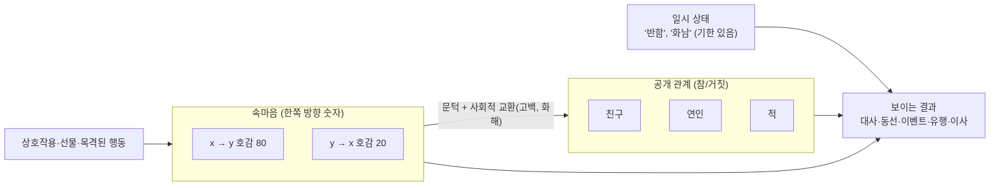

## 한눈에 보기

- 대부분의 게임은 관계를 **수치**(친밀도, 호감도)로 시작합니다. 수치 자체는 보이지 않으므로, 수치가 **문턱을 넘을 때 보이는 일**(대사 변화, 이벤트, 선물, 이사)을 만들어야 관계가 느껴집니다.
- 관계는 두 종류로 나눌 수 있습니다.
    - **플레이어 ↔ NPC**: 플레이어가 직접 쌓는 관계. 목표 지향적("하트 10개").
    - **NPC ↔ NPC**: 플레이어가 지켜보는 관계. 마을이 **나 없이도 돌아간다**는 느낌의 원천.
- 연구용 게임 Prom Week의 구분이 유용합니다. **속마음 수치**(한쪽 방향, 숫자)와 **공개 관계**(친구·연인·적, 참/거짓)를 따로 두면 "사귀고 있지만 마음이 식은" 같은 극적인 상태를 표현할 수 있습니다. [공식] ([Game AI Pro 1권 43장](https://www.gameaipro.com/GameAIPro/GameAIPro_Chapter43_An_Architecture_for_Character-Rich_Social_Simulation.pdf))

!!! note "비유: 통장 잔고와 계약서"
    호감도 수치는 통장 잔고, 공개 관계는 계약서입니다. 잔고가 많아도 계약서를 쓰는 사건(고백, 결혼식)이 있어야 관계가 바뀌고, 계약서가 있어도 잔고는 줄어들 수 있습니다. 둘을 분리하면 "잔고와 계약서가 어긋난 상태"가 드라마가 됩니다.

## 실제 게임 사례

### 스타듀 밸리 — 하트와 하트 이벤트 {관계}

[분석] ([위키: Friendship](https://stardewvalleywiki.com/Friendship), [Gifts](https://stardewvalleywiki.com/Gifts))

- 1하트 = 250점. 일반 주민은 10하트, 배우자는 14하트까지.
- 하루 한 번 말 걸기 +20. 선물은 하루 1개·주 2개까지. 기본값은 최애 +80 / 좋아함 +45 / 보통 +20 / 싫어함 −20이고, 생일에는 ×8, 겨울 축제 선물 교환에서는 ×5.
- 말을 걸지 않으면 매일 줄어듭니다. 결혼 상대 −20/일(멈추지 않음), 꽃다발을 준 상대 −10/일(10하트에서 멈춤), 꽃다발 전 결혼 후보와 일반 주민 −2/일(8하트·10하트에서 멈춤).
- 결혼 후보는 8하트에서 멈추고, **꽃다발**을 줘야 다시 오릅니다. 수치(잔고)와 관계 선언(계약서)을 분리한 장치입니다.
- 주민 근처에서 쓰레기통을 뒤지면 −25(라이너스만 +5). 행동이 **목격**될 때 관계가 바뀝니다.
- 하트가 일정 수에 이르면 그 인물의 **하트 이벤트**(작가가 쓴 장면)가 열립니다. 숫자가 이야기로 바뀌는 지점입니다.

### 동물의 숲 GameCube판 — 플레이어별 친밀도와 주민끼리의 관계 {관계} {소속감}

[분석] ([ac-decomp](https://github.com/ACreTeam/ac-decomp))

- **플레이어 ↔ 주민**: 기억 칸마다 친밀도 0~127(처음 1). 편지 +3, 내용이 이상한 편지 추가 −5, 선물 동봉 추가 +3(`m_npc.c`). 대화 결과에 따른 증감(+1, +3, −1, −3 등)은 `ac_quest_talk_init.c`에 있고, **대사 데이터 안에도 친밀도를 바꾸는 명령**이 들어 있습니다(`ac_quest_talk_normal_init.c`: 값이 100을 넘으면 `100 − 값`으로 음수 처리). 대사를 쓰는 사람이 "이 대답을 고르면 −2"를 텍스트 쪽에서 정할 수 있습니다.
- **편지 평가**: 편지 안의 "키워드 점수"가 100 이상이면 좋은 편지, 50 미만이면 나쁜 편지. 같은 글자를 계속 반복한 성의 없는 편지를 거르는 검사도 있습니다(`mNpc_CheckNormalMail_nes`, `mNpc_CheckNormalMail_sub`). AI 없이 "내 편지를 읽었다"는 반응을 냅니다.
- **주민 ↔ 주민**: 주민마다 다른 주민 15명에 대한 관계값 `animal_relations[15]`(0~255, 128이 보통)를 가집니다. 두 주민이 길에서 만나 인사하면 확률표가 굴러갑니다(`ac_npc_act_greeting.c_inc`).

| 반응 | 확률 | 관계 변화 |
|---|---|---|
| 기분 변화(말다툼): 화남·슬픔·평소 중 하나 | 20% | −8 / −4 / 0 (양쪽 각각) |
| 말버릇 따라 하기 | 10% | 서로 +8 |
| 말버릇 그만하라고 하기 | 10% | −8, 말한 쪽 화남 |
| 무늬 우산 바꾸기 | 10% | — |
| 옷 따라 입기 | 10% | 서로 +8 |
| 새 옷 사기 | 5% | −4, 슬픔 |
| 무늬 옷 바꾸기 | 10% | +8 |
| 원래대로(기본 옷·우산) | 5% | −4, 슬픔 |
| 아무 일도 없음 | 나머지 20% | — |

- 둘 중 **플레이어와 친밀도가 높은 쪽이 주도하는 쪽(A)**이 됩니다. 내가 아끼는 주민의 말버릇이 남에게 옮겨 가는 구조입니다.
- 정직하게 적어 둘 점: 소스 전체에서 `animal_relations` 값을 **쓰는** 곳은 찾았지만, 이 값을 **읽어서** 행동을 바꾸는 코드는 찾지 못했습니다(초기화, 섬 데이터 복사, 인사 반응에서 증감만 확인). 즉 GC판에서 주민끼리의 관계값은 저장되지만 눈에 보이는 결과로 이어지지 않았을 가능성이 있습니다. [분석] 관계가 실제로 "보이는" 것은 수치가 아니라 **옮겨 다니는 말버릇과 옷**입니다.

### 동물의 숲 모여봐요 — 이사와 친밀도 [분석]

데이터마이너 Ninji의 분석(2020년 코드 기준)에 따르면 모여봐요의 친밀도는 0~255이고, 이사 후보를 고를 때 **다른 주민들과의 평균 친밀도**가 낮을수록 후보가 되기 쉽습니다. 주민이 6명 이상일 때만 판정하고, 최근 생일이 지난 주민 등은 제외하며, **플레이어가 허락해야만** 떠납니다. ([Nintendo Everything 보도](https://nintendoeverything.com/animal-crossing-new-horizons-datamine-provides-details-about-how-villagers-move-out/)) GC판은 "기억 수가 적은 주민"이 자동으로 떠났지만, 모여봐요는 결정권을 플레이어에게 넘겼습니다.

### 림월드 — 상호작용이 호감도를 만든다 {관계} {개연성}

[분석] ([위키: Opinion](https://rimworldwiki.com/wiki/Opinion), [Social](https://rimworldwiki.com/wiki/Social))

- 정착민끼리 가까이 있으면 무작위 사회적 상호작용(잡담, 깊은 대화, 무시, 모욕 등)이 일어나고, 결과는 두 사람의 **궁합(compatibility)**에 영향을 받습니다.
- 상호작용은 "모욕당함 −5 (2일)" 같은 기한부 생각을 남기고, 이 생각들이 호감도를 이룹니다. 특성·외모 같은 고정 요인도 더해집니다([4장](04-personality.html)).
- 모욕 한 번에 4%, 무시 한 번에 0.5% 확률로 **주먹다짐(social fight)**이 시작됩니다.
- 연인·배우자·라이벌·가족 같은 관계가 따로 있고, 관계에 따라 죽음이나 이별의 생각이 달라집니다.

### Prom Week / Comme il Faut — 속마음과 공개 관계를 나눈다 {관계} {개연성}

[공식] ([Mateas & McCoy, Game AI Pro 1권 43장](https://www.gameaipro.com/GameAIPro/GameAIPro_Chapter43_An_Architecture_for_Character-Rich_Social_Simulation.pdf), [AIIDE 2011](https://ojs.aaai.org/index.php/AIIDE/article/view/12454))

- **사회 네트워크(social network)**: 인물 사이의 **한쪽 방향 숫자**. Prom Week에는 연애·우정·멋짐(존중) 세 가지 네트워크가 있습니다. x가 y에게 80인데 y는 x에게 20일 수 있습니다.
- **관계(relationship)**: 친구·사귐·적의 **참/거짓**. 모두가 인정하는 공개 상태입니다. 서로 호감이 높아도 "친구가 되는 사회적 교환"이 일어나야 관계가 바뀝니다.
- 이 분리로 "x와 y는 사귀고, y는 x에게 푹 빠졌지만, x는 마음이 식고 z에게 끌린다" 같은 상태가 표현됩니다. 그러면 x는 이별을 원하고 y는 이별을 농담으로 받아들일 가능성이 커지며, x가 z와 시시덕거리면 y는 질투합니다.
- **상태(status)**: "기분 좋음", "x가 y에게 반함" 같은 일시적인 효과. 시간이 지나면 사라집니다.
- **사회적 사실 DB(social facts)**: 과거에 있었던 사회적 교환의 기록. 다음 교환의 대사와 선택에 다시 쓰입니다.
- **문화 지식 DB(cultural knowledge base)**: 좀비 영화, 전기톱 같은 물건과 각 인물의 좋아함·싫어함 연결. "함께 좋아하는 것"이 대화거리가 됩니다.
- 이 모든 것이 **사회적 교환(social exchange)**이라는 단위로 묶입니다. 교환마다 전제 조건, 하고 싶은 정도를 정하는 영향 규칙, 결과(관계·수치 변화)가 있습니다.

### Versu — 상황이 할 수 있는 일을 제안한다 {관계} {실존감}

Versu(Richard Evans·Emily Short)는 저녁 식사 같은 **사회적 관습(social practice)**이 그 자리에서 할 수 있는 행동을 **제안만** 하고, 각 인물이 효용 기반으로 고르게 했습니다. 관습은 역할 단위로 써서 다른 인물이 같은 관습을 맡을 수 있습니다. [공식] ([Evans & Short 2014](https://www.cs.uky.edu/~sgware/reading/papers/evans2014versu.pdf)) 스마트 오브젝트([2장](02-brain.html))를 "상황"으로 넓힌 생각입니다.

### 오블리비언 — 모두가 모두에게 갖는 성향 [분석]

모든 NPC는 플레이어와 **다른 모든 NPC**에 대한 성향(disposition) 0~100을 가지고, 기본값은 소속 파벌 등에서 계산됩니다. ([Paavo](https://blog.paavo.me/radiant-ai))

### 크루세이더 킹즈 3 — 관계가 정치가 된다 [공식]

인물 사이에 호감도와 친구·라이벌·연인 같은 관계가 있고, 이것이 음모(scheme)와 결합해 정치적 사건이 됩니다. 특성이 관계와 스트레스를 바꾸는 방식은 [4장](04-personality.html)에 정리했습니다. ([개발 일지 104](https://forum.paradoxplaza.com/forum/threads/ck3-dev-diary-104-ai-ai-ai.1539411/)) 세부 수치는 원문을 직접 열지 못해 확인하지 않았습니다. [확인 못 함]

### Generative Agents — 대화가 관계망을 만든다 {관계}

25명의 에이전트가 이틀 동안 지내는 사이, 서로 아는 관계를 나타내는 네트워크 밀도가 0.167에서 0.74로 늘었습니다. 다른 에이전트를 아느냐는 453개의 답 중 1.3%(6개)는 기억에 없는 지어낸 답이었습니다. [공식] ([Park 외 2023, 7.1절](https://arxiv.org/abs/2304.03442))

## 구조 다이어그램



## 세 갈래로 보기

### AI 없이

| 후보 | 어떻게 | 좋은 점 | 약한 점 | 대표 |
|---|---|---|---|---|
| 단일 친밀도 + 문턱 이벤트 | 수치 하나, 하트마다 이벤트 | 목표가 분명, 작가가 통제 | NPC끼리 관계는 없음 | 스타듀 |
| 플레이어별 친밀도 + 유행 전파 | 기억 칸마다 친밀도, 주민끼리 확률 반응 | 마을이 스스로 변함 | 관계값이 보이지 않으면 무의미 | 동숲 GC |
| 생각 합산 호감도 | 기한부 생각들의 합 | 원인이 보이고 자동으로 회복 | 생각 종류를 많이 만들어야 함 | 림월드 |
| 속마음 + 공개 관계 + 교환 | 방향 있는 수치 여러 개, 관계 플래그, 교환 규칙 | 극적인 상태 표현 | 규칙 작성량이 많음 | Prom Week |
| 상황이 행동을 제안 | 관습/장소가 할 수 있는 일 목록 | 장면마다 자연스러운 행동 | 관습을 많이 써야 함 | Versu |

### AI 사용

- **대화로 관계 형성**: Generative Agents처럼 대화 기록과 회고로 "누가 누구와 친한지"를 언어 모델이 판단하게 합니다. 자연스럽지만 수치화가 어렵고, 게임 규칙(이벤트 조건 등)에 쓰기 힘듭니다.
- **관계 해석**: 수치와 사건 기록을 LLM에게 주고 "두 사람 관계를 한 문장으로" 요약하게 해 UI에 보여 줍니다.

### 섞어 쓰기

- **수치·플래그가 원본, LLM은 해석과 대사**: 관계 변화는 규칙(교환·생각)으로만 일어나게 하고, LLM은 "왜 사이가 나빠졌는지"를 사건 기록에서 골라 대사로 만듭니다. 관계 상태가 틀릴 일이 없고 설명만 다양해집니다.
- **LLM이 교환을 고르되 규칙이 결과를 정함**: 후보 교환(칭찬, 사과, 놀리기)을 LLM이 상황에 맞게 고르면, 성공 여부와 수치 변화는 Prom Week식 영향 규칙이 계산합니다.

## 구현 스케치

```csharp
// 속마음(방향 있는 수치) + 공개 관계(플래그) + 기한 있는 상태 (엔진 무관 C#)
using System.Collections.Generic;

public enum Network { Friendship, Romance, Respect }
public enum PublicRel { Friends, Dating, Enemies }

public class SocialState
{
    // (from, to, network) → -100~100
    readonly Dictionary<(string, string, Network), int> feelings = new();
    readonly HashSet<(string, string, PublicRel)> rels = new();
    readonly List<(string who, string status, string target, double untilHour)> statuses = new();
    public readonly List<string> History = new();   // 사회적 사실: 대사와 판단에 다시 쓴다

    public int Feel(string a, string b, Network n) => feelings.TryGetValue((a, b, n), out var v) ? v : 0;
    public void AddFeel(string a, string b, Network n, int d) =>
        feelings[(a, b, n)] = System.Math.Clamp(Feel(a, b, n) + d, -100, 100);

    public bool Has(string a, string b, PublicRel r) => rels.Contains((a, b, r)) || rels.Contains((b, a, r));
    public void Set(string a, string b, PublicRel r, bool on) { if (on) rels.Add((a, b, r)); else { rels.Remove((a, b, r)); rels.Remove((b, a, r)); } }

    public void AddStatus(string who, string status, string target, double nowHour, double hours) =>
        statuses.Add((who, status, target, nowHour + hours));
    public void Expire(double nowHour) => statuses.RemoveAll(s => s.untilHour <= nowHour);
}

// 사회적 교환: 전제 조건 + 하고 싶은 정도 + 결과
public abstract class SocialExchange
{
    public abstract string Name { get; }
    public abstract bool Pre(SocialState s, string a, string b);
    public abstract int Volition(SocialState s, string a, string b);   // 영향 규칙의 합
    public abstract bool Accept(SocialState s, string a, string b);
    public abstract void Apply(SocialState s, string a, string b, bool accepted);
}

public class AskOut : SocialExchange
{
    public override string Name => "고백";
    public override bool Pre(SocialState s, string a, string b) => !s.Has(a, b, PublicRel.Dating);
    public override int Volition(SocialState s, string a, string b) => s.Feel(a, b, Network.Romance) - 40;
    public override bool Accept(SocialState s, string a, string b) => s.Feel(b, a, Network.Romance) >= 50;
    public override void Apply(SocialState s, string a, string b, bool ok)
    {
        if (ok) s.Set(a, b, PublicRel.Dating, true);
        else s.AddFeel(a, b, Network.Respect, -10);          // 거절당한 쪽의 자존심
        s.History.Add($"{a}이(가) {b}에게 고백했고 {(ok ? "받아들여졌다" : "거절당했다")}");
    }
}
```

```csharp
// 동숲식: NPC끼리 마주치면 확률표로 반응 (배열 칸 수 = 확률, 엔진 무관)
public static class GreetingReaction
{
    static readonly (float rate, System.Action<Npc, Npc> act)[] table =
    {
        (0.20f, (a, b) => { Quarrel(a, b); Quarrel(b, a); }),
        (0.10f, (a, b) => { b.Catchphrase = a.Catchphrase; Bond(a, b, +8); }),   // 말버릇 옮기기
        (0.10f, (a, b) => { b.Outfit = a.Outfit; Bond(a, b, +8); }),             // 옷 따라 입기
        // ... 나머지 20%는 아무 일도 없음
    };

    public static void Roll(Npc x, Npc y, System.Random rng)
    {
        var (a, b) = x.FriendshipWithPlayer >= y.FriendshipWithPlayer ? (x, y) : (y, x);   // 플레이어와 친한 쪽이 주도
        double r = rng.NextDouble();
        foreach (var (rate, act) in table) { r -= rate; if (r < 0) { act(a, b); return; } }
    }
    static void Bond(Npc a, Npc b, int d) { a.Relation[b.Id] += d; b.Relation[a.Id] += d; }
    static void Quarrel(Npc a, Npc b) { a.Relation[b.Id] -= 4; a.SetMood(Mood.Angry, minutes: 1); }
}
```

## 장단점과 언제 쓰나

- **플레이어 ↔ NPC 관계만 있는 게임**(스타듀)은 목표가 분명하고 만들기 쉽지만, 마을이 "나를 중심으로만" 돌아갑니다.
- **NPC ↔ NPC 관계를 넣을 때**는 반드시 **보이는 결과**와 같이 넣으세요. 동숲 GC의 관계값처럼 보이지 않는 수치는 비용만 듭니다. 보이는 결과의 예: 같이 다니기, 말버릇·옷 옮기기, 말다툼 장면, 다른 NPC 이야기를 하는 대사, 결혼·이별 소식.
- **관계 수치가 결정에 쓰이게** 하세요. 동숲의 이사(인연이 약한 주민이 떠남), 림월드의 주먹다짐(모욕 확률), Prom Week의 교환 선택처럼, 관계가 무언가를 바꿀 때 플레이어는 관계를 신경 씁니다.
- **감소(decay)는 조심스럽게**. 스타듀는 매일 조금씩 줄지만 문턱에서 멈춥니다. 너무 빨리 줄면 숙제가 되고, 전혀 안 줄면 관계가 정적으로 느껴집니다.

## 출처

- Stardew Valley Wiki, Friendship / Gifts — <https://stardewvalleywiki.com/Friendship>, <https://stardewvalleywiki.com/Gifts>
- ACreTeam, ac-decomp (`src/game/m_npc.c`, `src/actor/npc/ac_npc_act_greeting.c_inc`, `src/actor/npc/ac_npc_action.c_inc`, `src/actor/ac_quest_talk_normal_init.c`) — <https://github.com/ACreTeam/ac-decomp>
- Nintendo Everything, 모여봐요 이사 데이터마이닝 보도 — <https://nintendoeverything.com/animal-crossing-new-horizons-datamine-provides-details-about-how-villagers-move-out/>
- RimWorld Wiki, Opinion / Social — <https://rimworldwiki.com/wiki/Opinion>, <https://rimworldwiki.com/wiki/Social>
- Michael Mateas & Josh McCoy, "An Architecture for Character-Rich Social Simulation" (Game AI Pro 1권 43장) — <https://www.gameaipro.com/GameAIPro/GameAIPro_Chapter43_An_Architecture_for_Character-Rich_Social_Simulation.pdf>
- McCoy 외, "Comme il Faut" (AIIDE 2011) — <https://ojs.aaai.org/index.php/AIIDE/article/view/12454>
- Evans & Short, "Versu" (IEEE TCIAIG 2014) — <https://www.cs.uky.edu/~sgware/reading/papers/evans2014versu.pdf>
- Paavo, "What was Radiant AI, anyway?" — <https://blog.paavo.me/radiant-ai>
- Paradox, CK3 개발 일지 104 — <https://forum.paradoxplaza.com/forum/threads/ck3-dev-diary-104-ai-ai-ai.1539411/>
- Park 외 2023 — <https://arxiv.org/abs/2304.03442>
