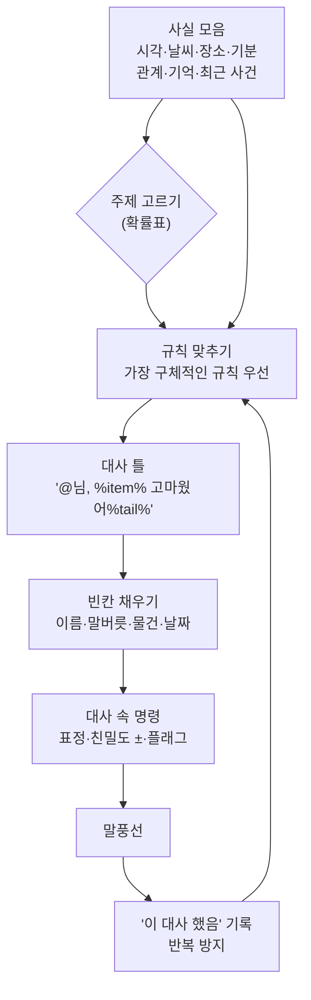

## 한눈에 보기

대사 시스템은 세 단계로 볼 수 있습니다.

1. **무슨 얘기를 할지 고르기**: 주제를 고른다(인사, 날씨, 부탁, 다른 주민 이야기).
2. **어떤 문장을 쓸지 고르기**: 조건(성격, 시간, 날씨, 관계, 기억)에 맞는 문장을 고른다.
3. **문장 채우기**: 빈칸(내 이름, 말버릇, 물건 이름, 날짜)을 채우고, 대사에 붙은 명령(표정, 친밀도 변화)을 실행한다.

"나를 알아본다"는 느낌은 2단계와 3단계에서 나옵니다. **나에 대한 기억**이 조건이 되고, **내 이름과 내가 한 일**이 빈칸에 들어갈 때입니다.

!!! note "비유: 편지 양식"
    은행에서 오는 안내문은 양식이 같지만 이름, 금액, 날짜가 들어가서 "내 편지"가 됩니다. 게다가 상황에 따라 다른 양식(연체 안내, 생일 축하)을 고릅니다. 대사 시스템은 **양식 고르기 + 빈칸 채우기**입니다.

## 실제 게임 사례

### 동물의 숲 GC — 대사는 번호 계산이다 {실존감} {관계}

[분석] ([ac-decomp](https://github.com/ACreTeam/ac-decomp) `src/actor/ac_quest_talk_normal_init.c`, `src/actor/ac_quest_talk_greeting.c`, `include/m_font.h`; [동숲 분석 2편](https://nobbs-it-study.tistory.com/entry/%EA%B2%8C%EC%9E%84-%EB%B6%84%EC%84%9D-%EB%8F%99%EC%88%B2-%EC%A3%BC%EB%AF%BC%EC%9D%84-%EC%96%B4%EB%96%BB%EA%B2%8C-%EC%82%B4%EC%95%84%EC%9E%88%EA%B2%8C-%EB%A7%8C%EB%93%A4%EC%97%88%EB%82%98-%EC%B5%9C%EC%A0%81%ED%99%94-%EB%B6%84%EC%84%9D-2%ED%8E%B8))

**1단계: 주제를 확률로 고른다.** 예를 들어 `l_ki_prob = {40, 30, 10, 10, 10}`은 평소 이야기 40%, 날씨·시간 30%, 물건 주기 10%, 가구 10%, 물건 사기 10%입니다. 뽑는 방법은 100칸짜리 배열을 확률만큼 채우고 무작위로 30번 섞은 뒤 한 칸을 고르는 것입니다(`aQMgr_decide_idx_prob_table`).

**2단계: 번호를 계산한다.** 주제마다 **성격별 시작 번호** 표가 있습니다.

```c
// 성격 순서: 친절함, 아이돌, 먹보, 운동광, 무뚝뚝, 성숙함  (ac_quest_talk_normal_init.c 170행)
static int l_normal3_weather[6] = { 0x1FC1, 0x1D29, 0x206C, 0x20AA, 0x2A38, 0x0F2C };
base_msg = l_normal3_weather[looks] + weather * 5;   // 1301행: 날씨마다 5문장, 그중 무작위 하나
```

인사도 같은 방식입니다. 마지막으로 만난 시각(처음 / 오늘 또 / 1일 / 14일 / 60일 이상), 날씨, 실내·실외, 시간대, 이벤트(봄맞이 대청소, 만우절), 기분, 짜증 상태로 기본 번호를 고르고 `+ 성격 × N + 무작위(3)`를 더합니다(`aQMgr_get_hello_msg_npc_feel_normal`).

**3단계: 빈칸과 명령.** 문장 안에 제어 코드가 박혀 있습니다(`include/m_font.h`).

| 제어 코드 | 하는 일 |
|---|---|
| `PUT_STRING_TAIL` | 그 주민의 말버릇을 넣는다 |
| `PUT_STRING_PLAYER_NAME` | 플레이어 이름 |
| `PUT_STRING_FREE0` ~ | 코드가 미리 채워 둔 빈칸(물건 이름, 날짜, 다른 마을 이름 등) |
| `SET_NEXT_MESSAGE_RANDOM_2` 등 | 다음 문장을 2~4개 중 무작위로 |
| `SET_MESSAGE_CONTENTS_ANGRY` 등 | 감정 표현 바꾸기 |

- 대사 데이터 안에 **친밀도를 바꾸는 명령**도 있습니다(값이 100을 넘으면 `100 − 값`으로 음수). 작가가 코드 없이 "이 대답은 친밀도 −2"를 정할 수 있습니다.
- 말버릇이 빈칸이라서, 말버릇 10바이트만 바꾸면 그 주민의 **모든 대사가 한꺼번에** 바뀝니다. 주민끼리 말버릇이 옮는 유행([6장](06-relationship.html))이 싸게 퍼질 수 있는 이유입니다. {소속감}

### 스타듀 밸리 — 키 이름이 곧 조건이다 {관계}

[분석] ([Modding:Dialogue](https://stardewvalleywiki.com/Modding:Dialogue))

- NPC마다 대사 파일이 있고, **키 이름에 조건**이 들어 있습니다. 예: `Sun4`(일요일 + 4하트 이상), `fall_Fri6`, `<장소><하트>`, `<요일><하트>_<첫해/이후>`. 하트 조건은 10, 8, 6, 4, 2 순서로 확인합니다.
- 정해진 순서대로 키를 확인해 **처음 맞는 것**을 씁니다. 결혼 상대가 있으면 `_inlaw_<배우자>`처럼 내 결혼 상대에 따라 달라지는 대사도 있습니다.
- 대사 안의 명령: `$h`(웃는 표정), `$s`(슬픈 표정), `#$e#`(대화 끊기), `$d kent#A|B`(켄트가 돌아왔는지에 따라 A/B), 성별에 따라 바뀌는 문장, `$action`(게임 동작 실행) 등.
- 예: `"Mon2": "$d kent#어제 남편이 무사히 돌아온 걸 감사드리러 갔어|어제 남편이 무사히 돌아오길 빌러 갔어"`처럼 **세계 상태**가 한 문장 안에서 분기합니다.

### Valve — 가장 구체적인 조건에 맞는 대사를 고른다 {실존감}

Valve의 Elan Ruskin은 GDC 2012에서 레프트 4 데드 2 등에 쓴 대사 시스템을 발표했습니다. 세계에 대한 수백 개의 **사실(fact)**을 수천 개의 대사 규칙과 맞춰 보고(fuzzy pattern matching), **조건이 가장 많이 맞는(가장 구체적인) 규칙**의 대사를 고릅니다. 덜 구체적인 규칙은 대체용이 됩니다. 작가가 많은 대사를 쉽게 쓰고, 상황 변화에 반응하고, 대화 중간에 끊을 수 있게 하는 것이 목표였습니다. [공식] ([GDC Vault](https://gdcvault.com/play/1015317/AI-driven-Dynamic-Dialog-through), [Emily Short의 요약](https://emshort.blog/2012/03/16/gdc-2012-talk-on-dynamic-dialogue/))

예: "공격받을 때" 규칙보다 "서커스 장소에서 공격받을 때" 규칙이 더 구체적이므로, 서커스에서는 특별한 농담이 나옵니다.

### F.E.A.R. — 대사로 협동하는 척 [공식]

Jeff Orkin은 F.E.A.R. 분대 행동의 설계 원칙을 "AI가 말하지 않았다면, 그 일은 일어나지 않은 것이다"라고 요약합니다. 병사가 혼자 외치는 대신 **여러 병사가 짧게 주고받는 대화로 자기 상태와 의도를 플레이어에게 알리게** 했고, 리뷰와 포럼에서 사람들이 기억한 것은 계획 시스템보다 이 "협동하는 분대"였다고 말합니다. ([Game AI Pro 2권 2장](https://www.gameaipro.com/GameAIPro2/GameAIPro2_Chapter02_Combat_Dialogue_in_FEAR_The_Illusion_of_Communication.pdf)) 1장의 "보여주는 것이 중요하다"는 원칙이 대사에 적용된 예입니다.

### Prom Week — 교환은 공용, 말투는 인물별 [공식]

사회적 교환의 대사는 공용으로 쓰고, `%greeting%`, `%pejorative%`, `%sweetie%` 같은 빈칸에 **인물별 표현**을 채웁니다. 교환이 과거 교환을 언급할 수도 있습니다. ([Game AI Pro 1권 43장](https://www.gameaipro.com/GameAIPro/GameAIPro_Chapter43_An_Architecture_for_Character-Rich_Social_Simulation.pdf))

## 구조 다이어그램



## "나를 알아보는" 대사의 재료

| 재료 | 예 | 근거 |
|---|---|---|
| 마지막으로 만난 시각 | "두 달 만이네!" | 동숲 GC 인사 분기 [분석] |
| 내가 한 일 | "지난번에 준 사과 맛있었어" | 기억 칸·사건 기록 |
| 나의 관계 단계 | 하트에 따라 말투가 친해짐 | 스타듀 하트 키 [분석] |
| 나와 다른 사람의 관계 | 내 배우자에 따라 달라지는 대사 | 스타듀 `_inlaw_` [분석] |
| 다른 플레이어·주민 이야기 | "그 친구가 이런 편지를 보냈어" | 동숲 GC 기억 재사용 [분석] |
| 세계 상태 | "버스가 고쳐졌다며?" | 스타듀 `$d bus` [분석] |
| 내가 지어준 것 | 내가 지어준 말버릇으로 말함 | 동숲 말버릇 빈칸 [분석] |

## 세 갈래로 보기

### AI 없이

| 후보 | 어떻게 | 좋은 점 | 약한 점 | 대표 |
|---|---|---|---|---|
| 번호 계산 | 성격별 시작 번호 + 오프셋 | 고르는 코드가 한 줄, 문장만 늘리면 됨 | 조건 조합이 표에 묶임 | 동숲 GC |
| 키 이름 = 조건 | 정해진 우선순위의 키 | 작가가 파일만 보고 이해 | 키 문법이 늘어남 | 스타듀 |
| 가장 구체적인 규칙 | 사실과 조건 매칭, 점수 높은 규칙 | 상황 대응이 풍부, 대체 대사 자동 | 규칙 DB 관리 도구 필요 | Valve |
| 공용 틀 + 인물별 빈칸 | 대사 틀은 공용, 표현은 인물별 | 인물이 늘어도 대사가 덜 늘어남 | 문장이 비슷해 보일 수 있음 | Prom Week |

### AI 사용

LLM으로 대사를 생성하면 표현은 무한히 다양해지지만 위험이 따릅니다.

- **설정 붕괴**: 대화가 길어지면 인물 설정에서 벗어나거나, 세계에 없는 것을 말합니다. Generative Agents도 기억에 없는 내용을 덧붙이는 일과 지나치게 격식 있는 말투를 한계로 밝혔습니다. [공식] ([Park 외 2023](https://arxiv.org/abs/2304.03442))
- **반복**: 같은 인물이 비슷한 문장을 되풀이합니다. 생성 결과를 기록하고 비슷한 문장을 거르는 장치가 필요합니다.
- **비용과 지연**: 대사마다 모델을 부르면 비용과 응답 시간이 쌓입니다([12장](12-ai-reality.html)).
- **게임 규칙과 어긋남**: LLM이 "내일 선물 줄게"라고 말했는데 게임에 그런 이벤트가 없으면 약속이 거짓말이 됩니다.
- **언어 지원**: 인조이의 자유 입력 기능(Zoi Pen)은 영어만 지원한다고 커뮤니티 위키에 적혀 있습니다. [추정] ([Fextralife](https://inzoi.wiki.fextralife.com/Smart_Zoi_Mode))

### 섞어 쓰기

가장 현실적인 구조는 **"무엇을 말할지"는 규칙이, "어떻게 말할지"만 LLM이** 정하는 것입니다.

1. 규칙 시스템이 주제와 **사실 묶음**을 정합니다. 예: `{화자: 먹보 토미, 주제: 감사, 대상: 플레이어, 물건: 사과, 언제: 3일 전}`.
2. LLM에게 "이 사실만 써서 성격에 맞게 한두 문장"을 요청합니다.
3. 결과를 검사합니다. 사실 묶음에 없는 고유명사·숫자·약속이 있으면 버리고, 미리 써 둔 틀 대사로 바꿉니다.
4. 대사에 붙는 명령(친밀도 변화 등)은 LLM 출력이 아니라 **규칙이 정한 값**을 씁니다.

## 구현 스케치

### 가장 구체적인 규칙 고르기 (Valve식, AI 없이)

```csharp
// 사실(fact) 사전과 규칙 목록. 조건이 모두 맞는 규칙 중 조건 수가 가장 많은 것을 고른다.
using System.Collections.Generic;
using System.Linq;

public class Facts : Dictionary<string, object> { }

public class DialogueRule
{
    public string Id;
    public List<(string key, System.Func<object, bool> test)> Criteria = new();
    public string[] Lines;              // 같은 규칙 안에서 무작위로
    public int FriendshipDelta;         // 대사에 붙은 명령: 작가가 데이터로 정함
    public float CooldownHours = 24;    // 반복 방지
    public double LastUsedHour = -1e9;

    public bool Matches(Facts f) => Criteria.All(c => f.TryGetValue(c.key, out var v) && c.test(v));
}

public static class DialoguePicker
{
    public static DialogueRule Pick(List<DialogueRule> rules, Facts f, double nowHour, System.Random rng)
    {
        var candidates = rules.Where(r => r.Matches(f) && nowHour - r.LastUsedHour >= r.CooldownHours).ToList();
        if (candidates.Count == 0) return null;
        int best = candidates.Max(r => r.Criteria.Count);
        var top = candidates.Where(r => r.Criteria.Count == best).ToList();   // 가장 구체적인 것들 중 무작위
        var pick = top[rng.Next(top.Count)];
        pick.LastUsedHour = nowHour;
        return pick;
    }
}
```

### 빈칸 채우기 (동숲·Prom Week식)

```csharp
// "{player}, {item} 고마웠어{tail}" 같은 틀을 채운다.
using System.Text.RegularExpressions;

public static class Template
{
    public static string Fill(string line, System.Func<string, string> lookup) =>
        Regex.Replace(line, @"\{(\w+)\}", m => lookup(m.Groups[1].Value) ?? m.Value);
}
// 사용: Template.Fill(rule.Lines[0], key => key switch {
//     "player" => player.Name, "tail" => npc.Catchphrase, "item" => memory.LastGift, _ => null });
```

### LLM은 표현만 (섞어 쓰기)

```csharp
// 규칙이 사실 묶음을 정하고, LLM은 문장만 만든다. 실패하면 틀 대사로.
public async System.Threading.Tasks.Task<string> Speak(Npc npc, DialogueRule rule, Facts facts)
{
    string fallback = Template.Fill(rule.Lines[0], k => facts.TryGetValue(k, out var v) ? v.ToString() : null);
    string prompt =
        $"너는 '{npc.Name}'. 성격: {npc.Personality.Summary}. 말버릇: '{npc.Catchphrase}'.\n" +
        $"아래 사실만 사용해서 1~2문장으로 말해. 새로운 이름, 숫자, 약속을 만들지 마.\n" +
        string.Join("\n", facts.Select(kv => $"- {kv.Key}: {kv.Value}"));

    string line = await llm.Complete(prompt, maxTokens: 60, timeoutMs: 1500);
    if (line == null || !Guard.OnlyKnownEntities(line, facts) || Guard.TooSimilarToRecent(npc, line))
        return fallback;
    npc.RecentLines.Add(line);
    npc.Memory.AddFriendship(rule.FriendshipDelta);   // 명령은 규칙이 정한 값
    return line;
}
```

## 장단점과 언제 쓰나

- **대사 수가 적은 소규모 게임**: 번호 계산이나 키 이름 방식으로 충분합니다. 핵심은 **반복 방지**(최근 쓴 대사 기록)와 **나를 알아보는 조건**(마지막 만남, 최근 사건) 몇 개입니다.
- **상황 대응이 중요한 게임**: Valve식 규칙 매칭이 강력합니다. 규칙이 수백 개를 넘으면 작가용 도구(규칙 검색, 어느 규칙이 왜 골라졌는지 보여주는 디버그 창)가 필요합니다.
- **대화가 핵심 재미인 게임**: 섞어 쓰기 구조로 LLM을 쓰되, 게임 규칙에 영향을 주는 정보(약속, 퀘스트, 수치)는 절대 LLM 출력에서 읽지 마세요.

## 출처

- ACreTeam, ac-decomp (`src/actor/ac_quest_talk_normal_init.c`, `src/actor/ac_quest_talk_greeting.c`, `include/m_font.h`) — <https://github.com/ACreTeam/ac-decomp>
- 동숲 최적화 분석 2편 — <https://nobbs-it-study.tistory.com/entry/%EA%B2%8C%EC%9E%84-%EB%B6%84%EC%84%9D-%EB%8F%99%EC%88%B2-%EC%A3%BC%EB%AF%BC%EC%9D%84-%EC%96%B4%EB%96%BB%EA%B2%8C-%EC%82%B4%EC%95%84%EC%9E%88%EA%B2%8C-%EB%A7%8C%EB%93%A4%EC%97%88%EB%82%98-%EC%B5%9C%EC%A0%81%ED%99%94-%EB%B6%84%EC%84%9D-2%ED%8E%B8>
- Stardew Valley Wiki, Modding:Dialogue — <https://stardewvalleywiki.com/Modding:Dialogue>
- Elan Ruskin, "AI-driven Dynamic Dialog through Fuzzy Pattern Matching" (GDC 2012) — <https://gdcvault.com/play/1015317/AI-driven-Dynamic-Dialog-through>
- Emily Short, "GDC 2012 Talk on Dynamic Dialogue" — <https://emshort.blog/2012/03/16/gdc-2012-talk-on-dynamic-dialogue/>
- Jeff Orkin, "Combat Dialogue in FEAR: The Illusion of Communication" (Game AI Pro 2권 2장) — <https://www.gameaipro.com/GameAIPro2/GameAIPro2_Chapter02_Combat_Dialogue_in_FEAR_The_Illusion_of_Communication.pdf>
- Mateas & McCoy (Game AI Pro 1권 43장) — <https://www.gameaipro.com/GameAIPro/GameAIPro_Chapter43_An_Architecture_for_Character-Rich_Social_Simulation.pdf>
- Park 외 2023 — <https://arxiv.org/abs/2304.03442>
- Fextralife inZOI Wiki, Smart Zoi Mode — <https://inzoi.wiki.fextralife.com/Smart_Zoi_Mode>
