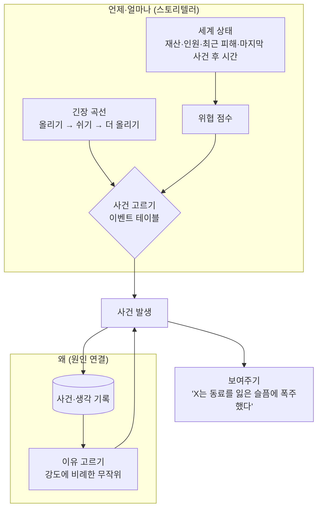

## 한눈에 보기

- 사건 생성은 두 질문으로 나뉩니다.
    1. **언제, 어떤 크기의 사건을 낼까?** — 긴장 곡선, 난이도 조절 (스토리텔러, 드라마 관리자)
    2. **이 사건은 왜 일어났나?** — 원인 연결 (생각·기억·관계에서 이유 고르기, 원인 기록)
- 놀랍게도 2번은 아주 단순해도 됩니다. 림월드의 정신 붕괴 "이유"는 기분에 영향을 준 생각 중 하나를 강도에 비례해 무작위로 고른 것입니다. Tynan Sylvester는 이것을 "무작위로 생각 하나를 고르는 코드 두 줄이 이유, 연결을 만든다"고 말했습니다. [공식] ([Rock Paper Shotgun 인터뷰, 2016](https://www.rockpapershotgun.com/how-rimworld-generates-great-stories))

!!! note "비유: 축구 해설"
    경기 자체는 선수들의 움직임이지만, 시청자가 기억하는 것은 해설입니다. "3분 전 실수를 만회하는 골!"이라는 한 마디가 무관한 두 장면을 이야기로 만듭니다. 사건 생성기에서 **해설 = 원인 표시**입니다.

## 실제 게임 사례

### 림월드 — AI 스토리텔러 {개연성}

- 스토리텔러는 습격, 벌레 떼, 상인 방문 같은 사건을 언제 보낼지 관리합니다. 플레이어가 셋 중 하나를 고릅니다. [분석] ([RimWorld 위키: AI Storytellers](https://rimworldwiki.com/wiki/AI_Storytellers))
    - **카산드라 클래식**: 고전적인 "점점 올라가는 도전과 긴장 곡선". 흥미진진한 위협과 휴식기를 번갈아 보내며 점점 어렵게 합니다.
    - **피비 칠랙스**: 재난 사이에 시간을 많이 줍니다.
    - **랜디 랜덤**: 규칙을 따르지 않습니다. 가끔 매우 불공평한 사건 묶음을 보냅니다.
- 사건의 크기는 정착지 재산, 정착민 수, 최근에 사망·중상자가 있었는지, 마지막 큰 사건 뒤 얼마나 지났는지 등을 고려합니다. 재산과 상관없이 시간에 따라 위협이 커지는 모드도 있습니다. [분석]
- Tynan은 랜디가 무작위로 사건을 보내도 플레이어가 쉽게 의미를 붙인다고 말합니다. 림월드에서는 모든 것이 **겹치기** 때문입니다. 정착민이 아파서 습격을 막기 어려워지고, 습격자 시체에서 얻은 음식으로 작물이 망한 일식을 버팁니다. 사건 하나하나는 무작위지만 함께 놓이면 이야기가 됩니다. [공식] ([RPS 인터뷰](https://www.rockpapershotgun.com/how-rimworld-generates-great-stories))
- 그는 GDC 2017에서 림월드를 "게임이 아니라 이야기 생성기"로 설계했다고 발표했습니다. [공식] ([GDC Vault](https://gdcvault.com/play/1024232/-RimWorld-Contrarian-Ridiculous-and))

### 림월드 — 기분이 사건을 만든다 {개연성}

- 기분은 생각(기한부 효과)들의 합이고, 기분이 임계값(기본 35%/20%/5%) 아래로 내려가면 정신 붕괴 위험이 생깁니다. 붕괴 뒤에는 "카타르시스" 생각이 +40을 2.5일 동안 줍니다. [분석] ([RimWorld 위키: Mental break](https://rimworldwiki.com/wiki/Mental_break))
- 모욕 한 번에 4% 확률로 주먹다짐이 시작됩니다. [분석] ([Opinion](https://rimworldwiki.com/wiki/Opinion))

**배울 점**: 이 사건들의 원인은 플레이어가 **이미 보고 있던** 생각 목록에 있습니다. 그래서 "그럴 만했다"가 됩니다.

### Façade — 드라마 관리자와 비트 {개연성} {관계}

Façade(Michael Mateas·Andrew Stern, 2005)는 부부의 집에 초대받은 플레이어가 대화로 개입하는 인터랙티브 드라마입니다. [공식] ([Mateas & Stern, AIIDE 2005](https://cdn.aaai.org/AIIDE/2005/AIIDE05-016.pdf))

- **드라마 관리자(drama manager)**가 "비트(beat)"라는 장면 단위를 이야기 긴장 곡선에 맞춰 순서대로 고릅니다.
- 비트는 특정 화제를 중심으로 한 행동 묶음이고, ABL이라는 언어로 쓴 수천 개의 "함께 하는 대화 행동"으로 이루어집니다.
- 플레이어의 입력은 비트 안에서 반응을 바꾸고, 어떤 비트가 다음에 올지에도 영향을 줍니다.

### 크루세이더 킹즈 3 — 스트레스가 사건을 부른다 [공식]

성격에 어긋나는 선택이 스트레스를 쌓고, 스트레스가 단계를 넘으면 성격에 따라 다른 정신 붕괴 이벤트가 나옵니다. 사건의 원인이 **플레이어 자신의 선택**이라서 납득이 쉽습니다. ([개발 일지 31](https://forum.paradoxplaza.com/forum/developer-diary/ck3-dev-diary-31-a-stressful-situation.1399764/))

### 동물의 숲 — 달력이 만드는 사건 {소속감}

- GC판은 핼러윈과 첫 아르바이트 기간에 일정표를 무시하고 모든 주민을 바깥으로 내보냅니다. 핼러윈용 주민 일정 파일(`ac_halloween_npc_schedule.c_inc`)도 따로 있습니다. [분석] ([ac-decomp](https://github.com/ACreTeam/ac-decomp))
- 꽃놀이, 불꽃놀이, 달맞이, 줄다리기, 공 던지기, 새해 참배 같은 행사마다 전용 주민 액터가 있습니다(`ac_hanami_npc0`, `ac_hanabi_npc0`, `ac_tukimi_npc0`, `ac_tunahiki_npc0`, `ac_tamaire_npc0`, `ac_hatumode_npc0` 등). [분석]

**배울 점**: 실시간 시계와 연결된 정기 행사는 "이 마을의 1년"을 만듭니다. 무작위 사건이 아니라 **예정된 사건**이 공동체 감각을 줍니다([10장](10-belonging.html)).

### 스타듀 밸리 — 조건이 맞으면 열리는 이벤트 [분석]

이벤트마다 `<ID>/<전제 조건들>` 형식의 키가 있고, 전제 조건에는 하트 수, 날짜, 날씨, 시간, 본 이벤트 여부 등이 들어갑니다. 예: `"36/f Penny 1500/p Penny"`(페니와 친밀도 1500 이상, 페니가 그 자리에 있을 때). ([Modding:Event data](https://stardewvalleywiki.com/Modding:Event_data))

### Wildermyth — 이야기의 종류를 나눠 둔다 [공식]

Wildermyth의 공식 위키는 이야기를 탐험, 전술, 전투(미션 중간·승리·패배), 영웅 모집, 무작위로 떠오르는 인물 관계 이야기, 시간 간격 이야기 등으로 분류하고, 대부분의 이야기가 **선택 하나**를 중심으로 돈다고 적었습니다. 분기가 많은 이벤트는 시스템상 다루기 어렵다고도 밝힙니다. ([Wildermyth Wiki: Event Types](https://www.wildermyth.com/wiki/Event_Types)) 개발자는 GDC 2022에서 손으로 쓴 층과 절차 생성 층을 번갈아 쌓는 방식을 발표했습니다. [공식] ([GDC Vault](https://gdcvault.com/play/1027614/Independent-Games-Summit-Session-Getting))

### Talk of the Town — 시뮬레이션하고 골라낸다 [공식]

James Ryan은 사건을 먼저 시뮬레이션해 기록으로 남기고, 그 기록에서 흥미로운 이야기를 찾아내는 **선별(curation)**을 별도 단계로 다뤘습니다. ([박사논문](https://escholarship.org/uc/item/1340j5h2))

## 구조 다이어그램



## 원인 → 결과 사슬로 개연성 만들기

1. **결과는 이미 보이는 상태에서 나오게 하세요.** 림월드의 정신 붕괴는 플레이어가 보고 있던 기분 막대에서 나옵니다. 숨겨진 수치에서 갑자기 터지는 사건은 무작위처럼 느껴집니다.
2. **이유를 하나 골라 말해 주세요.** 원인이 여러 개면 가장 강한 것 또는 강도에 비례한 무작위로 **하나**를 골라 문장으로 보여 줍니다(림월드). 여러 개를 다 보여주면 오히려 흐려집니다.
3. **사건이 다음 사건의 원인이 되게 하세요.** 사건이 생각·관계·기억을 남기고, 그것이 다음 사건의 조건이 되면 사슬이 생깁니다(주먹다짐 → 호감 하락 → 다음 모욕 확률 상승).
4. **겹치게 하세요.** 서로 다른 시스템의 사건이 같은 자원·사람을 건드리면 무작위 사건도 이야기가 됩니다(림월드 랜디).
5. **곡선을 관리하세요.** 큰 사건 뒤에는 쉬는 시간을 주세요(카산드라). 쉬는 시간이 다음 사건을 돋보이게 합니다.

## 세 갈래로 보기

### AI 없이

| 후보 | 어떻게 | 좋은 점 | 약한 점 | 대표 |
|---|---|---|---|---|
| 달력 이벤트 | 날짜에 고정된 행사 | 공동체의 1년, 기다리는 재미 | 반복 플레이에서 같음 | 동숲, 스타듀 |
| 조건부 이벤트 | 전제 조건이 맞으면 열림 | 작가가 통제, 관계·진행과 연결 | 조건 관리가 복잡 | 스타듀 하트 이벤트 |
| 이벤트 테이블 + 가중치 | 상황별 사건 후보와 확률 | 만들기 쉬움 | 원인이 안 보이면 무작위처럼 느껴짐 | 다수 |
| 스토리텔러 | 위협 점수 + 긴장 곡선 | 난이도와 리듬 관리 | 곡선을 플레이어가 눈치채면 기계적 | 림월드 |
| 드라마 관리자 | 장면 단위를 이야기 곡선에 맞춰 고름 | 극적 구조 | 장면을 많이 써야 함 | Façade |
| 시뮬레이션 + 선별 | 많이 시뮬레이션하고 재미있는 것만 보여줌 | 창발 + 품질 | 선별 기준 설계가 어려움 | Talk of the Town |

### AI 사용

- **LLM 사건 생성**: "이 마을에 오늘 일어날 만한 사건"을 LLM에게 묻는 방식. 다양하지만 게임 규칙(자원, 관계, 위치)과 어긋나기 쉽고, 결과를 다시 규칙으로 옮기는 일이 어렵습니다.
- **LLM 해설**: 이미 일어난 사건과 원인 기록을 주고 "한 문단짜리 마을 소식"이나 "인물의 일기"를 쓰게 하는 방식. 틀려도 게임이 망가지지 않아 훨씬 안전합니다.

### 섞어 쓰기

- **규칙이 사건과 원인을 정하고, LLM은 말로만 옮긴다.** 스토리텔러가 "습격, 크기 120"을 정하고, 원인 고르기가 "지난주 이 파벌의 상인을 쫓아냈음"을 고르면, LLM은 그 두 사실로 경고 메시지나 소문을 씁니다.
- **LLM이 후보를 고르고 규칙이 검증한다.** 미리 만든 사건 후보 20개 중 "지금 이야기 흐름에 가장 어울리는 3개"를 LLM이 추천하고, 스토리텔러가 위협 점수와 쿨다운으로 최종 선택합니다.

## 구현 스케치

### 긴장 곡선 스토리텔러 (카산드라식 단순화)

```csharp
// 위협을 보내고 → 쉬고 → 조금 더 큰 위협을 보내는 순환 (엔진 무관 C#)
public class Storyteller
{
    public float BaseInterval = 5f;          // 일 단위
    public float RestAfterBig = 3f;
    double nextEventDay = 3;
    int cycle = 0;

    public GameEvent Tick(double today, ColonyState colony, EventTable table, System.Random rng)
    {
        if (today < nextEventDay) return null;
        float points = ThreatPoints(colony) * (1f + 0.1f * cycle);   // 순환마다 조금씩 강해짐
        var ev = table.PickByPoints(points, colony, rng);              // 크기가 맞는 사건 후보 중 가중치 무작위
        bool big = ev.Points > points * 0.7f;
        nextEventDay = today + BaseInterval * (0.75 + rng.NextDouble() * 0.5) + (big ? RestAfterBig : 0);
        if (big) cycle++;
        return ev;
    }

    static float ThreatPoints(ColonyState c)
    {
        float p = c.Wealth * 0.01f + c.Colonists * 20f;
        if (c.DaysSinceLastDeath < 5) p *= 0.6f;                      // 최근 큰 피해가 있으면 봐준다
        return p;
    }
}
```

### 이유 고르기 (림월드식)

```csharp
// 기분을 깎은 생각들 중에서, 강도에 비례해 하나를 이유로 고른다
using System.Collections.Generic;
using System.Linq;

public static class CauseFinder
{
    public static Thought PickReason(IEnumerable<Thought> thoughts, System.Random rng)
    {
        var negative = thoughts.Where(t => t.MoodOffset < 0).ToList();
        if (negative.Count == 0) return null;
        float total = negative.Sum(t => -t.MoodOffset);
        double r = rng.NextDouble() * total;
        foreach (var t in negative) { r -= -t.MoodOffset; if (r <= 0) return t; }
        return negative[^1];
    }
}
// 출력: $"{pawn.Name}이(가) 폭주했다. 이유: {reason.Label}"  → 플레이어는 생각 목록에서 그 이유를 확인할 수 있다
```

### 원인 기록 (사건이 다음 사건의 원인이 되게)

```csharp
// 모든 사건을 구조화해 기록하고, 이벤트 조건과 대사·소식에서 다시 쓴다
public record EventRecord(double Day, string Type, string Actor, string Target, string CauseId, int Intensity);

public class Chronicle
{
    public readonly List<EventRecord> All = new();
    public EventRecord Add(EventRecord e) { All.Add(e); return e; }

    // "최근 30일 안에 A가 B를 모욕했는가?" 같은 조건 질의
    public bool Happened(string type, string actor, string target, double withinDays, double today) =>
        All.Any(e => e.Type == type && e.Actor == actor && e.Target == target && today - e.Day <= withinDays);
}
```

## 장단점과 언제 쓰나

- **생존·경영 시뮬**(위협이 핵심): 스토리텔러 + 원인 표시. 곡선 종류를 플레이어가 고르게 하면(림월드) 난이도 설정과 취향 설정을 겸합니다.
- **생활·관계 시뮬**(위협이 거의 없음): 달력 이벤트 + 조건부 이벤트 + NPC끼리의 작은 사건(말다툼, 유행). 큰 사건보다 **작은 사건이 자주** 일어나는 편이 낫습니다.
- **이야기 중심**: 드라마 관리자나 손으로 쓴 줄거리 + 절차 이벤트(Wildermyth). 분기를 너무 많이 만들면 작성량이 폭발한다는 점을 Wildermyth 위키도 인정합니다.
- 어떤 경우든 **사건 로그는 꼭** 남기세요. 디버깅, 원인 표시, 마을 기록([9장](09-world.html)), LLM 요약의 재료가 모두 로그입니다.

## 출처

- RimWorld Wiki: AI Storytellers / Mental break / Opinion — <https://rimworldwiki.com/wiki/AI_Storytellers>, <https://rimworldwiki.com/wiki/Mental_break>, <https://rimworldwiki.com/wiki/Opinion>
- Rock Paper Shotgun, "How RimWorld Generates Great Stories" (2016) — <https://www.rockpapershotgun.com/how-rimworld-generates-great-stories>
- Tynan Sylvester, "RimWorld: Contrarian, Ridiculous, and Impossible Game Design Methods" (GDC 2017) — <https://gdcvault.com/play/1024232/-RimWorld-Contrarian-Ridiculous-and>
- Michael Mateas & Andrew Stern, "Structuring Content in the Façade Interactive Drama Architecture" (AIIDE 2005) — <https://cdn.aaai.org/AIIDE/2005/AIIDE05-016.pdf>
- Paradox, CK3 개발 일지 31 — <https://forum.paradoxplaza.com/forum/developer-diary/ck3-dev-diary-31-a-stressful-situation.1399764/>
- ACreTeam, ac-decomp (`src/game/m_npc_schedule.c`, `src/actor/npc/ac_*_npc*.c`) — <https://github.com/ACreTeam/ac-decomp>
- Stardew Valley Wiki, Modding:Event data — <https://stardewvalleywiki.com/Modding:Event_data>
- Wildermyth Wiki, Event Types — <https://www.wildermyth.com/wiki/Event_Types>
- Nate Austin, Wildermyth GDC 2022 — <https://gdcvault.com/play/1027614/Independent-Games-Summit-Session-Getting>
- James Ryan, *Curating Simulated Storyworlds* — <https://escholarship.org/uc/item/1340j5h2>
