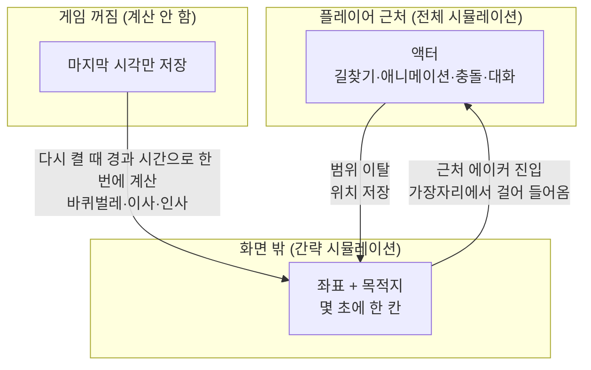

## 한눈에 보기

이 장은 세 가지를 다룹니다.

1. **과거 만들기**: 플레이 전에 세계의 역사를 만든다(드워프 포트리스, Caves of Qud).
2. **화면 밖 시간**: 플레이어가 보지 않는 곳, 게임을 끈 동안의 시간을 처리한다(동숲, 킹덤 컴).
3. **전달하기**: 그 사이에 일어난 일을 플레이어에게 알려 준다(전설 모드, 편지, 소문, 집 상태).

!!! note "비유: 연극 무대 뒤"
    관객은 무대 위만 봅니다. 배우가 무대 뒤에서 실제로 밥을 먹을 필요는 없지만, 다시 무대에 나올 때 "밥 먹고 왔어"라는 말과 입가의 소스 자국이 있으면 관객은 무대 뒤에서도 삶이 있었다고 믿습니다. 화면 밖 시뮬레이션의 핵심은 **다시 나올 때의 흔적**입니다.

## 과거 만들기

### 드워프 포트리스 — 실제로 수백 년을 돌린다 {개연성} {실존감}

- 세계 생성 때 정한 길이만큼 **역사를 실제로 시뮬레이션**합니다. 문명이 생기고, 인물이 태어나 죽고, 전쟁이 일어납니다. 역사가 길수록 생성 시간이 길어지고, 해마다 사건도 늘어납니다. [분석] ([DF 위키: World generation](https://dwarffortresswiki.org/index.php/DF2014:World_generation))
- 세계 생성 뒤에도 역사는 계속 흐르지만 훨씬 느립니다. [분석]
- 그 결과를 **전설 모드(Legends)**에서 인물·사건·유물별로 열람할 수 있습니다. [분석] ([DF 위키: Legends](https://dwarffortresswiki.org/index.php/DF2014:Legends))
- Tarn Adams는 묘사·규칙·플레이어의 선택이 합쳐져 창발적 서사가 생긴다고 설명합니다. [공식] ("Characterization and Emergent Narrative in Dwarf Fortress", [*Procedural Storytelling in Game Design*, 2019](https://www.routledge.com/Procedural-Storytelling-in-Game-Design-1st-Edition/Short-Adams/p/book/9781138595309))

**장점**: 모든 사건에 진짜 원인이 있습니다. **약점**: 시뮬레이션 비용이 크고, 결과가 너무 많아 전달이 어렵습니다.

### Caves of Qud — 사건을 먼저 뽑고 이유를 나중에 붙인다 {개연성}

- 완전한 역사 시뮬레이션 대신, **사건을 먼저 무작위로 만들고 나중에 그럴듯한 이유를 붙이는**(사후 합리화) 방식을 씁니다. [공식] ([Grinblat & Bucklew, FDG 2017](https://doi.org/10.1145/3102071.3110574), [Grinblat GDC](https://gdcvault.com/play/1024990/Procedurally-Generating-History-in-Caves))
- 술탄마다 인생 사건 여러 개를 뽑고, 그 사건들이 세계의 유적·지명으로 남습니다. 뽑힌 사건 중에 그 인물이 술탄이 되는 사건이 없으면 그런 사건을 추가합니다. [분석] ([Caves of Qud 위키: Sultan history](https://wiki.cavesofqud.com/wiki/Sultan_history))

**장점**: 싸고, 결과가 항상 "이야기 모양"입니다. **약점**: 실제 원인이 없으므로 사건끼리 상호작용하지 않습니다.

| | 드워프 포트리스 | Caves of Qud |
|---|---|---|
| 방식 | 실제 시뮬레이션 | 사건 생성 후 이유 붙이기 |
| 원인 | 진짜 | 그럴듯한 서술 |
| 비용 | 큼 | 작음 |
| 결과 모양 | 방대하고 불규칙 | 짧고 이야기 같음 |
| 어울리는 게임 | 역사 자체가 놀잇거리 | 역사가 배경·수집 요소 |

### 동물의 숲 GC — 마을 지형을 "조각 번호"로 {실존감}

[분석] ([ac-decomp](https://github.com/ACreTeam/ac-decomp) `src/game/m_random_field_ovl.c`, `src/game/m_field_make.c`, `include/m_name_table.h`; [동숲 분석 1편](https://nobbs-it-study.tistory.com/entry/%EA%B2%8C%EC%9E%84%EB%B6%84%EC%84%9D-%EB%86%80%EB%8F%99%EC%88%B2%EC%9D%98-%EB%A7%88%EC%9D%84%EC%9D%80-36-Byte%EB%8B%A4-%EC%B5%9C%EC%A0%81%ED%99%94-%EB%B6%84%EC%84%9D-1%ED%8E%B8))

- 마을은 에이커(acre: 16×16칸짜리 큰 조각) 단위입니다. 세이브에는 땅 모양이 아니라 "이 자리에 몇 번 조각"이라는 번호만 저장합니다. 1편은 놀러오세요의 마을 지형이 이 방식으로 36바이트라고 분석했습니다(놀러오세요 부분은 세이브 에디터 ACSE 등을 근거로 한 분석).
- 마을 생성은 **설계도 → 조각 끼우기** 두 단계이고, 반드시 있어야 할 조건 9개(왼쪽·오른쪽 비탈, 위·아래 다리, 신사, 파출소, 박물관, 연못, 에이블 시스터즈)를 비트로 체크해 **하나라도 빠지면 마을 전체를 다시 만듭니다**(`mRF_BIT_*`, `mRF_MakePerfectBit`). 15% 확률로 3단 마을이 됩니다(`mRF_GetRandom(100) < 15`).
- 나무는 "성장도" 변수가 없고 **아이템 번호 자체가 상태**입니다. 묘목(`TREE_SAPLING`) → `TREE_S0` → `TREE_S1` → `TREE_S2` → 다 자란 나무(`TREE`), 사과나무도 열매 없음 0·1·2 → 열매 있음 번호로 순환합니다. 하루가 지나면 번호를 바꾸는 것이 곧 성장입니다.
- 1년을 18개 절기로 나누고 절기마다 12개 색 팔레트 중 하나를 골라 땅 색만 바꿉니다(`field_pal_idx_table`).
- 메모리에는 플레이어 주변 **4개 조각**만 올립니다(`mFM_VISIBLE_BLOCK_NUM 4`).

**배울 점**: "조각 번호 + 상태 번호"로 세계를 저장하면, 세계가 크고 변해도 저장과 시간 경과 계산이 아주 쌉니다.

## 화면 밖 시간

### 동물의 숲 GC — 화면 밖 주민은 좌표 하나 (AI LOD) {실존감}

[분석] ([ac-decomp](https://github.com/ACreTeam/ac-decomp) `src/actor/ac_set_npc_manager.c`, `src/game/m_npc_walk.c`, `include/m_npc_walk.h`; [동숲 분석 2편](https://nobbs-it-study.tistory.com/entry/%EA%B2%8C%EC%9E%84-%EB%B6%84%EC%84%9D-%EB%8F%99%EC%88%B2-%EC%A3%BC%EB%AF%BC%EC%9D%84-%EC%96%B4%EB%96%BB%EA%B2%8C-%EC%82%B4%EC%95%84%EC%9E%88%EA%B2%8C-%EB%A7%8C%EB%93%A4%EC%97%88%EB%82%98-%EC%B5%9C%EC%A0%81%ED%99%94-%EB%B6%84%EC%84%9D-2%ED%8E%B8))

- 플레이어 주변 에이커에 있는 주민만 진짜 캐릭터(액터)로 만들고, 나머지는 **좌표 하나**로만 삽니다. 범위를 벗어나면 액터를 지우고 마지막 위치를 저장합니다.
- 그 좌표가 **걸어 다닙니다**. 7초마다 한 칸씩 목표 에이커 쪽으로 움직입니다(`frame_counter % (7 * FRAMES_PER_SECOND)`).
- 동시에 걷는 주민 수는 **현재 주민 수 ÷ 3**입니다(15명이면 5명, `mNpcW_GET_WALK_NUM`).
- 목적지는 신사, 다른 주민 집, 아무도 없는 에이커, 자기 집 중에서 성격·시간대별 배열로 고릅니다.
- 한 에이커에 3명 이상 있으면 들어가지 않고 기다립니다. 목표에 도착하면 108,000프레임(60fps 기준 30분) 머물다 집으로 돌아갑니다.
- 걸어오던 주민이 플레이어 옆 에이커에 오면, 상대 위치에 따라 방향을 정해 **화면 가장자리에서 걸어 들어오는** 액터로 만들어집니다.

그래픽스에서 멀리 있는 모델을 단순하게 그리듯, 멀리 있는 NPC의 생각도 단순하게 돌리는 것을 **AI LOD**(Level of Detail: 거리에 따라 계산의 정밀도를 낮추는 것)라고 부릅니다. 동숲은 2001년에 이것을 "좌표 + 목적지 + 7초에 한 칸"으로 했습니다. **시뮬레이션은 대충, 보이는 순간만 그럴듯하게.**

### 킹덤 컴: 딜리버런스 2 — 2,400명의 일과 {실존감}

Warhorse의 Petr Smrcek은 GDC 2026에서 NPC들이 플레이어가 떠난 뒤에도 일과를 계속하고 플레이어의 행동에 반응하며, 2편은 맵의 NPC 수가 1편의 네 배인 약 2,400명이고 그 절반가량이 한 도시에 몰려 있다고 소개했습니다. [공식] ([GDC Vault](https://gdcvault.com/play/1035718/Supporting-Thousands-of-NPCs-in)) 발표 본문은 확인하지 못했습니다. [확인 못 함]

### 게임을 끈 동안 — "마지막 시각"만 저장하고 다시 켤 때 계산 {실존감} {소속감}

동숲 GC는 시간 경과를 실시간으로 시뮬레이션하지 않고, **마지막 시각을 저장해 두었다가 다음 접속 때 차이를 계산**합니다. [분석] ([ac-decomp](https://github.com/ACreTeam/ac-decomp))

| 무엇 | 저장하는 것 | 다시 켤 때 | 소스 |
|---|---|---|---|
| 바퀴벌레 | 플레이어가 집을 마지막으로 쓴 날짜 | 6일을 넘게 비웠으면 바퀴벌레가 늘어남(이미 있으면 지난 날만큼, 없으면 지난 날 − 6만큼), 최대 10마리 | `m_cockroach.c` |
| 인사 | 주민별 마지막 대화 시각 | 1일 / 14일 / 60일 이상 인사 분기 | `ac_quest_talk_greeting.c` |
| 새 주민 | 마지막 입주 시각 | 24시간 이상 지났고, 그 플레이어가 지금 주민 모두와 대화한 적 있으면 확률적으로 입주 | `m_npc.c` `mNpc_CheckGrow` |
| 주민 이사 | 마지막 변화 날짜 | 15명이 꽉 찼고 10일 이상이면 한 명이 떠나고 작별 편지 | `m_npc.c` `mNpc_ForceRemove` |
| 떠난 주민 | 떠난 주민 기록 | 60일 안에 잠깐 돌아와 플레이어마다 한 번 인사 (헤더 주석) | `include/m_npc.h` `Anmret_c` |

바퀴벌레는 "네가 없는 동안 집이 방치됐다"는 것을 **집 상태로** 보여 주고, 작별 편지는 "네가 없는 동안 누가 떠났다"를 **편지로** 알려 줍니다. 둘 다 계산은 한 번뿐입니다.

## 전달하기: "내가 없을 때 일어난 일"

| 방법 | 예 | 장점 | 주의 |
|---|---|---|---|
| 환경의 흔적 | 바퀴벌레, 잡초, 자란 나무 | 말없이 시간이 흐른 걸 보여 줌 | 벌처럼 느껴지면 복귀가 싫어짐 |
| 편지·쪽지 | 작별 편지, 답장 | 개인적, 감정이 실림 | 너무 많으면 읽지 않음 |
| 소문·대사 | "○○가 이사 갔대", 다른 주민 이야기 | 관계망이 살아 있다는 느낌 | 원인 기록이 필요 |
| 기록 화면 | 전설 모드, 마을 연대기 | 깊이 파는 플레이어에게 보상 | 방대하면 안 읽음 |
| 변화 자체 | 옷·말버릇이 바뀐 주민 | 발견하는 재미 | 플레이어가 이전 상태를 기억해야 함 |

**핵심 원칙**: 아무도 못 보는 곳에서 일어난 변화는 없는 것과 같습니다. 동숲처럼 결과가 **플레이어가 아는 NPC**에게 쌓이게 하세요([1장](01-intro.html)의 선별).

## 구조 다이어그램



## 세 갈래로 보기

### AI 없이

- **역사**: 실제 시뮬레이션(DF) / 사건 먼저 + 이유 나중(Qud) / 손으로 쓴 설정 + 절차 변형.
- **화면 밖**: AI LOD(동숲 좌표 산책) / 일정표로 위치 계산만(현재 시각이면 이 NPC는 어디에 있어야 하나).
- **꺼진 동안**: 마지막 시각 + 경과 계산(동숲).

### AI 사용

- **역사 서술**: 구조화된 역사 기록을 LLM이 연대기·전설 문장으로 씁니다. 문장끼리 모순(같은 인물이 두 번 죽음)이 생기기 쉬우니 사실은 기록에서만 가져오게 해야 합니다.
- **복귀 요약**: "네가 없는 동안"을 LLM이 마을 소식으로 요약합니다.

### 섞어 쓰기

- **기록은 구조화, 서술은 LLM**: `{연도, 사건 종류, 인물, 장소, 원인}`으로 기록하고, 연대기 화면이나 노인 NPC의 옛날이야기만 LLM이 씁니다. Qud식 "이유 붙이기"를 LLM에게 맡기면 표현이 풍부해지지만, 붙인 이유를 다시 기록으로 저장해 일관성을 지키세요.

## 구현 스케치

### AI LOD: 가까우면 액터, 멀면 좌표

```csharp
using UnityEngine;                 // [Unity 의존] MonoBehaviour, Vector2Int, Instantiate
using System.Collections.Generic;

public class OffscreenNpc
{
    public string Id;
    public Vector2Int Cell;        // 화면 밖에서는 이것만 있다
    public Vector2Int Goal;
    public float StayTimer;
    public NpcActor Actor;         // 근처에 있을 때만 존재
}

public class NpcLodManager : MonoBehaviour
{
    public float StepInterval = 7f;          // 동숲: 7초에 한 칸
    public int ActiveRadius = 1;             // 플레이어 주변 몇 칸을 '근처'로 볼까
    public NpcActor prefab;
    public List<OffscreenNpc> npcs = new();
    float timer;

    void Update()
    {
        Vector2Int p = World.CellOf(Player.Position);
        timer += Time.deltaTime;
        bool step = timer >= StepInterval;
        if (step) timer = 0;

        foreach (var n in npcs)
        {
            bool near = Mathf.Abs(n.Cell.x - p.x) <= ActiveRadius && Mathf.Abs(n.Cell.y - p.y) <= ActiveRadius;
            if (near && n.Actor == null)
                n.Actor = Spawn(n, entryFrom: n.Cell - p);       // 가장자리에서 걸어 들어오게
            else if (!near && n.Actor != null)
            { n.Cell = World.CellOf(n.Actor.transform.position); Destroy(n.Actor.gameObject); n.Actor = null; }

            if (n.Actor == null && step) StepTowardGoal(n);       // 화면 밖: 아주 단순한 이동
        }
    }

    void StepTowardGoal(OffscreenNpc n)
    {
        if (n.Cell == n.Goal) { n.StayTimer -= StepInterval; if (n.StayTimer <= 0) n.Goal = Home(n); return; }
        var next = n.Cell + new Vector2Int(System.Math.Sign(n.Goal.x - n.Cell.x), System.Math.Sign(n.Goal.y - n.Cell.y));
        if (World.CountNpcsIn(next) >= 3) return;                 // 동숲: 3명 이상이면 기다림
        n.Cell = next;
    }

    NpcActor Spawn(OffscreenNpc n, Vector2Int entryFrom) { /* 방향에 맞는 화면 가장자리 위치에 생성 */ return Instantiate(prefab); }
    Vector2Int Home(OffscreenNpc n) => World.HomeOf(n.Id);
}
```

### 꺼진 동안의 시간: 마지막 시각 + 경과 계산

```csharp
// 접속할 때 한 번만 부른다 (엔진 무관 C#)
public static class Catchup
{
    public static void OnLoad(SaveData save, System.DateTime now)
    {
        int awayDays = (int)(now.Date - save.LastHomeVisit.Date).TotalDays;
        const int Grace = 6;                                       // 동숲: 6일까지는 봐준다
        if (awayDays > Grace)
        {
            int add = save.Roaches > 0 ? awayDays : awayDays - Grace;
            save.Roaches = System.Math.Min(10, save.Roaches + add);
        }
        // 나무 성장도 '번호 올리기'로 한 번에
        foreach (var tile in save.Tiles)
            for (int d = 0; d < awayDays && Item.CanGrow(tile.ItemId); d++) tile.ItemId = Item.NextGrowth(tile.ItemId);

        save.News.AddRange(Town.SimulateDaysCoarsely(save, awayDays));   // 이사·유행 같은 큰 변화만 거칠게
        save.LastLoad = now;
    }
}
```

!!! warning "현실 시간과 연결할 때"
    동숲처럼 실제 시계를 쓰면 "오래 비우면 벌 받는" 구조가 됩니다. 바퀴벌레는 귀여운 벌이지만, 소중한 것을 잃게 하면 복귀를 망설이게 됩니다. 모여봐요가 주민 이사에 플레이어의 허락을 받게 바꾼 것([6장](06-relationship.html))도 같은 방향으로 볼 수 있습니다. [추정]

## 출처

- Dwarf Fortress Wiki: World generation / Legends — <https://dwarffortresswiki.org/index.php/DF2014:World_generation>, <https://dwarffortresswiki.org/index.php/DF2014:Legends>
- Tanya X. Short & Tarn Adams (편), *Procedural Storytelling in Game Design* (2019) — <https://www.routledge.com/Procedural-Storytelling-in-Game-Design-1st-Edition/Short-Adams/p/book/9781138595309>
- Jason Grinblat & C. Brian Bucklew, "Subverting Historical Cause & Effect" (FDG 2017) — <https://doi.org/10.1145/3102071.3110574>
- Jason Grinblat, "Procedurally Generating History in Caves of Qud" (GDC) — <https://gdcvault.com/play/1024990/Procedurally-Generating-History-in-Caves>
- Caves of Qud Wiki, Sultan history — <https://wiki.cavesofqud.com/wiki/Sultan_history>
- ACreTeam, ac-decomp — <https://github.com/ACreTeam/ac-decomp>
- 동숲 최적화 분석 1편·2편 — <https://nobbs-it-study.tistory.com/entry/%EA%B2%8C%EC%9E%84%EB%B6%84%EC%84%9D-%EB%86%80%EB%8F%99%EC%88%B2%EC%9D%98-%EB%A7%88%EC%9D%84%EC%9D%80-36-Byte%EB%8B%A4-%EC%B5%9C%EC%A0%81%ED%99%94-%EB%B6%84%EC%84%9D-1%ED%8E%B8>, <https://nobbs-it-study.tistory.com/entry/%EA%B2%8C%EC%9E%84-%EB%B6%84%EC%84%9D-%EB%8F%99%EC%88%B2-%EC%A3%BC%EB%AF%BC%EC%9D%84-%EC%96%B4%EB%96%BB%EA%B2%8C-%EC%82%B4%EC%95%84%EC%9E%88%EA%B2%8C-%EB%A7%8C%EB%93%A4%EC%97%88%EB%82%98-%EC%B5%9C%EC%A0%81%ED%99%94-%EB%B6%84%EC%84%9D-2%ED%8E%B8>
- Petr Smrcek, "Supporting Thousands of NPCs in Kingdom Come: Deliverance" (GDC 2026) — <https://gdcvault.com/play/1035718/Supporting-Thousands-of-NPCs-in>
