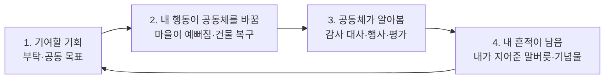

## 한눈에 보기

소속감을 만드는 순환은 네 단계입니다.



- 1~2만 있으면 **일**처럼 느껴집니다. 3이 있어야 "고맙다는 말을 들었다", 4가 있어야 "이 마을에 내 자리가 있다"가 됩니다.
- 소속감은 [6장](06-relationship.html)의 개인 관계와 다릅니다. 한 사람과 친해지는 것이 아니라 **집단 전체가 나를 일원으로 대하는 것**입니다.

!!! note "비유: 동네 단골집"
    단골집에서 소속감을 느끼는 순간은 사장님이 "늘 먹던 거?"라고 물을 때(알아봄), 내가 추천한 메뉴가 메뉴판에 올라갈 때(흔적), 가게 이사를 도와줬을 때(기여)입니다. 할인 쿠폰(보상)만으로는 생기지 않습니다.

## 실제 게임 사례

### 동물의 숲 — 마을을 가꾸면 공동체가 커진다 {소속감}

**GameCube판** [분석] ([ac-decomp](https://github.com/ACreTeam/ac-decomp) `src/game/m_field_assessment.c`, `src/game/m_npc.c`)

- 마을 평가는 에이커마다 나무 수를 봅니다(`l_block_rank_tree_num = {8, 11, 14, 17, 255}`, `l_block_rank_table = {0, 1, 2, 1, 0}`). 8그루 이하는 0점, 9~11그루는 "좋음", **12~14그루는 "완벽"**, 15~17그루는 다시 "좋음", 18그루 이상은 0점입니다. 너무 적어도 너무 많아도 안 됩니다. 한 에이커에 잡초가 3개 이상이면 그 에이커는 0점입니다.
- 마을 점수 = 완벽 에이커 수 + 좋음 에이커 수 ÷ 2. 단, 마을 전체에 쓰레기가 5개 이상이면 점수가 0이 됩니다(`mFAs_GetFieldGoodBlockNum_common`).
- 점수가 0/2/4/7/12/16을 넘을 때마다 등급이 0~6으로 오릅니다. 15일 연속 최고 등급이면 금도끼를 받습니다(`mFAs_PERFECT_DAY_STREAK_MAX 15`).
- 이 등급이 **새 주민이 이사 올 확률**(40/50/60/70/80/90/100%)과 이어집니다(`mNpc_CheckGrowFieldRank`). 마을을 가꾸면 공동체가 커지는 고리입니다.
- 새 주민이 오려면 **이 마을 플레이어가 지금 주민 모두와 한 번씩은 대화했어야** 합니다(`mNpc_CheckGrow`). 관계가 쌓일 속도보다 빨리 마을이 바뀌지 않게 막는 장치입니다.
- 주민은 플레이어에게 말버릇을 지어 달라고 부탁하고, 그 말버릇이 다른 주민에게 옮겨 갑니다([6장](06-relationship.html)). 말버릇은 10글자 이하입니다. [분석] ([Nookipedia: Catchphrase](https://nookipedia.com/wiki/Catchphrase))

**시리즈별** [분석] ([Nookipedia: Environment rating](https://nookipedia.com/wiki/Island_evaluation))

- 마을 평가를 알려 주는 존재가 작품마다 다릅니다. GC판은 소원 우물, 놀러오세요·타운으로 놀러가요는 마을 사무소의 펠리·펠리코, 튀어나와요·모여봐요는 여울.
- 튀어나와요는 평가가 세 범주로 나뉘고, **공공사업**이 있어야 좋은 평가를 받습니다. 에이커별 나무 수 조건은 없어졌습니다.
- 말버릇을 바꾸는 방법도 바뀌었습니다. 놀러오세요는 주민이 부탁할 때만, 타운으로 놀러가요 이후로는 마을 사무소에서도 가능하고, 모여봐요는 두 주민의 대화를 플레이어가 **목격**해서 한 주민이 다른 주민의 말버릇을 따라 하게 되는 경우도 있습니다.

### 스타듀 밸리 — 마을회관과 공동체의 선택 {소속감} {개연성}

[분석] ([위키: Community Center](https://stardewvalleywiki.com/Community_Center))

- 마을회관의 두루마리가 요구하는 **꾸러미(bundle)**를 채우면 마을회관이 복구됩니다. 플레이어의 농사·채집·낚시가 마을 전체를 위한 기여가 됩니다.
- 모두 채운 뒤 맑은 날에는 **재개관 행사**가 열려 마을 사람들이 모이고, 대형 마트(조자마트)에 맞서 마을 가게를 지키자는 장면이 나옵니다. 그 뒤 조자마트가 문을 닫고 마을 가게의 영업일이 바뀝니다. **내 기여가 마을의 경제와 일상을 바꿉니다.**
- 반대로 조자마트 회원권을 사면 마을회관이 조자 창고로 바뀝니다. 공동체 편에 설지 고르는 선택입니다.
- 대사에도 이 결과가 들어갑니다(`$d cc`, `$d joja`처럼 마을회관·조자마트 상태로 갈리는 대사). [분석] ([Modding:Dialogue](https://stardewvalleywiki.com/Modding:Dialogue))

### 공통 장치: 정기 행사 {소속감}

- 동숲 GC는 꽃놀이, 불꽃놀이, 달맞이, 줄다리기, 공 던지기, 새해 참배 같은 행사마다 전용 주민 액터가 있고, 핼러윈에는 일정표를 무시하고 주민을 모두 밖으로 내보냅니다. [분석] ([ac-decomp](https://github.com/ACreTeam/ac-decomp))
- 스타듀의 축제는 날짜에 맞춰 마을 사람 모두가 한곳에 모입니다. 일정 데이터에 축제 키가 따로 있습니다. [분석] ([Modding:Schedule data](https://stardewvalleywiki.com/Modding:Schedule_data))

**배울 점**: 정기 행사는 **공동체가 함께 시간을 보낸다**는 감각을 만들고, 플레이어도 그 일원으로 참석합니다.

### Wildermyth — 영웅이 전설로 남는다 [공식]

Wildermyth는 손으로 쓴 이야기와 절차 생성 이야기를 번갈아 쌓아 플레이어가 절차 생성 캐릭터에 감정을 쌓게 하는 방법을 GDC 2022에서 발표했습니다. ([GDC Vault](https://gdcvault.com/play/1027614/Independent-Games-Summit-Session-Getting)) 캠페인을 거친 영웅이 이후 캠페인에 다시 등장할 수 있다는 점이 "내 영웅이 이 세계의 역사가 된다"는 소속감을 줍니다. [추정]

## 소속감 장치 목록

| 장치 | 내용 | 예 | 근거 |
|---|---|---|---|
| 공동 목표 | 마을 전체를 위한 장기 과제 | 스타듀 마을회관 꾸러미, 튀어나와요 공공사업 | [분석] |
| 부탁과 보답 | 주민의 작은 부탁, 해결하면 감사 | 동숲 주민 부탁, 스타듀 게시판 | [분석] |
| 평가와 인정 | 공동체가 내 기여를 평가해 알려 줌 | 동숲 마을 평가와 금도끼 | [분석] |
| 공동체의 성장 | 내 기여가 공동체 규모·서비스를 바꿈 | 동숲 이사 확률, 스타듀 가게 영업일 | [분석] |
| 흔적의 전파 | 내가 준 것이 공동체에 퍼짐 | 동숲 말버릇·옷 유행 | [분석] |
| 정기 행사 | 다 같이 모이는 날 | 동숲·스타듀 축제 | [분석] |
| 편 고르기 | 공동체를 위한 선택과 그 결과 | 스타듀 마을회관 vs 조자 | [분석] |
| 집단 기억 | 공동체가 나의 과거를 이야기함 | 동숲 "다른 플레이어 편지" 대사 | [분석] |

## 세 갈래로 보기

### AI 없이

위 표의 장치는 모두 AI 없이 만들 수 있고, 실제 사례도 모두 AI를 쓰지 않습니다. 설계의 핵심은 **기여 → 변화 → 인정 → 흔적** 순환의 각 단계를 하나 이상씩 두는 것입니다.

### AI 사용

- **공동체 소식지**: 그주의 사건 기록(플레이어가 한 일 포함)을 LLM이 마을 신문 기사로 씁니다. "○○ 씨가 기증한 화석으로 박물관 전시실이 채워졌다" 같은 문장이 **인정** 단계를 강화합니다.
- **주민들의 뒷이야기**: 플레이어가 한 일을 주민끼리 이야기하는 대사를 LLM이 만듭니다.

### 섞어 쓰기

- 사건 기록과 수치(누가 무엇을 기여했나)는 규칙으로 집계하고, LLM은 그 집계 결과를 **칭찬과 소문의 말투**로만 바꿉니다. 사실 확인이 끝난 정보만 문장이 되므로, "하지 않은 일로 칭찬받는" 어색함을 막을 수 있습니다.

## 구현 스케치

```csharp
// 마을 평가 → 공동체 성장 고리 (동숲 GC 구조를 일반화, 엔진 무관 C#)
public static class TownRating
{
    // 구역 점수: 0(나쁨) / 1(좋음) / 2(완벽). 동숲 GC: 나무 9~11·15~17 좋음, 12~14 완벽, 잡초 3개 이상이면 0
    public static int AreaScore(int trees, int weeds)
    {
        if (weeds >= 3) return 0;
        if (trees <= 8 || trees >= 18) return 0;
        return (trees >= 12 && trees <= 14) ? 2 : 1;
    }

    // 마을 점수 = 완벽 + 좋음/2, 쓰레기가 많으면 0
    public static int TownScore(System.Collections.Generic.IEnumerable<(int trees, int weeds)> areas, int townLitter)
    {
        int perfect = 0, good = 0;
        foreach (var a in areas) { int s = AreaScore(a.trees, a.weeds); if (s == 2) perfect++; else if (s == 1) good++; }
        return townLitter >= 5 ? 0 : perfect + good / 2;
    }

    // 점수 → 등급 0~6 (동숲: 0/2/4/7/12/16을 넘을 때마다 한 단계)
    static readonly int[] Thresholds = { 0, 2, 4, 7, 12, 16 };
    public static int Rank(int score)
    {
        for (int i = 0; i < Thresholds.Length; i++) if (score <= Thresholds[i]) return i;
        return 6;
    }

    // 등급 → 새 주민 확률 (동숲: 40~100%)
    static readonly int[] MoveInChance = { 40, 50, 60, 70, 80, 90, 100 };

    public static bool TryMoveIn(Town town, PlayerData player, System.DateTime now, System.Random rng)
    {
        if (town.Residents.Count >= town.Capacity) return false;
        if ((now - town.LastMoveIn).TotalHours < 24) return false;            // 하루 한 명
        if (!town.Residents.TrueForAll(r => r.HasMet(player.Id))) return false; // 다 만나 본 뒤에만
        if (rng.Next(100) >= MoveInChance[Rank(TownScore(town.Areas(), town.Litter))]) return false;
        town.AddResident(Recruit.LeastRepresentedPersonality(town));          // 성격 다양성 보정(4장)
        town.LastMoveIn = now;
        town.News.Add($"새 주민이 이사 왔습니다. 마을이 아름다워서 왔대요!");  // 인정: 원인을 말해 준다
        return true;
    }
}
```

## 점검 질문

1. 플레이어가 **공동체 전체**를 위해 할 수 있는 일이 있는가? (개인 퀘스트만 있지 않은가)
2. 그 일의 결과가 **공동체의 모습**을 바꾸는가? (보상 아이템만 주지 않는가)
3. 공동체가 그 일을 **알아보는가**? 누가, 언제, 어떻게 말해 주는가?
4. 플레이어가 남긴 **흔적**이 시간이 지나도 남거나 퍼지는가?
5. 플레이어가 **참석하는 정기 행사**가 있는가?
6. 공동체를 위한 선택과 자기 이익을 위한 선택이 갈리는 순간이 있는가? (스타듀 마을회관 vs 조자)

## 출처

- ACreTeam, ac-decomp (`src/game/m_field_assessment.c`, `src/game/m_npc.c`) — <https://github.com/ACreTeam/ac-decomp>
- Nookipedia, Environment rating / Catchphrase — <https://nookipedia.com/wiki/Island_evaluation>, <https://nookipedia.com/wiki/Catchphrase>
- Stardew Valley Wiki, Community Center / Modding:Dialogue / Modding:Schedule data — <https://stardewvalleywiki.com/Community_Center>
- Nate Austin, Wildermyth GDC 2022 — <https://gdcvault.com/play/1027614/Independent-Games-Summit-Session-Getting>
